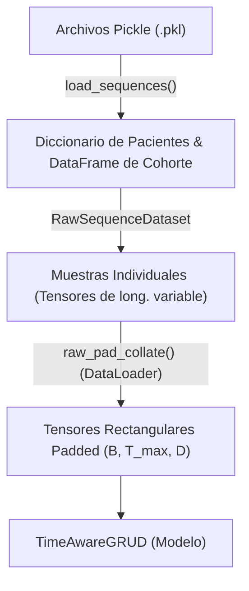

# Carga y Preparación de Secuencias para GRU-D

Este documento detalla paso a paso cómo se cargan las secuencias temporales desde los archivos pickle, cómo se estructuran en el dataset y cómo se transforman finalmente mediante la función de colación para alimentar los modelos recurrentes de supervivencia.

---

## 1. Flujo Paso a Paso de los Datos

El pipeline de datos consta de tres etapas principales antes de pasar a la red neuronal:



### Paso 1: Lectura de secuencias desde disco (`load_sequences`)
La lectura inicial se define en la función `load_sequences` de [grud_student.ipynb](file:///c:/Users/rtrin/OneDrive/Escritorio/FORMACION/MASTER/TFM/tfm-mulcia-2025/tfm-mulcia-2025/2DA%20FASE/us-mulcia-2026-ramon/grud_student.ipynb#L136):
1. Carga los archivos pickle (`sequences_train.pkl` / `sequences_val.pkl`) que contienen el diccionario de pacientes y la información de la cohorte.
2. Filtra los pacientes cuyos registros secuenciales son `None` debido a procesos de preprocesamiento previos.
3. Retorna un diccionario indexado por el ID del paciente (`dict[str, dict]`), una lista con los 23 códigos LOINC de laboratorio y un `pd.DataFrame` de la cohorte que indica la supervivencia (`Id`, `event`, `duration`, `status`).

---

### Paso 2: Creación del Dataset (`RawSequenceDataset`)
La clase [RawSequenceDataset](file:///c:/Users/rtrin/OneDrive/Escritorio/FORMACION/MASTER/TFM/tfm-mulcia-2025/tfm-mulcia-2025/2DA%20FASE/us-mulcia-2026-ramon/grud_student.ipynb#L179) hereda de `torch.utils.data.Dataset` y se encarga de preparar los datos individuales de cada paciente en relación con la edad de landmark (`landmark_age`):

1. **Alineación de Landmark:** Para cada paciente vivo al llegar a la edad de landmark (`lm`), calcula el tiempo restante desde el landmark hasta el evento o censura (`time_from_lm = duration - (lm - index_age)`). Si el paciente experimentó el evento antes del landmark, se descarta del análisis (`time_from_lm <= 0`).
2. **Filtrado Temporal:** Conserva únicamente las observaciones de laboratorio (`labs`) y las máscaras (`masks`) cuya edad de registro sea menor o igual al landmark (`times <= lm`). Esto simula un escenario clínico real: "qué sabemos del paciente hasta hoy (landmark)".
3. **Truncamiento:** Si el número de visitas en este intervalo supera `max_events` (200), se trunca la secuencia reteniendo los últimos `max_events` registros (las observaciones clínicas más recientes).
4. **Cálculo de Variables Auxiliares:** Calcula `time_since_index` (edad en años transcurrida desde la edad de entrada a la cohorte, 18 años).
5. **Conversión a Tensores:** En `__getitem__(idx)`, convierte las listas Python y arrays de NumPy de esa muestra a tensores de PyTorch.

---

### Paso 3: Función de Colación (`raw_pad_collate`)
El lote o Batch se construye usando `torch.utils.data.DataLoader` configurado con una función de colación personalizada llamada `raw_pad_collate` (definida en [grud_student.ipynb](file:///c:/Users/rtrin/OneDrive/Escritorio/FORMACION/MASTER/TFM/tfm-mulcia-2025/tfm-mulcia-2025/2DA%20FASE/us-mulcia-2026-ramon/grud_student.ipynb#L308)):

1. **Desempaquetado del Batch:** Convierte la lista de tuplas del lote en listas independientes de tensores (tiempos, laboratorios, máscaras, etc.).
2. **Cálculo de Longitudes Reales:** Crea un tensor `lengths` que almacena la longitud real $T_i$ de las visitas de cada paciente en el lote.
3. **Acolchado (Padding):** Utiliza la función de utilidad de PyTorch `torch.nn.utils.rnn.pad_sequence` para rellenar con `0.0` todas las secuencias a la longitud máxima dentro del lote actual ($T_{max} = \max(T_i)$).
4. **Cálculo de Deltas de Tiempo ($\delta_t$):** Calcula la diferencia de tiempo en años entre visitas sucesivas:
   $$\delta_t^{(0)} = 0$$
   $$\delta_t^{(t)} = \text{times}^{(t)} - \text{times}^{(t-1)}$$
   Esto permite que la red calcule los decaimientos exponenciales de GRU-D según el tiempo transcurrido desde la última visita del paciente.

---

## 2. Forma de los Tensores de Salida y su Justificación

Los tensores devueltos por `raw_pad_collate` y consumidos por el modelo tienen las siguientes formas conceptuales:

| Nombre del Tensor | Forma del Tensor | Significado de las Dimensiones |
|---|---|---|
| `padded_labs` ($x$) | `(B, T_max, 23)` | `B` = Tamaño de Lote (Batch), `T_max` = Visitas Máximas en el lote, `23` = Variables de lab (LOINC) |
| `padded_masks` ($m$) | `(B, T_max, 23)` | Indicador binario (1 si se midió, 0 si no) para cada lab en cada visita |
| `deltas` ($\delta$) | `(B, T_max)` | Años transcurridos desde el timestep anterior para cada paciente |
| `lengths` | `(B,)` | Longitud real pre-padding $T_i$ para cada paciente del lote |

### ¿Por qué se utiliza Padding (`(B, T_max, D)`) en lugar de `PackedSequence`?

En PyTorch, es habitual empaquetar secuencias variables con `torch.nn.utils.rnn.pack_padded_sequence` para optimizar el paso por capas RNN estándar de C++/cuDNN. Sin embargo, en el modelo **GRU-D**, esto no se hace por las siguientes razones:

1. **Imputación y Decaimiento Paso a Paso:** El modelo GRU-D realiza un procesamiento personalizado en cada timestep $t$. Para calcular la entrada imputada $\hat{x}_t$ y decaer el estado oculto anterior $h_{t-1}$, requiere calcular factores de decaimiento temporal $\gamma_x$ y $\gamma_h$ específicos usando $\delta_t$.
2. **Dificultad de Indexación en Packed Sequences:** Una `PackedSequence` aplana las dimensiones temporales y agrupa las secuencias por longitudes. Realizar operaciones personalizadas paso a paso e indexar variables del timestep anterior en una estructura aplanada y empaquetada añade una complejidad matemática y de código muy elevada.
3. **Simplicidad de Procesamiento Temporal:** Al mantener los datos acolchados (padded) en la dimensión rectangular `(B, T_max, D)`, el modelo puede iterar secuencialmente a lo largo del tiempo con un simple bucle:
   ```python
   for t in range(max_len):
       # delta_t, x_t, m_t se extraen fácilmente para todo el lote
       delta_t = deltas[:, t:t+1]
       x_t     = x[:, t, :]
       m_t     = mask[:, t, :]
       
       # Cálculos matemáticos de GRU-D
       gamma_x = torch.exp(-torch.clamp(self.decay_x(delta_t), min=0.0))
       ...
   ```
   Esto permite que las operaciones vectorizadas se ejecuten de manera extremadamente rápida en paralelo sobre todo el lote de tamaño $B$ para cada timestep $t$.

> [!IMPORTANT]
> **Evitar fugas de padding al calcular el riesgo:**
> Dado que todas las secuencias del lote se rellenan con ceros hasta $T_{max}$, el estado oculto $h_t$ de los timesteps de relleno (posteriores a la longitud real $T_i$ de un paciente) no tiene significado clínico útil.
> Para evitar que estos valores de relleno distorsionen las predicciones, se utiliza el tensor `lengths` para extraer el riesgo únicamente de la **última visita real** de cada paciente:
> ```python
> last_idx  = (lengths - 1).clamp(min=0)
> batch_idx = torch.arange(batch_size, device=device)
> last_risk = all_risks[batch_idx, last_idx]
> ```
> De esta forma, el modelo obtiene el log-risk score de supervivencia (`(B,)`) evaluado en la visita clínica más reciente previa al landmark.

### Clarificación: Dimensión Temporal ($T$) vs. Tiempo Real (Edad)

Existe una diferencia fundamental entre la longitud de la secuencia acolchada ($T_{max}$) y la edad del paciente en años:

* **La dimensión $T$ representa el número de visitas/observaciones físicas, NO los años de edad.** No se crea una posición o "hueco" en la secuencia para cada año o unidad de tiempo en el que el paciente no acude al hospital.
* **Múltiples visitas o visitas repetidas:** Si un paciente realiza varias consultas en periodos cortos de tiempo (incluso varias visitas el mismo año), estas simplemente se registran como pasos de tiempo secuenciales sucesivos en $T$.
* **El padding se realiza sobre el número de visitas:** Si un lote contiene pacientes con 4, 10 y 6 visitas, todas las secuencias se acolchan con ceros hasta $T_{max} = 10$ visitas. No se acolcha hasta la edad máxima (por ejemplo, 80 años).

#### Modelado del tiempo real e irregular ($\delta_t$)
La irregularidad del tiempo físico entre visitas se maneja mediante el tensor de deltas de tiempo ($\delta_t$), calculado como la diferencia en años entre visitas sucesivas:
$$\delta_t^{(0)} = 0$$
$$\delta_t^{(t)} = \text{times}^{(t)} - \text{times}^{(t-1)}$$

**Ejemplo:** Si un paciente tiene visitas a las edades `[18.5, 19.0, 19.1, 25.0]` (4 visitas):
* Su longitud real de secuencia es **4**.
* Sus deltas correspondientes serán $\delta_t = [0.0, 0.5, 0.1, 5.9]$ años.
* El decaimiento exponencial del modelo GRU-D ($\gamma_x$, $\gamma_h$) se calcula a partir de este $\delta_t$, de modo que el paso de 5.9 años entre la tercera y la cuarta visita provoca que el modelo "olvide" gradualmente la información antigua (los laboratorios no medidos en la visita 4 tienden a la media poblacional), mientras que el intervalo de 0.1 años entre la segunda y la tercera visita mantiene el estado oculto prácticamente intacto.
