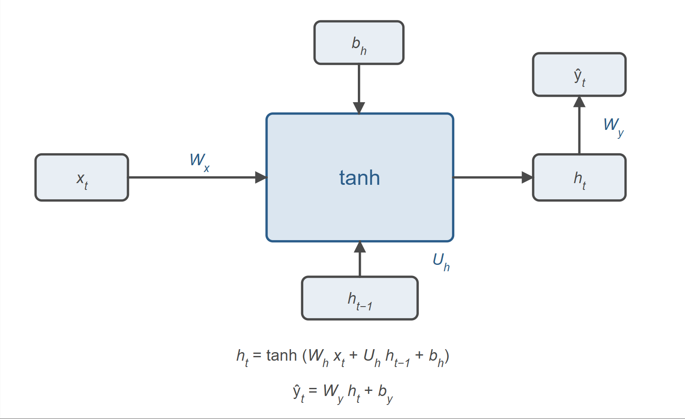
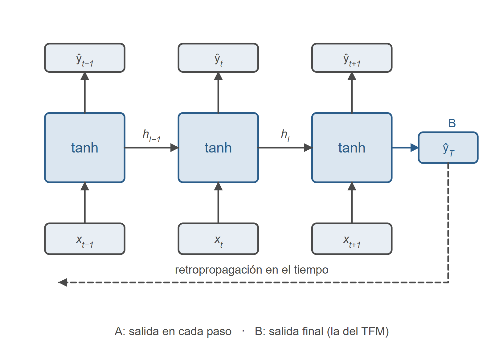

La reproducción del estudio requiere cinco componentes: el marco de supervivencia sobre el que se formula el problema, la representación de los datos, las arquitecturas entrenadas, el protocolo experimental y las métricas de evaluación. Cada una se describe en el orden en que el pipeline la ejecuta, de modo que el capítulo pueda seguirse en paralelo al código.

## Marco de supervivencia {#sec-3-1}

El estudio formula el cribado como un problema de tiempo hasta el evento, y este apartado fija el vocabulario que usan el resto del capítulo y el capítulo 5. Concretamente, qué se entiende por evento y por censura, cómo se estima la probabilidad de seguir en observación, qué añade el modelo de Cox y cómo se traduce todo a una probabilidad a cinco años en cada edad de corte.

### Tiempo hasta evento, censura y riesgos competitivos {#sec-3-1-1}

Los modelos de tiempo hasta el evento describen, para cada paciente, cuánto tarda en ocurrir un suceso y si llegó a ocurrir mientras se le observaba. El suceso se caracteriza con dos variables, el tiempo hasta el evento, $T$, y un indicador que dice si el seguimiento terminó con el evento o no. La particularidad de este caso es que el evento objetivo no es la muerte, como en un modelo de supervivencia al uso, sino el primer diagnóstico de cáncer de pulmón. Por eso el seguimiento puede terminar de tres maneras, porque aparece el diagnóstico, porque el paciente fallece o porque se pierde su seguimiento.

Como solo se observa uno de los tres desenlaces, el tiempo registrado es el mínimo entre el instante del diagnóstico y el instante en que se deja de observar al paciente:

$$T_i = \min(T_i^{e}, C_i)$$

donde $T_i^{e}$ es el tiempo hasta el diagnóstico y $C_i$ el tiempo hasta el final del seguimiento por muerte o por pérdida. El indicador sigue el convenio habitual: vale uno cuando el mínimo lo marca el diagnóstico y cero en los otros dos casos.

La censura es el final del seguimiento sin que haya ocurrido el evento, ya sea por pérdida o por muerte. Con esta definición, un paciente censurado no es un paciente que no vaya a desarrollar el tumor, sino uno del que se deja de tener información a partir de un instante concreto. Puede diagnosticarse después, fuera de la ventana de observación, y ese desenlace queda fuera del alcance del modelo. De ahí que la probabilidad de censura, $G(t) = P(C > t)$, no sea un detalle accesorio, sino una magnitud que entra en la evaluación. Se estima con Kaplan-Meier sobre los tiempos de censura de train,

$$\hat{G}(t) = \prod_{s \le t} (1 - d_s / n_s)$$

con $d_s$ censuras en el instante $s$ y $n_s$ pacientes aún en observación. El estimador se calcula sobre los tiempos de cada paciente, y en la evaluación se ajusta por separado en cada landmark con las filas de train de ese corte, de modo que cada edad tiene su propia referencia de censura. Un ejemplo ilustra su significado. Si a los diez años de seguimiento la mitad de la cohorte ya ha salido de la observación, la probabilidad de seguir en observación vale $0,5$ y un evento observado a esa edad pesa el doble que uno observado al principio. Las métricas que dependen de ella ponderan a cada paciente por la inversa de esa probabilidad (apartado 3.6.3), de modo que un paciente con un seguimiento largo sin censura pesa más, porque representa también a los que se perdieron antes.

Un riesgo competitivo es un suceso que impide que ocurra el evento de interés. Aquí lo es la muerte por una causa ajena al cáncer de pulmón, porque un paciente que fallece sin diagnóstico no puede ser diagnosticado después, y su desenlace no es equivalente a una pérdida de seguimiento. La muerte por otras causas se trata formalmente como censura a la derecha. Por consiguiente, las probabilidades estimadas corresponden al riesgo de diagnóstico mientras el paciente permanezca con vida y en seguimiento, y no a la probabilidad acumulada de enfermar a lo largo de la vida.

### El modelo de Cox y la verosimilitud parcial {#sec-3-1-2}

El modelo de Cox supone que el riesgo de cada paciente es el producto de un riesgo basal común a toda la cohorte y de un factor exponencial que depende de sus covariables [@cox1972regression]:

$$h_i(t) = h_0(t) \cdot e^{\theta_i}$$

donde $\theta_i$ es un predictor calculado sobre las covariables del paciente, lineal en el caso clásico y la salida de una red neuronal en las variantes profundas. El riesgo basal $h_0(t)$ queda sin forma funcional impuesta. No se supone que crezca, que decrezca ni que siga una exponencial, y no se estiman parámetros que lo describan. Se deja libre y se estima después, de forma escalonada, con el estimador de Breslow. Por eso el modelo se llama semiparamétrico, porque la parte de las covariables es paramétrica y la del tiempo, no.

El interés de esta formulación está en que permite estimar $\theta$ sin conocer $h_0$. Si en un instante ocurre un evento, la probabilidad de que le ocurra al individuo $i$ y no a otro del conjunto de pacientes aún en riesgo en ese instante, $R(t_i)$, es:

$$\frac{h_i(t_i)}{\sum_{j \in R(t_i)} h_j(t_i)} = \frac{h_0(t_i) \, e^{\theta_i}}{\sum_{j \in R(t_i)} h_0(t_i) \, e^{\theta_j}} = \frac{e^{\theta_i}}{\sum_{j \in R(t_i)} e^{\theta_j}}$$

El primer paso sustituye cada riesgo por su forma multiplicativa y el segundo cancela el riesgo basal, que aparece como factor común en el numerador y en el denominador. Por ello no es necesario modelarlo. Multiplicando esa probabilidad sobre los instantes con evento se obtiene la verosimilitud parcial,

$$L_p(\theta) = \prod_{k} \frac{e^{\theta_{(k)}}}{\sum_{j \in R(t_{(k)})} e^{\theta_j}}$$

y tomando logaritmos y cambiando el signo, la función a minimizar:

$$\mathcal{L}(\theta) = -\ln L_p(\theta) = -\sum_{k} \left[ \theta_{(k)} - \ln \sum_{j \in R(t_{(k)})} e^{\theta_j} \right]$$

donde el sumatorio recorre los instantes $k$ con evento y $\theta_{(k)}$ es el predictor del paciente que lo sufre. La implementación ordena a los pacientes por duración descendente, del seguimiento más largo al más corto. Así, el conjunto de riesgo de un paciente es el tramo de la lista que va desde el principio hasta él, y el cálculo se resuelve con una suma acumulada. La lista es la del lote de 128 muestras y no la de toda la cohorte, de modo que el conjunto de riesgo de cada evento lo forman los pacientes del lote que seguían en observación en ese instante. Es la aproximación habitual cuando una red se entrena por minilotes [@kvamme2019timetoevent], y supone que cada paso optimiza una verosimilitud parcial calculada sobre una muestra del conjunto de riesgo y no sobre el conjunto completo. La exponencial se evalúa restando antes el máximo de los predictores del lote, una precaución numérica que evita desbordamientos y que no cambia el resultado. Solo los pacientes con evento aportan a la suma, y los censurados entran únicamente en los conjuntos de riesgo de los demás.

La forma de la pérdida indica qué optimiza el modelo. Para cada evento compara su predictor con una media suavizada de los predictores de todos los que estaban en riesgo. El primer término favorece un predictor alto para el paciente diagnosticado y el logaritmo del sumatorio lo contrapone a los de los demás, de modo que el modelo aprende a dar más riesgo a quien se diagnostica antes. El resultado no es una probabilidad, porque la pérdida no cambia si se suma la misma constante a todos los predictores, y por eso el riesgo basal se cancela. Sin embargo, sí depende de cuánto supera un predictor a otro, y no solo de su orden. Un ejemplo sencillo lo ilustra. Si dos pacientes están en riesgo, con predictor $a$ el que se diagnostica y $b$ el otro, su contribución a la pérdida es $\ln(1 + e^{b - a})$, que baja de forma continua a medida que crece la diferencia $a - b$ y no solo cuando cambia de signo. La medida que solo depende del orden es el C-index del apartado 3.6.1. Esa diferencia de magnitud es la que el riesgo basal de Breslow convierte después en una probabilidad.

### Riesgo basal de Breslow y probabilidad a horizonte {#sec-3-1-3}

Para pasar del orden relativo a una probabilidad absoluta hace falta recuperar el riesgo basal, y el estimador de Breslow lo reconstruye a partir de los propios datos [@breslow1974covariance]. La idea es repartir los eventos observados en cada instante entre los pacientes que estaban en riesgo, en proporción a su riesgo relativo. Si en el instante $t_k$ hay $d_k$ eventos y el conjunto de riesgo es $R(t_k)$, a cada paciente le corresponde una fracción $e^{\theta_j} / \sum_{l \in R(t_k)} e^{\theta_l}$ de esos eventos. Al dividir esa fracción por el factor relativo del paciente, $e^{\theta_j}$, queda una cantidad común a todos, y sumándola sobre los instantes hasta $t$ se obtiene el riesgo acumulado basal:

$$\hat{H}_0(t) = \sum_{t_k \le t} \frac{d_k}{\sum_{j \in R(t_k)} e^{\theta_j}}$$

donde $d_k$ son los eventos observados en el instante $t_k$. De él se deriva la probabilidad de supervivencia de cada paciente. El riesgo acumulado de un paciente concreto es el basal multiplicado por su factor relativo, $H(t \mid x_i) = \hat{H}_0(t) \cdot e^{\theta_i}$, y la supervivencia es la exponencial negativa de ese riesgo acumulado:

$$S(t \mid x_i) = \exp(-\hat{H}_0(t) \cdot e^{\theta_i})$$

La probabilidad de diagnóstico dentro del horizonte es entonces $1 - S(5 \mid x_i)$, con el tiempo medido desde el corte y el riesgo basal estimado en cada landmark sobre las filas de train de ese corte ($5$ representa el horizone de predicción establecido para este trabajo).

El pipeline fija este riesgo basal solo con los datos de train y no lo recalcula nunca sobre validación ni sobre `holdout`, que es la misma precaución que se toma con la distribución de censura y evita que información del conjunto de prueba se filtre a la predicción. La versión nula del modelo, con todos los riesgos a cero, da la incidencia basal de train, que es la referencia contra la que se mide el índice de precisión en el apartado 3.6.4.

### Landmarking: predicción a edad fija, ventana de cinco años y anidamiento de cohortes {#sec-3-1-4}

El análisis se plantea como un problema de predicción en un instante concreto de la vida del paciente, no como una predicción única. El esquema es el del *landmarking* [@vanhouwelingen2007landmarking], y consta de cuatro pasos. Se fija una edad de corte, se selecciona a los pacientes que siguen vivos y libres del evento en esa edad, se recoge su historia clínica hasta ese momento y se predice el evento en una ventana futura fija.

En este trabajo la rejilla de cortes son 26 edades, de los 45 a los 70 años, y la ventana es de cinco años, ambos declarados en el fichero de configuración. El filtro de elegibilidad se aplica con el tiempo transcurrido desde el corte,

$$\tilde{T}_i = T_i - (t_{LM} - 18)$$

de manera que la muestra se descarta si ese tiempo no es positivo, y la historia que ve el modelo se recorta a las observaciones hasta el corte, inclusive. Un paciente que en el momento del corte ya había sufrido el evento, o que ya había salido del seguimiento, no entra en esa cohorte. El instante de predicción lo fija la edad y no el desenlace, y la historia se recorta del mismo modo para quienes desarrollarán el cáncer y para quienes no. Esta es la diferencia de fondo con los diseños de casos y controles que fijan el índice de los casos en la fecha del diagnóstico, en los que el modelo puede aprender el propio proceso diagnóstico en lugar del riesgo previo [@yuan2021temporal].

Las cohortes de los distintos cortes comparten pacientes y están anidadas. Quien sigue en observación a los 70 años ya lo estaba a los 45, así que la cohorte de un landmark tardío es un subconjunto de la de uno temprano. En `holdout`, el corte de 45 años reúne 12 616 filas de paciente y landmark y el de 70 reúne 6 996, de modo que se retiene el 55,5 % y el tamaño decrece de forma monótona en los 26 cortes. En train el primer corte coincide con la cohorte del modelo, 9 917 pacientes, y el último baja a 5 458. Al sumar los 26 cortes de `holdout` se obtienen 258 685 filas sobre 12 616 pacientes únicos, es decir, cada paciente aparece en unos veinte cortes de media. Ese anidamiento es el problema que hay que resolver al agregar las métricas, y se trata en el apartado 3.6.6.

## Descripción de la cohorte y de las secuencias {#sec-3-2}

El estudio trabaja con dos objetos. La cohorte es un fichero con una fila por paciente y tres columnas (`Id`, `duration` y `event`), que define quién entra y cuándo termina su seguimiento. Las secuencias son la historia de cada paciente reconstruida como una serie de instantes con sus analíticas y sus diagnósticos.

### Variables y estadísticos de la tabla de características {#sec-3-2-1}

La tabla descriptiva de la cohorte se construye cruzando el artefacto de cohorte con el fichero crudo de pacientes, que aporta la fecha de nacimiento, la de muerte y el sexo, y se calcula una sola vez sobre train, validación y `holdout`. Las variables son seis: el número de pacientes y el de eventos se obtienen directamente de la cohorte. La tasa de evento es el cociente entre ambos. El seguimiento mediano es la mediana de `duration`, medida desde la fecha índice de los 18 años. La edad mediana al final del seguimiento es esa misma mediana más 18. El porcentaje de mujeres se obtiene del indicador de sexo que la secuencia guarda por paciente.

La tabla se acompaña de dos elementos más, a saber, el *embudo* de la muestra encadena la cohorte de `discovery`, el reparto en train y validación, las secuencias construidas, los pacientes con al menos un par válido y los pares paciente-landmark, de modo que cada cifra se lee como el resto de la anterior. La curva de incidencia acumulada por split se estima con Kaplan-Meier sobre los tiempos hasta el evento (`discovery` no lleva curva propia, porque es la unión de train y validación y duplicaría la figura).

### Medidas de dispersión, co-ocurrencia y muestreo informativo {#sec-3-2-2}

El análisis exploratorio se organiza en cuatro bloques, y cada uno responde a una pregunta distinta sobre los mismos datos.

-   **Lo que ve el modelo en cada corte.** Por cada landmark se cuentan las muestras, cuántas no tienen ninguna analítica anterior al corte, la mediana y los cuantiles de analíticas y de códigos por muestra, y la mediana de instantes con registro. Es la única vista que responde a qué recibe la red.
-   **Densidad de observación.** Se mide el número de analíticas por visita y la presencia de cada analítica en dos unidades distintas, el porcentaje de pacientes que la tienen alguna vez y el porcentaje de visitas que la incluyen. Se añade la intensidad por banda de edad, en observaciones por paciente y año, calculada como el solapamiento entre la ventana de cada paciente y la banda.
-   **Muestreo informativo.** Para cada paciente se calcula la tasa de visitas con analítica por año de seguimiento, contando solo las que caen entre los 18 años y el final de su seguimiento. Las tasas de los pacientes con evento y sin evento se contrastan con una prueba de Mann-Whitney, y el tamaño del efecto se mide con la δ de Cliff, que vale P(X \> Y) − P(X \< Y), con X la tasa del grupo con evento e Y la del grupo sin evento. Vale cero cuando ninguna de las dos distribuciones domina a la otra y ±1 cuando todos los pacientes de un grupo se miden más que todos los del otro; los empates no cuentan en ninguno de los dos términos.
-   **Magnitudes y normalización.** Por analítica se resume la distribución de los valores estandarizados observados y se contrasta con las medias y desviaciones que el pipeline guardó en train. Las analíticas que se salen de la tolerancia se marcan y no se corrigen.

El análisis se rige por dos criterios. El paciente es la unidad de inferencia, nunca el par ni el valor, porque un mismo paciente aparece hasta en 26 cortes y contar sobre la muestra del modelo multiplicaría cada observación. Por eso la densidad, el muestreo y las magnitudes se calculan sobre la historia completa, y la muestra del modelo se usa solo donde la pregunta es qué ve la red. El segundo criterio es que toda cifra se almacena en un artefacto con su unidad, su población y su denominador, y que cada figura muestra un solo mensaje.

## Representación de los datos {#sec-3-3}

La representación es la pieza que decide qué puede aprender cada modelo. Una misma historia clínica admite varias representaciones, y cada una impone sus supuestos sobre qué es un hueco, cuánto dura el pasado y cómo se codifica un diagnóstico. Este apartado describe cómo se construye la representación del estudio (@sec-3-3-1), las dos formas de leerla que usan los modelos (@sec-3-3-2) y el filtro que impide que el desenlace entre como variable (@sec-3-3-3).

### Secuencias irregulares con códigos ICD-10-CM {#sec-3-3-1}

La representación de partida se construye con una única regla que lee los tres ficheros crudos, `patients.csv.gz`, `conditions.csv.gz` y `observations.csv.gz`, y escribe por paciente cinco elementos, que son los instantes de la historia, la matriz de analíticas, su máscara de observación, el sexo y los códigos de diagnóstico.

Los instantes son la unión ordenada de las edades en que hay una analítica o un diagnóstico, de modo que la secuencia avanza de visita en visita y no sobre una rejilla de tiempo fijo. La matriz de analíticas tiene una fila por visita y una columna por cada una de las 23 analíticas fijadas, con el valor estandarizado en media y desviación. La máscara tiene la misma forma y marca qué se midió y qué no, y es lo que permite distinguir un valor ausente de un valor que casualmente vale cero. Los códigos de diagnóstico se guardan como una lista por visita, ya traducidos a categorías ICD-10-CM, tal como se describe en el capítulo 2.

La matriz se organiza como un tensor de tres dimensiones, lote, tiempo y variable, con una fila por visita y una columna por analítica. El eje temporal cuenta visitas y no años, y por eso los lotes se rellenan hasta la longitud máxima del lote en lugar de hasta una rejilla fija. Junto a la matriz viaja el intervalo desde la visita anterior, que se calcula como la diferencia entre instantes consecutivos y vale cero en la primera. Ese intervalo es el $\delta_t$ con el que GRU-D decide cuánto decae cada valor entre una visita y la siguiente.

La estandarización usa la media y la desviación calculadas solo con train, y esas mismas cifras se reutilizan en validación y en `holdout`, para que ningún paciente del conjunto de prueba participe en la normalización. El vocabulario de códigos se fija igual, en train. Se ordenan alfabéticamente las categorías que aparecen, se les asigna un índice a partir del uno y se reserva el cero para el relleno. Son 119 categorías observadas en train, y esa es la cifra que manejan los modelos, no las 1 312 que el mapa permite.

### Tripletas (t, f, v) frente a matriz densa {#sec-3-3-2}

Los modelos recurrentes y el transformer reciben esta misma historia, pero la procesan de forma distinta, y esa diferencia da lugar a las dos representaciones de este apartado.

La representación densa es la de GRU-D y la LSTM. Cada visita ocupa una fila de la matriz, con sus 23 analíticas, su máscara de observación y un intervalo adicional, el tiempo transcurrido desde la visita anterior, que vale cero en la primera. Los lotes se rellenan a la longitud máxima del lote, con la dimensión temporal contando visitas y no años, de modo que cada paciente aporta tantas filas como visitas tiene.

La representación en tripletas es la de STraTS. Cada observación elemental se escribe como una terna $(t_i, f_i, v_i)$, el instante exacto, un identificador de variable y su valor respectivamente. El identificador unifica analíticas y diagnósticos en un mismo espacio, con las 23 analíticas en los primeros índices y los códigos desplazados a continuación, y el valor es el z-score de la analítica o un uno constante cuando la observación es un diagnóstico. La serie queda entonces como una secuencia ordenada de observaciones sueltas, sin rejilla común y sin necesidad de rellenar huecos.

Las dos máscaras comparten nombre, pero no función. La de la representación densa es una máscara de observación y por tanto dice qué variables se midieron en cada visita, y GRU-D la usa además para decidir qué imputar. La del transformer es una máscara de relleno, por lo que solo dice qué posiciones son artificiales porque el lote se ha igualado en longitud, y no lleva información clínica.

### Fuga de información: eliminación de variables reveladoras {#sec-3-3-3}

Un modelo que predice un diagnóstico no puede recibir como entrada el código de ese diagnóstico. El capítulo 2 ya describe los tres descartes que el pipeline aplica sobre los diagnósticos crudos antes de traducirlos a categorías (@sec-2-5). Aquí interesa su efecto sobre la representación, y ese efecto es que el vocabulario que llega al modelo no contiene ninguna categoría del desenlace. Como los cuatro conceptos SNOMED del evento se traducen a `C34`, el descarte de `C33` y `C34` los elimina aunque no se hubieran excluido por código, y las categorías que empiezan por `O`, `Z`, `V`, `W`, `X` o `Y` quedan fuera por el mismo filtro.

El filtro se ha comprobado sobre el vocabulario que queda. Ninguna categoría `C33` ni `C34` aparece, ninguno de los cuatro conceptos SNOMED que definen el evento está presente y no aparece ninguna de las iniciales excluidas.

## Modelos {#sec-3-4}

El estudio entrena cinco modelos que representan tres familias. La línea base es un modelo de Cox sobre una tabla estática, sin ninguna noción de secuencia. Dos son recurrentes, la LSTM y GRU-D, y la segunda se entrena en dos variantes, con y sin códigos de diagnóstico. El quinto es un transformer, STraTS, que trata la historia como un conjunto de observaciones sueltas. Todos producen un riesgo escalar por paciente y corte, que la verosimilitud parcial del apartado 3.1.2 ordena. Cada subsección sigue el mismo esquema, la idea, las ecuaciones que la definen y los parámetros que se entrenan, y los parámetros de los cinco se recogen juntos al final del apartado.

### Línea base tabular: Cox con LOCF {#sec-3-4-1}

La línea base del estudio es un modelo de Cox sobre una matriz tabular por landmark. Para cada corte se construye una matriz con una fila por paciente y una columna por variable, rellenando las analíticas con la última observación disponible hacia delante. Si una analítica no se ha medido nunca en ese paciente, se imputa con la mediana de train de esa columna. A esas 23 columnas se añade el sexo y, cuando la variante los usa, un indicador por cada categoría de diagnóstico presente en la historia hasta el corte, lo que deja 143 columnas de entrada.

El modelo es una capa lineal sobre ese vector, de modo que el predictor es $\theta_i = x_i^{\top}\beta$ y el riesgo se obtiene aplicando la exponencial del apartado 3.1.2. Es la variante más simple de las cinco y sirve de referencia, porque mide cuánto se puede explicar con las últimas analíticas conocidas y el sexo, sin ninguna noción de secuencia ni de tiempo entre visitas.

La particularidad es que no hay un modelo, sino 26, ya que cada corte se ajusta por separado con sus propios pacientes y su propia matriz. Es el único del catálogo que se reentrena en cada corte, y por eso, aunque cada ajuste es computacionalmente económico, su entrenamiento completo dura lo mismo que el de las redes recurrentes, unos cinco minutos (apartado 4.7).

Cabe señalar que los modelos de Cox por landmarks con la última observación disponible de cada variable (LOCF, del inglés *Last Observation Carried Forward*), es una estrategia tradicional y de uso habitual para incorporar mediciones longitudinales a la predicción de supervivencia [@MirkoRetif2026Benchmarking].

### Procesamiento secuencial y RNN básicas {#sec-3-4-2}

Una red neuronal recurrente (RNN, *Recurrent Neural Network*) procesa la historia visita a visita y mantiene un estado oculto que resume lo visto hasta el momento. La celda es siempre la misma y se aplica en cada paso, aunque al dibujarla se despliegue en el tiempo para ver el cálculo completo (@fig-rnn-esquema). Ese despliegue no es una red distinta, sino la misma celda repetida tantas veces como visitas tenga la historia.

{#fig-rnn-esquema width="70%"}

La @fig-rnn-desplegada muestra el despliegue temporal. En cada instante la celda recibe la entrada $x_t$ y el estado anterior $h_{t-1}$, y produce un estado nuevo. La salida puede tomarse en cada paso, si la tarea pide una predicción por visita, o solo en el último, si lo que se quiere es un resumen de toda la secuencia. Este estudio usa la segunda opción, porque el riesgo se calcula una vez por paciente y corte y no en cada visita. El entrenamiento se hace sobre el grafo desplegado, con retropropagación a través del tiempo.

{#fig-rnn-desplegada width="85%"}

La celda más simple actualiza el estado con una tangente hiperbólica sobre la entrada actual y el estado anterior:

$$h_t = \tanh(W_h x_t + U_h h_{t-1} + b_h)$$

Los parámetros entrenables son las dos matrices y el sesgo, en total $d_h(d_x + d_h + 1)$, que no dependen de la longitud de la secuencia porque la misma celda se reutiliza en cada paso. El problema de esta celda es que la señal se diluye a lo largo de la secuencia, porque el gradiente que llega desde el final hasta el principio se multiplica por tantos factores que tiende a desvanecerse, y la red pierde la información de los pasos más antiguos. De ahí surgen las dos celdas que sí usa el estudio, la LSTM y la GRU, y de ahí también que el transformer sea una alternativa razonable cuando la historia es larga.

En el catálogo del pipeline no hay ninguna red recurrente básica. Las dos celdas que resuelven el problema del olvido son las que se describen en las dos subsecciones siguientes, y este apartado es el marco que las introduce.

### LSTM {#sec-3-4-3}

La LSTM resuelve el problema del olvido con una memoria de celda separada del estado oculto y tres compuertas que deciden qué se guarda, qué se olvida y qué se transmite [@hochreiter1997long]. La @fig-lstm recoge la celda completa, donde la entrada $x_t$ y el estado anterior $h_{t-1}$ forman el vector conjunto que alimenta a las compuertas.

![Celda LSTM (esquema conceptual basado en @hochreiter1997long). A partir del vector conjunto $[x_t, h_{t-1}]$, las compuertas de olvido ($f_t$), entrada ($i_t$) y salida ($o_t$) regulan el flujo de información: $f_t$ modula el estado anterior $C_{t-1}$ y $i_t$ incorpora el candidato de celda $\tilde{C}_t$ para actualizar la memoria $C_t$, cuya activación por tangente hiperbólica filtrada por $o_t$ genera el nuevo estado oculto $h_t$.](images/lstm_celda.png){#fig-lstm width="90%" fig-scap="Celda LSTM."}

La compuerta de olvido y la de entrada actualizan la memoria,

$$C_t = f_t \odot C_{t-1} + i_t \odot \tilde{C}_t$$

y la compuerta de salida decide qué parte de esa memoria pasa al estado oculto,

$$h_t = o_t \odot \tanh(C_t)$$

con las tres compuertas calculadas como una sigmoide sobre el vector conjunto $[x_t, h_{t-1}]$, y el candidato $\tilde{C}_t$ como una tangente hiperbólica. El camino de la memoria a través de la suma es lo que permite que el gradiente se propague a pasos lejanos sin desvanecerse.

En el pipeline la celda es una LSTM sobre un vector por visita que concatena las analíticas ya imputadas, la máscara de observación y el sexo, más un vector aprendido por categoría de diagnóstico cuando la variante los incorpora. La imputación es la media de train, sin decaimiento, porque la LSTM no usa el tiempo transcurrido entre visitas, y esa es su diferencia principal con GRU-D. El riesgo se toma del estado en la última visita real, no en el relleno, y una capa lineal lo convierte en el escalar que consume la pérdida de Cox.

### GRU y GRU-D {#sec-3-4-4}

La GRU es una versión reducida de la LSTM. En lugar de tres compuertas y una memoria aparte, usa dos compuertas y un único estado, con menos parámetros y un rendimiento parecido en la práctica. La @fig-gru muestra la celda, con la compuerta de reinicio modulando el estado anterior que entra al candidato y la de actualización gobernando la interpolación convexa hacia el nuevo estado.

![Celda GRU (esquema conceptual basado en @cho2014properties). A partir del vector conjunto $[x_t, h_{t-1}]$, la compuerta de reinicio $r_t$ modula la proporción del estado anterior que participa en el cálculo del candidato $\tilde{h}_t$, mientras que la compuerta de actualización $z_t$ ejecuta la interpolación convexa $h_t = (1 - z_t) \odot h_{t-1} + z_t \odot \tilde{h}_t$ para obtener el nuevo estado oculto $h_t$.](images/gru_celda.png){#fig-gru width="90%" fig-scap="Celda GRU."}

Sobre esa celda construyen Che et al. su modelo para series con valores ausentes, y esa es la variante que entrena el estudio [@che2018recurrent]. La aportación de GRU-D es tratar el tiempo transcurrido como información. Cada analítica y el propio estado oculto decaen hacia su valor de referencia con una velocidad aprendida:

$$\gamma_x = \exp(-\max(0, W_x \delta_t + b_x))$$

donde $\delta_t$ es el tiempo desde la visita anterior. En el artículo original el intervalo es propio de cada variable y cuenta desde su última medición. En el pipeline es uno solo, común a todas las analíticas, y una capa lineal lo convierte en una velocidad de decaimiento por analítica. Con ese decaimiento se imputa el valor ausente mezclando la última observación conocida de esa analítica, $x_{t'}$, y la media de train, $\bar{x}$,

$$\hat{x}_t = m_t x_t + (1 - m_t)(\gamma_x x_{t'} + (1 - \gamma_x) \bar{x})$$

y se atenúa el estado oculto antes de actualizarlo con un decaimiento análogo. Si entre dos visitas pasan tres años, el valor imputado se parece más a la media que si pasa una semana, y el grado de aproximación lo aprende el modelo con sus propios parámetros en lugar de fijarse a mano. Como el intervalo cuenta desde la visita anterior y no desde la última medición, una analítica que lleva años sin medirse pero con visitas intermedias frecuentes conserva un valor imputado cercano al último observado.

La celda recurrente recibe la concatenación de las analíticas imputadas, la máscara, el sexo y el tiempo desde la fecha índice (la edad menos 18 años), más el vector de códigos cuando los usa, y la cabeza de riesgo es la misma que en la LSTM. La adaptación respecto al artículo original está en cómo se introduce la máscara. En lugar de las matrices separadas para cada compuerta, el pipeline concatena la máscara a la entrada de una celda GRU estándar. Para la máscara el resultado es equivalente, porque multiplicar una concatenación por una matriz es lo mismo que sumar los productos de sus bloques. No es idéntico al original en otros dos detalles, porque la celda de PyTorch aplica la compuerta de reinicio después de multiplicar el estado anterior y no antes, y porque la entrada añade el tiempo desde la fecha índice, que Che et al. no usan. La variante sin códigos es la que sirve para la ablación del apartado 3.5.2.

### STraTS: Transformer sobre tripletas de observación {#sec-3-4-5}

STraTS es un transformer pensado para series clínicas dispersas e irregulares [@tipirneni2022strats]. Su tarea original es clasificación, con una tarea auxiliar de predicción de valores observados que se entrena antes del ajuste fino. De esa propuesta se toma aquí la arquitectura, no el preentrenamiento. El modelo se entrena desde cero y solo con la pérdida de Cox, y el aprendizaje autosupervisado queda como línea futura en el capítulo 6. La razón es de alcance, porque aquí el objetivo no es reducir las etiquetas necesarias, sino comparar arquitecturas bajo un protocolo común. Según el propio artículo, la fase autosupervisada es la que permite a la arquitectura mantener su rendimiento con menos etiquetas, y esa ventaja queda sin explorar en esta memoria.

Esta adaptación es la aportación técnica central del trabajo. STraTS ya se ha aplicado al riesgo de cáncer de pulmón como clasificador a un año, con los códigos representados mediante embeddings de MedBERT [@Rasmy2021], sin valores de analítica y sobre una muestra de casos y controles [@alonso2025ehrs]. Aquí conserva la representación en tripletas con valores continuos, se entrena con la verosimilitud parcial de Cox, que incorpora la censura, y se integra en el esquema de landmarking. Produce así un riesgo por paciente y corte que el riesgo basal de Breslow convierte en una probabilidad a cinco años (apartado 3.1.3).

Antes de describir el modelo conviene recordar cómo funciona un transformer. Un transformer procesa toda la secuencia en paralelo, sin recorrerla en orden, y lo hace con un mecanismo de atención que relaciona cada elemento con todos los demás. La atención se construye con tres proyecciones lineales de cada elemento, la consulta, la clave y el valor, de modo que el peso entre dos posiciones se obtiene del producto escalar de la consulta de una con la clave de la otra, normalizado y pasado por una softmax (@fig-atencion). Cada posición obtiene así una combinación ponderada de los valores de todas las demás.

{#fig-atencion width="85%" fig-scap="Autoatención por producto escalar."}

El mecanismo se repite en varias cabezas en paralelo, cada una con sus propias proyecciones, y el resultado se concatena. Así, cada cabeza puede especializarse en un tipo de relación distinta. Después, el bloque del codificador añade una conexión residual y una normalización, y una capa densa con su propia residual (bloque contextual en @fig-strats-arquitectura). Ambos elementos facilitan el entrenamiento de una red de este tipo, porque mantienen el gradiente en un camino directo a través de las capas.

En el caso de las series clínicas, el transformer no necesita codificación posicional como la de un texto, porque cada observación incluye su instante real y ese instante se usa como una entrada más. El modelo trabaja sobre las tripletas del apartado 3.3.2 y construye cada una como la suma de tres piezas, el instante, la variable y el valor, cada una proyectada a la dimensión interna del modelo. El instante y el valor pasan por una red de dos capas con una tangente hiperbólica en medio, que es lo que permite tratar un tiempo o un valor continuo como un vector. La variable se representa con un vector aprendido por identificador. Cuando la observación es un diagnóstico, la contribución del valor se anula, de modo que la representación del código es íntegramente la de la variable y el uno constante no introduce ninguna falsa noción de magnitud.

Sobre esas representaciones actúa un codificador de dos capas con cuatro cabezas de atención, que relaciona cada observación con todas las demás sin recorrer la secuencia en orden. La máscara de relleno impide que las posiciones artificiales participen en la atención. Después, la secuencia se resume con una atención aprendida (*Fusion Self-Attention*), en la que cada observación recibe un peso $\alpha_i$ proporcional a su relevancia y el resumen es la suma ponderada,

$$e^T = \sum_i \alpha_i h_i$$

El riesgo se calcula combinando ese resumen temporal $e^T$ con la información demográfica. El vector de demográficas $d$ (en este estudio, el sexo del paciente) pasa por una red densa (*feed-forward*, FFN) con activación tangente hiperbólica para obtener una representación latente $e^d$. Ambos vectores se concatenan en $\begin{bmatrix} e^d \\ e^T \end{bmatrix}$ y alimentan la cabeza de Cox (@fig-strats-arquitectura), que devuelve una única salida escalar de riesgo $\hat{y}$ por muestra. No devuelve riesgos intermedios, porque el transformer procesa la secuencia entera en paralelo y no tiene pasos temporales recurrentes.

![Arquitectura de STraTS adaptada a la verosimilitud parcial de Cox (esquema adaptado a partir del propuesto por @tipirneni2022strats, modificando la etapa final de predicción para incorporar la función de riesgo de Cox). El flujo consta de cuatro etapas: (1) incrustación inicial de tripletas (*Initial Triplet Embedding*), donde cada observación $(t_i, f_i, v_i)$ suma las proyecciones del tiempo (CVE-Time), el identificador de variable (*Variable embedding*) y el valor continuo (CVE-Value, anulado en los diagnósticos); (2) codificación contextual (*Contextual Triplet Embedding*) mediante $M$ bloques de autoatención multicabeza y capas densas con conexiones residuales; (3) agregación temporal (*Fusion Self-Attention*), que pondera los estados mediante coeficientes $\alpha_i$ para producir el vector de la secuencia $e^T$; y (4) predicción de supervivencia (*Prediction*), en la que las covariables demográficas $d$ se procesan mediante una red densa (FFN) para generar $e^d$, concatenándose con $e^T$ antes de la cabeza lineal de Cox para estimar la salida de riesgo $\hat{y}$.](images/strats_paper.png){#fig-strats-arquitectura width="90%" fig-scap="Arquitectura de STraTS adaptada a Cox."}

La @tbl-parametros recoge el tamaño de los cinco modelos. La cifra de Cox es por landmark, porque se ajusta uno en cada corte, y las demás son el total del modelo.

::: {#tbl-parametros}
| Modelo | Familia | Parámetros entrenables |
|------------------------|------------------------|------------------------|
| `cox` | Lineal sobre tabla | 144 por landmark, 3 744 en los 26 cortes |
| `lstm` | Recurrente (LSTM) | 12 449 |
| `grud` | Recurrente (GRU-D con códigos) | 11 471 |
| `grud_labs` | Recurrente (GRU-D sin códigos) | 8 015 |
| `strats` | Transformer | 23 149 |

: "Parámetros entrenables por modelo, contados sobre los artefactos entrenados. En Cox el número es por landmark, porque se ajusta un modelo distinto en cada corte."
:::

## Protocolo experimental {#sec-3-5}

Los cinco modelos compiten con el mismo presupuesto y sobre las mismas particiones. Las diferencias de configuración se limitan a lo que exige cada arquitectura (las épocas y la paciencia de la línea base, que además no tiene dimensión oculta, y el decaimiento de pesos del transformer), y el fichero de configuración define una única combinación por arquitectura para mantener un presupuesto de cómputo uniforme y reproducible entre modelos (apartado 4.7).

### Partición por paciente, sobremuestreo de eventos y parada temprana {#sec-3-5-1}

La partición se hace a nivel de paciente y estratificada por evento, con un 80 % para train y un 20 % para validación, sobre el pool `discovery` y con semilla fija. `holdout` no se reparte, porque es una población generada aparte que no entra en el ajuste en ningún momento. El reparto busca que la tasa de evento sea la misma en los dos conjuntos, porque con una prevalencia del 3,6 % una partición al azar desequilibrada cambiaría el punto de partida de los modelos.

Aun así, la prevalencia es baja, y para que el entrenamiento no se limite a aprender la clase mayoritaria se usa un muestreador que da tres veces más peso a los pacientes con evento. Es un sobremuestreo con reemplazamiento, no una reponderación de la pérdida, y el factor es el mismo para los cinco modelos.

La parada temprana vigila la pérdida de validación con un umbral de mejora de $10^{-4}$ y guarda el mejor estado del modelo. Cada arquitectura lleva su propia paciencia. El optimizador es Adam, con el decaimiento de pesos de la configuración y un planificador que reduce la tasa de aprendizaje a la mitad cuando la pérdida de validación se estanca durante tres épocas.

Los modelos secuenciales se entrenan con las filas de los 26 cortes de train mezcladas en los mismos lotes, cada una con su duración medida desde su propio corte. Esa duración es todo el seguimiento restante, sin censurar a los cinco años, de modo que el entrenamiento aprende el orden a lo largo de todo el seguimiento y el horizonte solo interviene en la evaluación y en el riesgo basal de Breslow. Cada fila lleva además un peso $1 + \gamma \cdot \ell$, con $\gamma = 1$ y $\ell$ la edad del corte reescalada a $[0, 1]$, de modo que una fila del corte de 70 pesa el doble que una del de 45. La pérdida de cada lote es la media de las contribuciones de sus eventos ponderada por esos pesos. Cox, que se ajusta por separado en cada corte, no mezcla filas de cortes distintos.

### Ablación de códigos ICD-10-CM {#sec-3-5-2}

La única ablación del estudio compara las dos variantes de GRU-D, la que recibe los códigos de diagnóstico junto a las analíticas y la que solo usa analíticas. Las dos comparten arquitectura, hiperparámetros y particiones, y se diferencian únicamente en la dimensión del vector de códigos, que se anula en la segunda. Los instantes de la secuencia, en cambio, son los mismos en las dos, y siguen incluyendo las fechas con diagnóstico. La variante sin códigos sabe cuándo hubo un diagnóstico, cuántos hubo y cuánto tiempo pasó entre ellos, aunque no sepa cuál fue. La comparación mide, por tanto, qué aporta la identidad de los códigos con todo lo demás fijo, no qué aportan los diagnósticos, y sus resultados están en el apartado 4.6.

### Presupuesto de entrenamiento e hiperparámetros {#sec-3-5-3}

La @tbl-hiperparametros recoge la configuración de los cinco modelos. Las filas que coinciden en todas las columnas son el presupuesto común, y las que no se explican por las exigencias de cada arquitectura.

::: {#tbl-hiperparametros}
| Hiperparámetro | `cox` | `lstm` | `grud` | `grud_labs` | `strats` |
|------------------------------------------|----------|----------|----------|------------|----------|
| Tamaño de lote | 128 | 128 | 128 | 128 | 128 |
| Tasa de aprendizaje | 0,001 | 0,001 | 0,001 | 0,001 | 0,001 |
| Decaimiento de pesos | 0,01 | 0,01 | 0,01 | 0,01 | 0,0001 |
| Épocas máximas | 100 | 20 | 20 | 20 | 20 |
| Paciencia de parada | 20 | 3 | 3 | 3 | 3 |
| Sobremuestreo de eventos | 3,0 | 3,0 | 3,0 | 3,0 | 3,0 |
| Longitud máxima de historia (posiciones) | 200 | 200 | 200 | 200 | 200 |
| Dimensión oculta | — | 32 | 32 | 32 | 32 |
| Cabezas de atención | — | — | — | — | 4 |
| Capas de atención | — | — | — | — | 2 |
| Dimensión de la capa densa | — | — | — | — | 64 |
| Dimensión demográfica | — | — | — | — | 8 |
| *Dropout* | — | 0,2 | 0,2 | 0,2 | 0,2 |
| Códigos de diagnóstico | sí | sí | sí | no | sí |

: "Configuración de cada modelo. Las filas idénticas en las cinco columnas forman el presupuesto común, y las diferencias se deben a la arquitectura. Un guion indica que el hiperparámetro no aplica al modelo."
:::

Las tres diferencias responden a motivos concretos. Cox lleva más épocas y más paciencia porque es un modelo lineal con pocos parámetros por corte y no necesita la contención de recursis que exigen las redes. Cada ajuste es rápido, y los 26 cortes juntos suman unos cinco minutos de entrenamiento (apartado 4.7). El decaimiento de pesos es una penalización sobre la magnitud de los pesos que se suma a la pérdida y los empuja hacia cero, de modo que el modelo no sobreajuste los datos de entrenamiento. En el transformer es cien veces menor que en las redes recurrentes, y el resto de sus valores son propios de la arquitectura (número de cabezas, capas y dimensión de la capa densa). La línea base no tiene dimensión oculta porque no tiene capa recurrente.

### Réplicas con distintas particiones y semillas {#sec-3-5-4}

Un único entrenamiento no basta para comparar arquitecturas, porque su resultado depende de dos fuentes de azar que el bootstrap del conjunto de evaluación no recoge: qué pacientes de `discovery` caen en train y en validación, y la semilla del entrenamiento. Para medir las dos, el estudio repite el procedimiento completo de construcción de los modelos, que es lo que debe validarse y no un ajuste concreto [@steyerberg2016validation]. Cada réplica $r$ reparte `discovery` en train y validación con la semilla $r$, ajusta con ese train la normalización de las analíticas, construye sus secuencias, `holdout` incluido, y entrena los cinco modelos con la misma semilla, que fija la inicialización de los pesos, las extracciones del muestreador que sobrepondera los eventos y, en los modelos que lo usan, el *dropout*. La ejecución principal es la réplica 0, cuya partición es la del capítulo 2, y sus cifras son las de las tablas principales del capítulo 4. Con las réplicas 1 a 10, cada modelo suma once ejecuciones. `holdout` es el mismo en todas, y todas se evalúan con el procedimiento del apartado 3.6.

La variabilidad de cada modelo se resume con la media, la desviación típica y el rango de cada estimando agrupado entre las once ejecuciones, y se compara con el error estándar del bootstrap de cada ejecución, aproximado como la anchura de su intervalo dividida entre $2 \times 1,96$.

Para comparar modelos, la réplica es la unidad de emparejamiento. Los cinco modelos de una réplica comparten partición y se evalúan sobre los mismos pacientes de `holdout`, de modo que su diferencia no arrastra el ruido de la muestra que comparten. El intervalo de cada diferencia se obtiene con un bootstrap de dos niveles. En cada iteración se sortea una de las once réplicas y se remuestrean los pacientes de `holdout` con el cluster bootstrap del apartado 3.6.6, y sobre esa pseudopoblación se calculan los estimandos agrupados de todos los modelos de esa réplica. Con 200 iteraciones, los percentiles $2,5$ y $97,5$ de las diferencias forman un intervalo que recoge a la vez la variación de partición y entrenamiento y la del conjunto de evaluación. Es la extensión a varias réplicas de la comparación de índices de concordancia correlacionados, calculados sobre los mismos pacientes [@kang2015comparing], y evita la fragilidad de las comparaciones con un único entrenamiento, en las que la variación entre particiones y semillas puede igualar a la que se atribuye a la arquitectura [@bouthillier2021accounting]. Los resultados están en el apartado 4.8.

## Evaluación {#sec-3-6}

Cada modelo se evalúa con las mismas cinco métricas, sobre los mismos cortes y con los mismos datos de referencia. Este apartado define qué mide cada una y por qué se usan las cinco: tres evalúan el orden, una el error de la probabilidad y otra lo compara con el modelo nulo, y cada una deja fuera algo que las demás cubren. Todas se calculan sobre la cohorte completa de cada corte, con la prevalencia que produce el generador, y no sobre una muestra de casos y controles, en la que el AUPRC, la eficiencia de cribado y cualquier recalibración dependerían de la proporción de casos fijada por el diseño.

### Discriminación: el C-index de Harrell y su falta de horizonte {#sec-3-6-1}

El C-index de Harrell mide la proporción de parejas de pacientes en las que el modelo ordena correctamente el riesgo, es decir, en las que asigna más riesgo al que sufre el evento antes [@harrell1996multivariable]. La implementación cuenta tres tipos de parejas. Las concordantes son aquellas en que el orden del riesgo coincide con el del tiempo, las discordantes son las que lo invierten, y las empatadas son aquellas en que los dos riesgos son iguales, con una tolerancia numérica configurable que decide cuándo dos riesgos distintos cuentan como empate. Con esos tres conteos,

$$C = \frac{n_c + \tfrac{1}{2} n_t}{n_c + n_d + n_t}$$

donde el factor un medio refleja que una pareja empatada no se considera concordante ni discordante. Vale $0,5$ cuando el modelo ordena al azar y $1$ cuando ordena a todos por su tiempo real.

Su limitación, que se discute en el capítulo 5, es que no considera la ventana de predicción. Un modelo que distinga bien entre un evento a un año y otro a veinte obtiene un C-index alto aunque, en el horizonte de cinco años que aquí interesa, apenas separe a quien va a enfermar de quien no. Es una medida del orden global a lo largo de todo el seguimiento, no de la utilidad a cinco años. A ello se suma que el estimador descarta las parejas en que uno de los dos está censurado antes del evento del otro, sin reponderarlas, lo que hace que su valor dependa de la distribución de la censura y no solo del modelo [@uno2011cstatistics]. Ambas limitaciones motivan las métricas siguientes.

La implementación usa la versión censurada de la biblioteca de supervivencia y guarda, además del valor, el número de parejas concordantes, discordantes y empatadas, que es lo que permite agregar después sin volver a emparejar.

### AUROC dependiente del tiempo a cinco años {#sec-3-6-2}

El AUROC dependiente del tiempo (*time-dependent* AUROC) mide la capacidad de separar a los pacientes que sufren el evento dentro del horizonte de los que siguen libres al terminarlo [@blanche2013estimating]. Los casos son los diagnósticos ocurridos antes de los cinco años y los controles son los pacientes aún libres en ese instante. Los censurados antes del horizonte no cuentan ni como casos ni como controles, porque no se sabe en qué lado habrían quedado, y su ausencia se compensa ponderando a los que sí cuentan. Formalmente es una proporción de parejas caso-control, ponderadas por la inversa de la probabilidad de censura:

$$\mathrm{AUC}(t) = \frac{\sum_{i} \sum_{j} w_i w_j \, \mathbb{1}[\hat{r}_i > \hat{r}_j] \, \mathbb{1}[T_i \le t, \, \delta_i = 1] \, \mathbb{1}[T_j > t]}{\sum_{i} \sum_{j} w_i w_j \, \mathbb{1}[T_i \le t, \, \delta_i = 1] \, \mathbb{1}[T_j > t]}$$

donde el numerador cuenta las parejas bien ordenadas y el denominador todas las comparables, con $w_i = 1/\hat{G}(T_i)$ para los casos y $w_j = 1/\hat{G}(t)$ para los controles.

En el pipeline se calcula en un único instante, el horizonte de cinco años, con lo que se obtiene una cifra por corte comparable entre landmarks y alineada con lo que el modelo pretende hacer. Por esta razón, y por simplicidad en la notación a lo largo de toda la memoria, las menciones a AUROC corresponden siempre a este estimador dependiente del tiempo evaluado a cinco años. La implementación espera un riesgo, con el valor alto indicando más riesgo. Intercambiar el signo invierte la métrica y devuelve valores por debajo de $0,5$.

### Ponderación IPCW y el C-index de Uno {#sec-3-6-3}

La ponderación por la inversa de la probabilidad de censura es el mecanismo que permite usar los datos de los censurados sin sesgo. En el C-index de Uno solo cuentan las parejas comparables, aquellas en que el paciente $i$ tiene el evento ($\delta_i = 1$) antes del tiempo observado del paciente $j$ ($T_i < T_j$), y cada una se pondera por el inverso del cuadrado de la probabilidad de seguir en observación en el instante del evento,

$$w_{ij} = \frac{1}{\hat{G}(T_i)^2}$$

de modo que un evento ocurrido tarde, cuando ya se ha perdido a buena parte de la cohorte, cuenta más que uno ocurrido pronto, porque representa también a las parejas que la censura ha impedido observar. El C-index de Uno es el de Harrell con esa corrección [@uno2011cstatistics], y estima una cantidad que no depende de la censura siempre que esta sea independiente de las covariables. Con el peso, el índice es el mismo cociente del apartado 3.6.1, sumando las parejas ponderadas:

$$C_w = \frac{\sum_{i \neq j} w_{ij} \, \kappa_{ij} \left( c_{ij} + \tfrac{1}{2} e_{ij} \right)}{\sum_{i \neq j} w_{ij} \, \kappa_{ij}}$$

donde $\kappa_{ij}$ vale uno cuando la pareja es comparable, y $c_{ij}$ y $e_{ij}$ valen uno cuando, además, el paciente con el evento recibe más riesgo o los dos riesgos empatan, respectivamente.

El artículo original limita las parejas a eventos anteriores a un instante $\tau$ en el que $\hat{G}$ todavía es estable, porque en la cola de la distribución $\hat{G}$ se hace pequeña y los pesos crecen sin control. El pipeline no aplica ese límite, y con seguimientos de hasta cincuenta años desde el corte de 45 algunos eventos tardíos reciben pesos grandes.

La distribución de censura $G(t)$ se estima, como se dijo en el apartado 3.1.1, con Kaplan-Meier sobre los tiempos de censura de train de cada landmark, y no se recalcula nunca sobre validación ni sobre `holdout`.

La función de la biblioteca que calcula este C-index devuelve los conteos sin ponderar, idénticos a los del C-index de Harrell. Agrupar los 26 landmarks sumando esos conteos daría exactamente el C-index de Harrell agrupado, no el de Uno. Por eso el valor agrupado se calcula como media ponderada por el número de parejas comparables de cada corte, y se declara explícitamente como aproximación al estimador estratificado, en lugar de presentarse como el estimador exacto.

### Brier IPCW e IPA frente al modelo nulo {#sec-3-6-4}

El Brier IPCW es el error cuadrático medio de la probabilidad predicha, con la misma reponderación por censura [@graf1999assessment; @gerds2006consistent]:

$$\mathrm{BS}(t) = \frac{1}{n} \sum_i w_i(t) \cdot \left( \mathbb{1}[T_i > t] - \hat{S}(t \mid x_i) \right)^2$$

donde el peso corrige la censura con la regla de Graf. Un paciente con el evento antes de $t$ pesa $1/\hat{G}(T_i)$, uno que sigue libre en $t$ pesa $1/\hat{G}(t)$, y uno censurado antes de $t$ pesa cero, porque no se sabe en qué lado del horizonte habría quedado:

$$w_i(t) = \frac{\mathbb{1}[T_i \le t, \, \delta_i = 1]}{\hat{G}(T_i)} + \frac{\mathbb{1}[T_i > t]}{\hat{G}(t)}$$

Toma valores entre cero y uno y, a diferencia de las anteriores, un valor menor indica un mejor rendimiento. Requiere probabilidades de supervivencia, no riesgos, y por eso se calcula con la supervivencia derivada del riesgo basal de Breslow del apartado 3.1.3 en lugar del orden que produce el modelo.

El valor absoluto de esta métrica no es interpretable de forma aislada. La incidencia a cinco años no llega al $2$ % en ningún corte, y un modelo que prediga para todos la misma incidencia $p$ obtiene un Brier cercano a $p(1 - p)$, que con estas cifras ya es muy bajo. Una cifra de $0,008$ no indica por sí sola si el modelo es útil. Su interpretación requiere una referencia, que es el modelo nulo: el mismo cálculo con el riesgo basal reestimado en train con todos los riesgos a cero, que equivale a la incidencia basal sin covariables.

El índice de precisión compara ambos valores [@kattan2018index]:

$$\mathrm{IPA} = 1 - \frac{\mathrm{BS}_{\text{modelo}}}{\mathrm{BS}_{\text{nulo}}}$$

Vale cero cuando el modelo no aporta nada sobre la incidencia basal y es negativo cuando predice peor que no usar ninguna covariable. En la agregación, el índice se calcula como cociente de los Brier agrupados, no como media de los índices por landmark, porque el segundo procedimiento da un valor distinto y menos interpretable.

### Intervalos de confianza por bootstrap a nivel de paciente {#sec-3-6-5}

Todas las métricas se acompañan de un intervalo de confianza al $95$ % obtenido por remuestreo con reemplazamiento. El remuestreo se hace sobre pacientes. Dentro de un landmark cada paciente aporta una sola fila, así que remuestrear filas o pacientes daría lo mismo. La diferencia aparece al agregar, donde cada paciente tiene unas veinte filas repartidas por los cortes, y en ese caso sortear filas rompería esa correspondencia. El procedimiento sortea identificadores de paciente, recupera en bloque todas sus filas y calcula la métrica sobre esa pseudopoblación.

Los intervalos son los percentiles $2,5$ y $97,5$ de la distribución de las réplicas. Es el método del percentil, que no supone normalidad. Sus límites llevan además un error de Monte Carlo, que baja al aumentar el número de réplicas. Con $200$ réplicas por landmark, cada extremo del intervalo lo fijan las cinco réplicas más extremas, así que los límites pueden moverse algunas milésimas si se repite el remuestreo con otra semilla. No se aumentó por su coste, porque cada réplica evalúa un corte completo. Las referencias que se fijan en train, la distribución de censura y el riesgo basal, no se remuestrean en ninguna réplica, de modo que el intervalo mide la incertidumbre del conjunto de evaluación y no la de los datos de ajuste.

Conviene precisar un aspecto de la lectura. Cada réplica sortea tantos pacientes como tiene la cohorte, de modo que algunos aparecen varias veces y, en promedio, una fracción $(1 - 1/n)^n \approx 1/e$, cerca del $37$ %, no aparece en esa réplica concreta. No supone descartar a nadie, porque cada paciente entra en cerca del $63$ % de las réplicas.

### Agregación sobre landmarks anidados: estimando agrupado y cluster bootstrap {#sec-3-6-6}

Agregar los 26 cortes en una sola cifra por modelo tiene un problema que no es aritmético, sino estadístico. Como se vio en el apartado 3.1.4, las cohortes de los distintos landmarks comparten pacientes. En `holdout`, 258 685 filas corresponden a 12 616 pacientes, unos veinte cortes por paciente. Las filas no son independientes, y promediar los 26 resultados como si lo fueran daría una cifra razonable pero un intervalo de confianza falso, más estrecho de lo que permite la evidencia.

La solución tiene dos partes. Para el valor agrupado, cada métrica se combina con la aritmética que le corresponde. El C-index de Harrell suma las parejas de todos los cortes y divide una sola vez, el Brier es una media ponderada por el número de pacientes de cada corte y el índice de precisión es el cociente de los Brier agrupados. El AUROC y el C-index de Uno se agregan también como media ponderada, y quedan declarados como aproximación por la razón explicada en 3.6.3. En ningún caso se comparan pacientes de cortes distintos entre sí.

Para el intervalo, el remuestreo se hace una sola vez sobre la cohorte de pacientes y se incluyen en bloque todas sus filas de todos sus cortes. Así, cada réplica reconstruye una pseudopoblación coherente en la que el paciente sigue apareciendo en los mismos veinte cortes, se evalúan los 26 landmarks sobre ella y se combinan con la misma aritmética, lo que produce un único valor agrupado por réplica. Con $100$ réplicas se obtienen los percentiles que forman el intervalo, aunque con ese número cada extremo descansa en dos o tres réplicas y su error de Monte Carlo es mayor que el de los intervalos por landmark. La alternativa, remuestrear cada landmark por separado, rompería la dependencia entre cortes y estrecharía el intervalo.