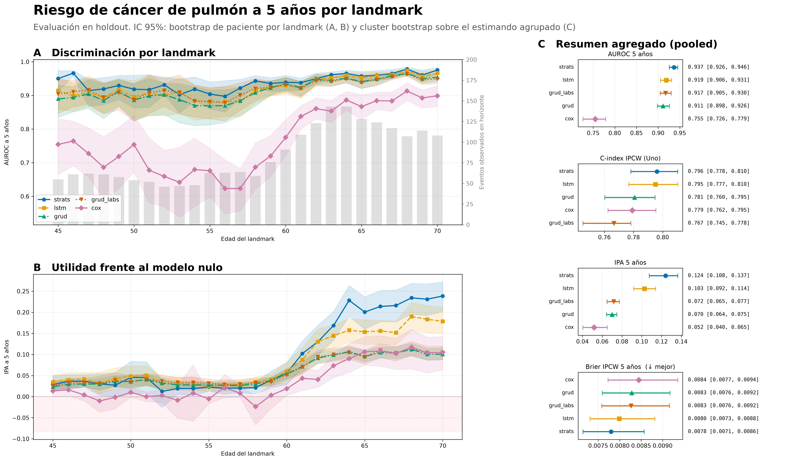

Los números que siguen describen lo que hacen los cinco modelos sobre la cohorte, sin interpretarlos. La interpretación ocupa el capítulo siguiente. Salvo donde se indique lo contrario, todas las cifras son del pool `holdout`, que no participó en el ajuste ni en la selección de modelos.

## Características de la cohorte {#sec-4-1}

La @tbl-cohorte resume la cohorte con la que se trabaja en cada split. Los tres conjuntos proceden del mismo generador y el reparto de `discovery` es estratificado por evento, de modo que la tasa de diagnóstico es casi idéntica en train y en validación (3,57 % y 3,58 %) y algo mayor en `holdout` (4,03 %), que es una población generada aparte y no una partición de la anterior.

::: {#tbl-cohorte}
| Característica                               |  train | validación | holdout |
|----------------------------------------------|-------:|-----------:|--------:|
| Pacientes                                    | 12 069 |      3 018 |  15 346 |
| Eventos observados                           |    431 |        108 |     618 |
| Tasa de evento                               | 3,57 % |     3,58 % |  4,03 % |
| Seguimiento mediano desde edad índice (años) |   49,1 |       48,5 |    49,3 |
| Edad mediana al final del seguimiento (años) |   67,1 |       66,5 |    67,3 |
| Mujeres                                      | 46,4 % |     47,3 % |  46,8 % |

: "Composición de la cohorte por split. El seguimiento se mide desde la fecha índice (18 años) y los pacientes sin evento quedan censurados."
:::

Una mediana de seguimiento de 49 años medida desde los 18 sitúa el final del seguimiento en torno a los 67 años de edad, por lo que la cohorte cubre la vida adulta completa de cada paciente y no una ventana de pocos años. La proporción de mujeres queda cerca de la mitad en los tres conjuntos, así que un desequilibrio por sexo no puede explicar las diferencias que aparezcan después.

La @fig-cohorte recoge la incidencia acumulada de diagnóstico por split, con su intervalo al 95 %, sobre la ventana de landmarks. La curva crece con la edad, `holdout` queda por encima de train y validación en toda la ventana, y el intervalo se ensancha en los cortes finales.

{#fig-cohorte width="85%"}

## Caracterización de las secuencias {#sec-4-2}

El análisis exploratorio describe los datos antes de que ningún modelo los use. Se apoya en un artefacto único que declara su procedencia, su versión de esquema y los hashes de sus entradas, y distingue tres vistas de la historia, la completa, la truncada en el corte y la muestra que consume el modelo. Esa distinción importa porque un mismo paciente aparece hasta en 26 cortes, y contar visitas sobre la muestra del modelo multiplicaría por 26 cada observación. Las cifras de este apartado salen de train.

### Lo que ve el modelo en cada corte {#sec-4-2-1}

La @fig-cobertura muestra las tres cosas que cambian con la edad del corte, cuántas muestras hay, qué proporción de ellas no tiene ninguna analítica previa y cuántas magnitudes recibe el modelo cuando hay datos. El resultado principal es que el modelo ve sobre todo diagnósticos.

El filtro de landmarks, descrito en el capítulo 3, descarta a quien no tiene ninguna observación previa al corte: de los 12 069 pacientes de train, 9 917 tienen al menos un par válido, lo que produce 202 672 filas sobre los 26 puntos de corte. De ellas, 160 233 (el 79,06 %) no tienen ni una analítica anterior al corte, y la mediana de analíticas por muestra es cero en los 26 cortes. La mediana de códigos de diagnóstico es 3 y el percentil 90 es 8.

{#fig-cobertura width="85%"}

La cobertura depende de la edad. La proporción de muestras sin analítica baja del 85,44 % en el corte de 45 años al 67,99 % en el de 70, y la mediana de instantes con registro sube de 2 a 5. Cuando el paciente sí tiene analíticas no son pocas, porque la mediana condicional es de 45 mediciones en el corte de 45 años y de 64 en el de 70. La muestra efectiva es, por tanto, una mezcla de pacientes con mucha historia y de pacientes sin ninguna, y esa mezcla cambia con el corte.

### Muestreo informativo {#sec-4-2-2}

La @fig-muestreo compara la frecuencia de medición de los pacientes según su desenlace. Para cada uno de los 9 917 pacientes del modelo se calcula la tasa de visitas con analítica por año de seguimiento, contando solo las que caen dentro de la ventana que va de los 18 años al final del seguimiento de cada paciente. La mediana es de 0,256 visitas al año en los pacientes sin evento y de 0,192 en los que lo desarrollan, con un contraste de Mann-Whitney de p = 1,1 × 10⁻²¹ y un δ de Cliff de −0,272.

{#fig-muestreo width="62%"}

### Densidad de observación {#sec-4-2-3}

La @fig-densidad reúne la carga de cada visita, la presencia de cada analítica y la intensidad por edad. En una visita se registran 8 analíticas de mediana y 9,05 de media, con un rango de 1 a 23. La presencia se mide en dos unidades que no son intercambiables. Entre el 97,3 % y el 99,8 % de los pacientes tiene alguna vez cada analítica, pero solo entre el 13,8 % y el 82,7 % de las visitas la incluye. La primera cifra dice que casi todos los pacientes acaban teniendo cada analítica en algún momento, y la segunda que en una visita concreta se mide una fracción. La intensidad por banda de edad crece con los años.

{#fig-densidad width="85%"}

### Magnitudes y normalización {#sec-4-2-4}

La @fig-magnitudes representa, para cada analítica, la distribución de los valores estandarizados que recibe el modelo, con la media en cero y la desviación en uno como referencia. Las bandas de ±5 marcan el límite a partir del cual un valor se considera extremo.

Sobre 2 143 703 valores observados, 19 de las 23 analíticas cumplen la tolerancia de media a ±0,01 de cero y desviación a ±0,01 de uno. Cuatro se salen, todas con una desviación menor del 1,5 %. Son la frecuencia respiratoria (0,972), la frecuencia cardíaca (0,986), la concentración de hemoglobina corpuscular media (media 0,017 y desviación 0,987) y los leucocitos (media −0,012). Se marcan y no se corrigen, porque el z-score se ajustó en train sobre las observaciones antes del filtrado por edad y por código, y ese orden explica la diferencia.

{#fig-magnitudes width="85%"}

## Discriminación por landmark {#sec-4-3}

La @fig-cindex muestra el C-index IPCW de Uno en `holdout` a lo largo de los 26 puntos de corte, de 45 a 70 años, con una banda de intervalo de confianza al 95 % obtenida por bootstrap de paciente en cada landmark. Los cinco modelos mejoran con la edad y ninguno lo hace de forma monótona. Los retrocesos locales aparecen en el 50 y en el 65, y el del 65 es el único que comparten los cinco.

{#fig-cindex width="90%"}

En el landmark de 45 años el C-index IPCW va de 0,730 del peor modelo a 0,760 del mejor. En el de 70 años, de 0,863 a 0,912. La tabla @tbl-cindex-anclas recoge las dos anclas de cada modelo.

::: {#tbl-cindex-anclas}
| Modelo      | Landmark 45 | Landmark 70 |
|-------------|------------:|------------:|
| `strats`    |       0,760 |       0,912 |
| `lstm`      |       0,749 |       0,908 |
| `grud`      |       0,747 |       0,876 |
| `grud_labs` |       0,730 |       0,863 |
| `cox`       |       0,743 |       0,877 |

: "C-index IPCW (Uno) en holdout en los extremos de la rejilla de landmarks."
:::

El tamaño de cada corte no depende del modelo, porque la rejilla es común, y sí cambia mucho con la edad, por ejemplo, en el landmark de 45 años hay 12 616 pacientes evaluables y 618 eventos acumulados, mientras que en el de 70 quedan 6 996 pacientes y 227 eventos. No obstante, los eventos que caen dentro del horizonte de predicción en cada landmark crecen en sentido contrario, de 55 en el horizonte a cinco años en el landmark 45 a 108 en el landmark 70, porque un paciente de 70 años tiene más probabilidad de diagnosticarse en los cinco años siguientes que uno de 45.

## Utilidad frente al modelo nulo {#sec-4-4}

El índice de precisión (IPA) y el Brier IPCW, definidos en el capítulo 3, miden si el modelo mejora la estimación de la incidencia y no solo el orden de los pacientes.

La @fig-brier muestra el error por landmark y la @fig-ipa el IPA por landmark. Dos cosas se ven en la segunda, el IPA es positivo en la mayor parte de la rejilla para los cinco modelos, y `cox` es el único que cruza el cero, con valores negativos en los landmarks 48, 49, 51, 53, 55 y 58 y un mínimo de −0,023 en el 48. Los otros cuatro se mantienen por encima de cero en toda la rejilla.

{#fig-brier width="90%"}

{#fig-ipa width="90%"}

## Resumen agregado por modelo {#sec-4-5}

La @fig-principal reúne el resultado del estudio en tres paneles: la discriminación por landmark, la utilidad frente al nulo por landmark y los cuatro estimandos agrupados con su intervalo de confianza al 95 %. La @tbl-pooled traduce el tercer panel a números.

{#fig-principal width="95%"}

::: {#tbl-pooled}
| Modelo | AUROC | C-index IPCW | IPA | Brier IPCW |
|---------------|---------------|---------------|---------------|---------------|
| **`strats`** | **0,934** \[0,922; 0,944\] | **0,804** \[0,787; 0,817\] | **0,113** \[0,102; 0,124\] | **0,0079** \[0,0073; 0,0087\] |
| `lstm` | 0,925 \[0,915; 0,936\] | 0,798 \[0,779; 0,814\] | 0,094 \[0,082; 0,106\] | 0,0081 \[0,0074; 0,0089\] |
| `grud` | 0,919 \[0,907; 0,932\] | 0,784 \[0,765; 0,797\] | 0,067 \[0,061; 0,071\] | 0,0083 \[0,0076; 0,0092\] |
| `grud_labs` | 0,902 \[0,887; 0,918\] | 0,769 \[0,748; 0,781\] | 0,072 \[0,066; 0,078\] | 0,0083 \[0,0076; 0,0092\] |
| `cox` | 0,758 \[0,729; 0,781\] | 0,779 \[0,763; 0,796\] | 0,052 \[0,040; 0,065\] | 0,0084 \[0,0077; 0,0094\] |

: "Estimandos agrupados en holdout con intervalo de confianza al 95 % por cluster bootstrap. En Brier IPCW el valor bajo es el mejor."
:::

En la @tbl-pooled aparecen remarcados los mejores valores de cada columna, que recaen todos en `strats`. Los cuatro modelos secuenciales se agrupan en discriminación y `cox` queda por detrás en AUROC, aunque su C-index IPCW supera al de `grud_labs`. Los cinco intervalos del IPA excluyen el cero, de modo que todos baten al modelo nulo, mientras que los del Brier se solapan por completo y no ordenan a los modelos: con una incidencia del 4 %, el error del modelo nulo ya es bajo y la cifra solo dice algo acompañada del IPA.

## Ablación de códigos ICD-10-CM {#sec-4-6}

Los dos GRU-D del catálogo comparten arquitectura e hiperparámetros y solo se diferencian en que `grud` recibe los códigos de diagnóstico junto a las analíticas y `grud_labs` no. La comparación entre ambos mide, por tanto, qué aporta el bloque de diagnósticos cuando todo lo demás está fijo. La @tbl-ablacion recoge las cinco métricas agrupadas en holdout.

::: {#tbl-ablacion}
| Métrica | `grud` (con códigos) | `grud_labs` (sin códigos) | Diferencia |
|------------------|------------------|------------------|------------------|
| AUROC | **0,919** \[0,907; 0,932\] | 0,902 \[0,887; 0,918\] | +0,017 |
| C-index IPCW | **0,784** \[0,765; 0,797\] | 0,769 \[0,748; 0,781\] | +0,015 |
| IPA | 0,067 \[0,061; 0,071\] | **0,072** \[0,066; 0,078\] | −0,006 |
| Brier IPCW | 0,00831 \[0,00760; 0,00920\] | **0,00826** \[0,00758; 0,00916\] | +0,00005 |

: "Ablación de los códigos de diagnóstico: mismas arquitectura e hiperparámetros, con y sin el bloque ICD-10-CM."
:::

La diferencia favorece a la variante con códigos en discriminación y no en calibración, porque gana en AUROC y en C-index IPCW, mientras que la variante sin códigos tiene un IPA algo mayor y un Brier prácticamente idéntico. Los intervalos se solapan en las cuatro métricas, de modo que ninguna diferencia es concluyente. La ganancia en discriminación es mayor en train que en holdout, un patrón compatible con una mejora pequeña y real que el tamaño del pool no permite confirmar.

## Coste computacional {#sec-4-7}

El estudio completo se ejecutó en una máquina local de ocho núcleos, sin GPU, con `snakemake --cores all`. La @tbl-coste recoge la duración de cada regla en esa ejecución.

::: {#tbl-coste}
| Regla          | Modelo      |      Duración |
|----------------|-------------|--------------:|
| `split_cohort` | —           |           8 s |
| `eda`          | —           |      1 m 59 s |
| `train`        | `grud_labs` |     28 m 24 s |
| `train`        | `cox`       |     30 m 03 s |
| `train`        | `grud`      |     30 m 49 s |
| `train`        | `lstm`      |     33 m 54 s |
| `train`        | `strats`    | 5 h 44 m 28 s |
| `eval`         | `strats`    |     31 m 04 s |
| `eval`         | `cox`       | 3 h 24 m 10 s |
| `eval`         | `lstm`      | 3 h 35 m 14 s |
| `eval`         | `grud`      | 3 h 37 m 25 s |
| `eval`         | `grud_labs` | 3 h 39 m 07 s |
| `compare`      | los cinco   |          15 s |

: "Duración de cada regla en la ejecución final. Los entrenamientos y las evaluaciones se lanzaron en paralelo, de modo que sus tiempos se solapan y no son aditivos."
:::

