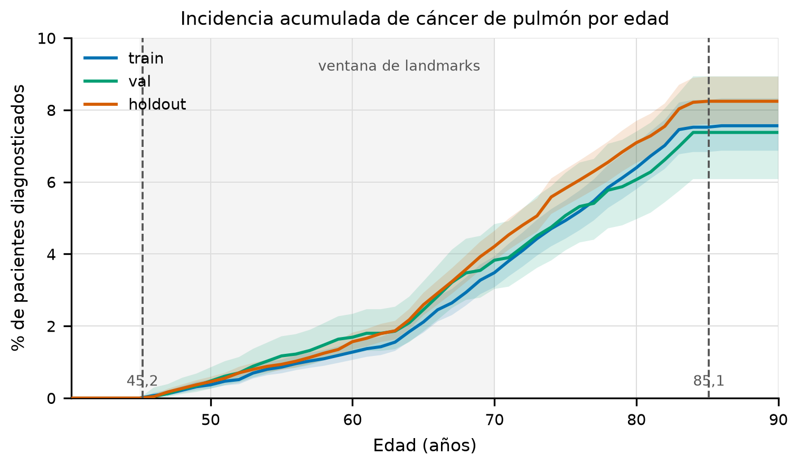
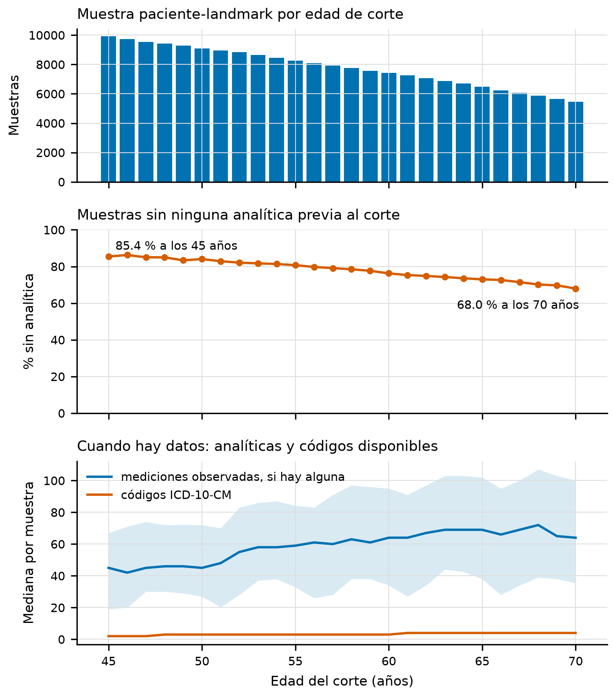
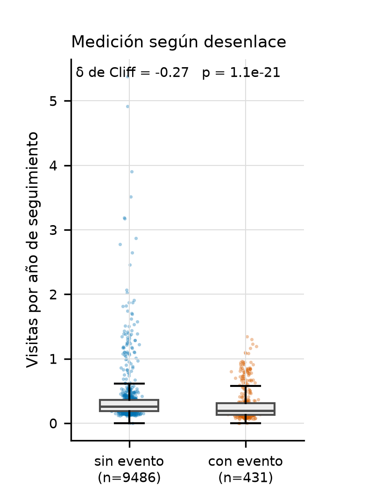
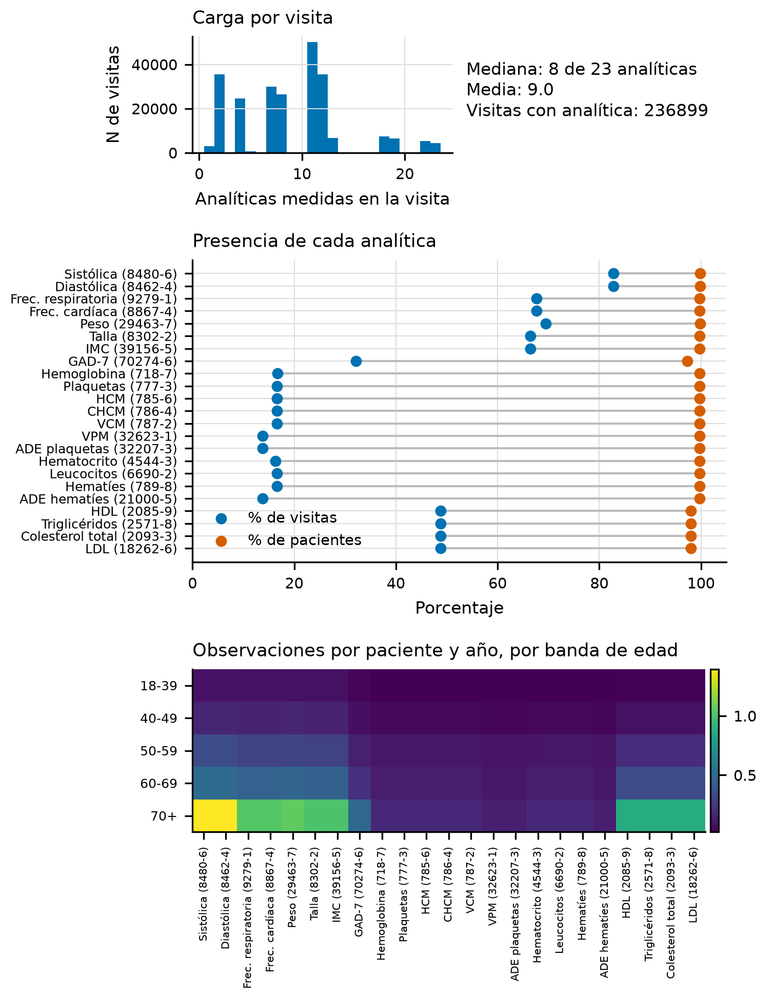
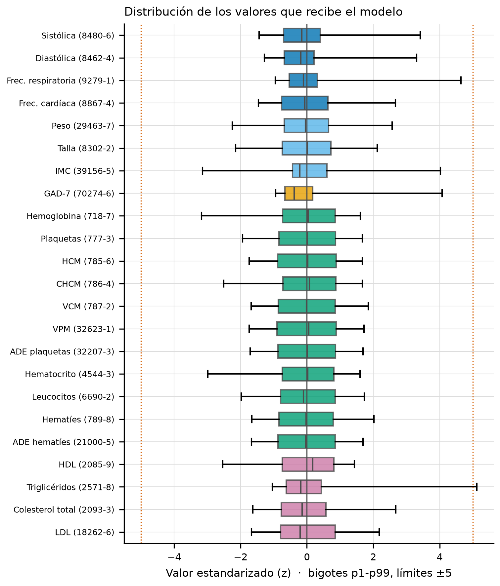
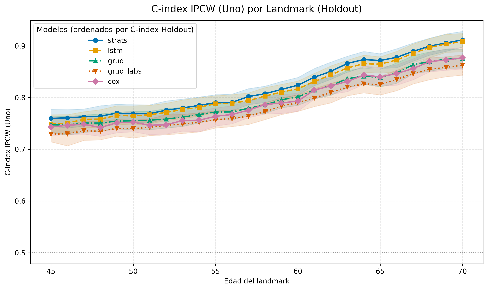
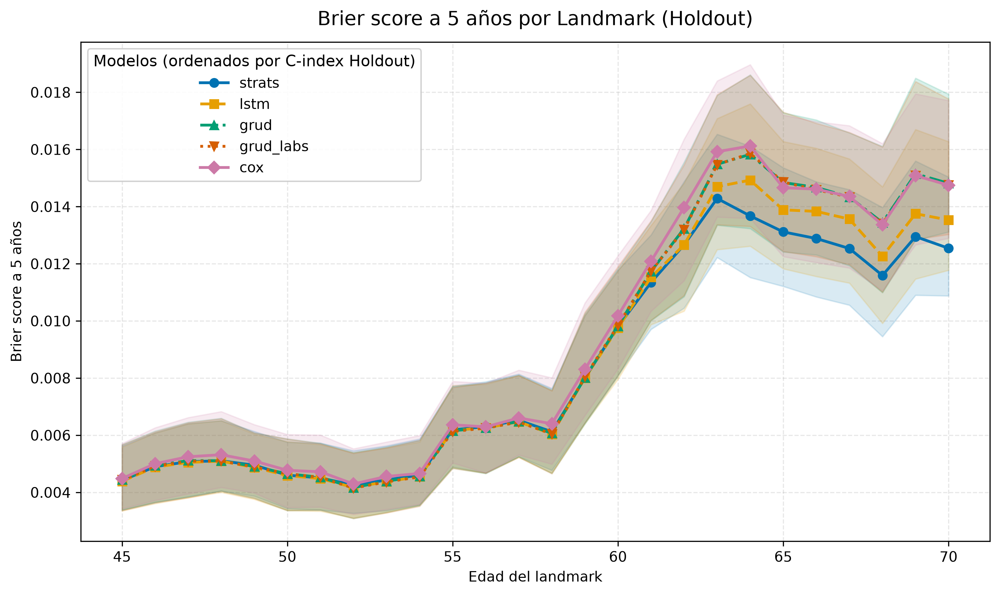
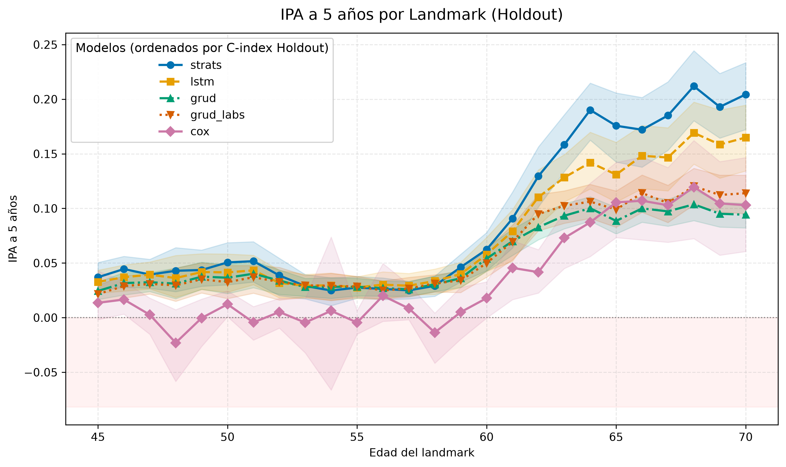

Este capítulo presenta los resultados de los cinco modelos sobre la cohorte, sin interpretarlos; la interpretación se aborda en el capítulo siguiente. Salvo donde se indique lo contrario, todas las cifras son del pool `holdout`, que no participó en el ajuste ni en la selección de modelos.

## Características de la cohorte {#sec-4-1}

La @tbl-cohorte resume la cohorte con la que se trabaja en cada split. Los tres conjuntos proceden del mismo generador y el reparto de `discovery` es estratificado por evento, de modo que la tasa de diagnóstico es casi idéntica en train y en validación (3,57 % y 3,58 %) y ligeramente superior en `holdout` (4,03 %), que es una población generada aparte y no una partición de la anterior.

::: {#tbl-cohorte}
| Característica                               |  train | validación | holdout |
|----------------------------------------------|-------:|-----------:|--------:|
| Pacientes                                    | 12 069 |      3 018 |  15 346 |
| Eventos observados                           |    431 |        108 |     618 |
| Tasa de evento                               | 3,57 % |     3,58 % |  4,03 % |
| Seguimiento mediano desde edad índice (años) |   49,1 |       48,5 |    49,3 |
| Edad mediana al final del seguimiento (años) |   67,1 |       66,5 |    67,3 |
| Mujeres                                      | 46,4 % |     47,3 % |  46,8 % |

: "Composición de la cohorte por split. El seguimiento se mide desde la fecha índice (18 años) y los pacientes sin evento quedan censurados."
:::

Una mediana de seguimiento de 49 años medida desde los 18 sitúa el final del seguimiento en torno a los 67 años de edad, por lo que la cohorte cubre la vida adulta completa de cada paciente y no una ventana de pocos años. La proporción de mujeres queda cerca de la mitad en los tres conjuntos, por lo que un desequilibrio por sexo no puede explicar las diferencias que se observan después.

La @fig-cohorte recoge la incidencia acumulada de diagnóstico por split, con su intervalo al 95 %, sobre la ventana de landmarks. La curva crece con la edad, `holdout` queda por encima de train y validación en toda la ventana, y el intervalo se ensancha en los cortes finales.

{#fig-cohorte width="75%"}


## Caracterización de las secuencias {#sec-4-2}

El análisis exploratorio describe los datos antes de que ningún modelo los use. Se apoya en un artefacto único que declara su procedencia, su versión de esquema y los hashes de sus entradas, y distingue tres vistas de la historia, la completa, la truncada en el corte y la muestra que consume el modelo. Esa distinción importa porque un mismo paciente aparece hasta en 26 cortes, y contar visitas sobre la muestra del modelo multiplicaría hasta por 26 cada observación. Las cifras de este apartado proceden de train.

### Lo que ve el modelo en cada corte {#sec-4-2-1}

La @fig-cobertura muestra tres magnitudes que varían con la edad del corte: el número de muestras, la proporción de ellas sin ninguna analítica previa y el número de magnitudes que recibe el modelo cuando hay datos. El resultado principal es que la información que recibe el modelo consiste sobre todo en diagnósticos.

El filtro de landmarks, descrito en el capítulo 3, descarta las muestras cuyo seguimiento ha terminado antes del corte. Una muestra sin ninguna observación previa no se descarta, sino que entra con un único paso vacío en la edad del corte. De los 12 069 pacientes de train, 9 917 tienen al menos un par válido, lo que produce 202 672 filas sobre los 26 puntos de corte. De ellas, 160 233 (el 79,06 %) no tienen ninguna analítica anterior al corte, y la mediana de analíticas por muestra es cero en los 26 cortes. La mediana de códigos de diagnóstico es 3 y el percentil 90 es 8.

La cobertura depende de la edad. La proporción de muestras sin analítica baja del 85,44 % en el corte de 45 años al 67,99 % en el de 70, y la mediana de instantes con registro sube de 2 a 5. Cuando el paciente tiene analíticas, su número es elevado: la mediana condicional es de 45 mediciones en el corte de 45 años y de 64 en el de 70. La muestra efectiva es, por tanto, una mezcla de pacientes con mucha historia y de pacientes sin ninguna, y esa mezcla cambia con el corte.

### Muestreo informativo {#sec-4-2-2}

La @fig-muestreo compara la frecuencia de medición de los pacientes según su desenlace. Para cada uno de los 9 917 pacientes del modelo se calcula la tasa de visitas con analítica por año de seguimiento, contando solo las que caen dentro de la ventana que va de los 18 años al final del seguimiento de cada paciente. La mediana es de 0,256 visitas al año en los pacientes sin evento y de 0,192 en los que lo desarrollan, con un contraste de Mann-Whitney de p = 1,1 × 10⁻²¹ y un δ de Cliff de −0,272.

::: {#fig-eda-cobertura layout-ncol=2}
{#fig-cobertura}

{#fig-muestreo}

Cobertura longitudinal por punto de corte de landmark (a) y contraste de la tasa de visitas con analítica según el desenlace clínico (b).
:::

### Densidad de observación {#sec-4-2-3}

La @fig-densidad reúne la carga de cada visita, la presencia de cada analítica y la intensidad por edad. En una visita se registran 8 analíticas de mediana y 9,05 de media, con un rango de 1 a 23. La presencia se mide en dos unidades que no son intercambiables. Entre el 97,3 % y el 99,8 % de los pacientes tiene alguna vez cada analítica, pero solo entre el 13,8 % y el 82,7 % de las visitas la incluye. La primera cifra indica que casi todos los pacientes tienen cada analítica en algún momento, y la segunda, que en cada visita solo se mide una fracción de ellas. La intensidad por banda de edad crece con los años.

### Magnitudes y normalización {#sec-4-2-4}

La @fig-magnitudes representa, para cada analítica, la distribución de los valores estandarizados que recibe el modelo, con la media en cero y la desviación en uno como referencia. Las bandas de ±5 marcan el límite a partir del cual un valor se considera extremo.

Sobre 2 143 703 valores observados, 19 de las 23 analíticas cumplen la tolerancia de media a ±0,01 de cero y desviación a ±0,01 de uno. Cuatro quedan fuera de ella, todas por menos de tres centésimas. Son la frecuencia respiratoria (0,972), la frecuencia cardíaca (0,986), la concentración de hemoglobina corpuscular media (media 0,017 y desviación 0,987) y los leucocitos (media −0,012). Se marcan y no se corrigen, porque el z-score se ajustó en train sobre las observaciones antes del filtrado por edad y por código, y ese orden explica la diferencia.

::: {#fig-eda-mediciones layout-ncol=2}
{#fig-densidad}

{#fig-magnitudes}

Densidad de observación longitudinal de analíticas clínicas (a) y control de distribución estandarizada tras normalización (b).
:::


## Discriminación por landmark {#sec-4-3}

La @fig-cindex muestra el C-index IPCW de Uno en `holdout` a lo largo de los 26 puntos de corte, de 45 a 70 años, con una banda de intervalo de confianza al 95 % obtenida por bootstrap de paciente en cada landmark. Los cinco modelos mejoran con la edad y ninguno lo hace de forma monótona. El retroceso del 65 es el único que comparten los cinco, y el del 50 aparece en tres de ellos.

{#fig-cindex width="75%"}

En el landmark de 45 años el C-index IPCW va de 0,728 del peor modelo a 0,750 del mejor. En el de 70 años, de 0,863 a 0,909. La @tbl-cindex-anclas recoge los dos valores extremos de cada modelo.

::: {#tbl-cindex-anclas}
| Modelo      | Landmark 45 | Landmark 70 |
|-------------|------------:|------------:|
| `strats`    |       0,750 |       0,909 |
| `lstm`      |       0,745 |       0,908 |
| `grud`      |       0,738 |       0,876 |
| `grud_labs` |       0,728 |       0,863 |
| `cox`       |       0,746 |       0,878 |

: "C-index IPCW (Uno) en holdout en los extremos de la rejilla de landmarks."
:::

El tamaño de cada corte no depende del modelo, porque la rejilla es común, pero varía mucho con la edad: en el landmark de 45 años hay 12 616 pacientes evaluables y 618 eventos acumulados, mientras que en el de 70 quedan 6 996 pacientes y 227 eventos. No obstante, los eventos dentro del horizonte de predicción de cada landmark crecen en sentido contrario, de 55 en el horizonte a cinco años en el landmark 45 a 108 en el landmark 70, porque un paciente de 70 años tiene más probabilidad de diagnosticarse en los cinco años siguientes que uno de 45.


## Utilidad frente al modelo nulo {#sec-4-4}

El índice de precisión (IPA) y el Brier IPCW, definidos en el capítulo 3, miden si el modelo mejora la estimación de la incidencia y no solo el orden de los pacientes.

La @fig-brier muestra el error por landmark y la @fig-ipa el IPA por landmark. La segunda muestra dos resultados: el IPA es positivo en la mayor parte de la rejilla para los cinco modelos, y `cox` es el único que cruza el cero, con valores negativos en los landmarks 48, 49, 53, 55 y 58 y un mínimo de −0,024 en el 58. Los otros cuatro se mantienen por encima de cero en toda la rejilla.

::: {#fig-utilidad layout-ncol=2}
{#fig-brier}

{#fig-ipa}

Calibración mediante Brier IPCW (a) y utilidad clínica frente al modelo nulo mediante IPA (b) a lo largo de la rejilla de landmarks.
:::


## Resumen agregado por modelo {#sec-4-5}

La @fig-principal reúne el resultado del estudio en tres paneles: la discriminación por landmark, la utilidad frente al nulo por landmark y los cuatro estimandos agrupados con su intervalo de confianza al 95 %. La @tbl-pooled traduce el tercer panel a números.

```{=typst}
// Figura girada 90 grados en una página vertical propia, como lscape en LaTeX.
#pagebreak(weak: true)
#align(center + horizon)[#rotate(-90deg, reflow: true)[#block(width: 22.5cm)[
```

![Riesgo de cáncer de pulmón a cinco años por landmark en holdout. (A) AUROC dependiente del tiempo a cinco años en cada uno de los 26 landmarks, con su intervalo de confianza al 95 % por bootstrap de paciente en bandas. Las barras grises, en el eje derecho, son los eventos observados dentro del horizonte en cada corte, que pasan de 55 en el de 45 años a un máximo de 143 hacia los 63 y 64. (B) IPA a cinco años por landmark, con el mismo intervalo. La zona sombreada por debajo de cero marca predicciones peores que la incidencia basal sin covariables. (C) Estimandos agrupados sobre los 26 cortes (AUROC, C-index IPCW de Uno, IPA y Brier IPCW), con intervalo al 95 % por cluster bootstrap, que remuestrea cada paciente con todas sus filas de todos los cortes. En el Brier el valor bajo es el mejor. Los intervalos son marginales de cada modelo, así que el solapamiento entre dos de ellos no equivale a una comparación emparejada (apartado 4.8).](images/figure_main.png){#fig-principal width="100%" fig-scap="Riesgo de cáncer de pulmón a cinco años por landmark en holdout."}

```{=typst}
]]]
#pagebreak()
```

::: {#tbl-pooled}
| Modelo | AUROC | C-index IPCW | IPA | Brier IPCW |
|---------------|---------------|---------------|---------------|---------------|
| **`strats`** | **0,937** `#linebreak()`{=typst}\[0,926; 0,946\] | **0,796** `#linebreak()`{=typst}\[0,778; 0,810\] | **0,124** `#linebreak()`{=typst}\[0,108; 0,137\] | **0,0078** `#linebreak()`{=typst}\[0,0071; 0,0086\] |
| `lstm` | 0,919 `#linebreak()`{=typst}\[0,906; 0,931\] | 0,795 `#linebreak()`{=typst}\[0,777; 0,810\] | 0,103 `#linebreak()`{=typst}\[0,092; 0,114\] | 0,0080 `#linebreak()`{=typst}\[0,0073; 0,0088\] |
| `grud` | 0,911 `#linebreak()`{=typst}\[0,898; 0,926\] | 0,781 `#linebreak()`{=typst}\[0,760; 0,795\] | 0,070 `#linebreak()`{=typst}\[0,064; 0,075\] | 0,0083 `#linebreak()`{=typst}\[0,0076; 0,0092\] |
| `grud_labs` | 0,917 `#linebreak()`{=typst}\[0,905; 0,930\] | 0,767 `#linebreak()`{=typst}\[0,745; 0,778\] | 0,072 `#linebreak()`{=typst}\[0,065; 0,077\] | 0,0083 `#linebreak()`{=typst}\[0,0076; 0,0092\] |
| `cox` | 0,755 `#linebreak()`{=typst}\[0,726; 0,779\] | 0,779 `#linebreak()`{=typst}\[0,762; 0,795\] | 0,052 `#linebreak()`{=typst}\[0,040; 0,065\] | 0,0084 `#linebreak()`{=typst}\[0,0077; 0,0094\] |

: "Estimandos agrupados en holdout de la ejecución principal, con intervalo de confianza al 95 % por cluster bootstrap. En Brier IPCW el valor bajo es el mejor."
:::

En la @tbl-pooled aparecen remarcados los mejores valores de cada columna, que recaen todos en `strats`. Los cuatro modelos secuenciales se agrupan en discriminación y `cox` queda por detrás en AUROC, aunque su C-index IPCW supera al de `grud_labs`. Los cinco intervalos del IPA excluyen el cero, de modo que todos superan al modelo nulo, mientras que los del Brier se solapan por completo y no ordenan a los modelos: con una incidencia a cinco años que no llega al 2 % en ningún corte, el error del modelo nulo ya es bajo y la cifra solo es informativa junto al IPA.

Estas cifras corresponden a la ejecución principal, la réplica 0 del apartado 3.5.4. Sus intervalos son marginales, y el solapamiento de dos de ellos no indica si la diferencia entre los modelos es significativa. El apartado 4.8 mide cuánto cambian las cifras con otras particiones y semillas y compara los modelos de forma emparejada.


## Ablación de códigos ICD-10-CM {#sec-4-6}

Los dos GRU-D del catálogo comparten arquitectura e hiperparámetros y solo se diferencian en que `grud` recibe los códigos de diagnóstico junto a las analíticas y `grud_labs` no. Como los instantes con diagnóstico siguen en la secuencia de las dos variantes, la comparación mide qué aporta la identidad de los códigos cuando todo lo demás está fijo, no qué aportan los diagnósticos. La @tbl-ablacion recoge las cuatro métricas agrupadas en holdout.

::: {#tbl-ablacion}
| Métrica | `grud` (con códigos) | `grud_labs` (sin códigos) | Diferencia |
|------------------|------------------|------------------|------------------|
| AUROC | 0,911 `#linebreak()`{=typst}\[0,898; 0,926\] | **0,917** `#linebreak()`{=typst}\[0,905; 0,930\] | −0,006 |
| C-index IPCW | **0,781** `#linebreak()`{=typst}\[0,760; 0,795\] | 0,767 `#linebreak()`{=typst}\[0,745; 0,778\] | +0,014 |
| IPA | 0,070 `#linebreak()`{=typst}\[0,064; 0,075\] | **0,072** `#linebreak()`{=typst}\[0,065; 0,077\] | −0,002 |
| Brier IPCW | 0,00828 `#linebreak()`{=typst}\[0,00760; 0,00917\] | **0,00827** `#linebreak()`{=typst}\[0,00758; 0,00916\] | +0,00001 |

: "Ablación de los códigos de diagnóstico: mismas arquitectura e hiperparámetros, con y sin el bloque ICD-10-CM. La diferencia es `grud` menos `grud_labs`; en Brier IPCW un valor positivo favorece a `grud_labs`."
:::

En la ejecución principal, la variante con códigos gana en C-index IPCW, y la variante sin códigos tiene un AUROC y un IPA ligeramente mayores, con un Brier prácticamente idéntico. Los intervalos marginales se solapan en las cuatro métricas. La ganancia en C-index IPCW es algo mayor en train (0,795 frente a 0,778) que en holdout, un patrón compatible con un ligero sobreajuste del bloque de códigos. La comparación emparejada sobre las once réplicas (apartado 4.8) muestra que solo la ventaja en C-index IPCW es significativa.


## Coste computacional {#sec-4-7}

El estudio se ejecutó completo en un servidor de 64 núcleos sin GPU, con 60 asignados a Snakemake y un número fijo de hilos por trabajo, cuatro en cada entrenamiento y uno en cada evaluación. La ejecución reúne 173 trabajos, los de la ejecución principal y los de las diez réplicas de los cinco modelos, y tardó 3 h 27 min de reloj, mientras que la suma de las duraciones de todos los trabajos es de 48,8 horas. La @tbl-coste recoge la duración de cada regla en la ejecución principal.

::: {#tbl-coste}
| Regla             | Modelo o split           |        Duración |
|-------------------|--------------------------|----------------:|
| `split_cohort`    | no aplica                |             1 s |
| `fit_lab_stats`   | no aplica                |            15 s |
| `build_sequences` | train                    |     2 min 05 s |
| `build_sequences` | validación               |            49 s |
| `build_sequences` | `holdout`                |     2 min 36 s |
| `eda`             | no aplica                |            17 s |
| `train`           | `cox`                    |     4 min 41 s |
| `train`           | `grud`                   |     5 min 29 s |
| `train`           | `lstm`                   |     5 min 57 s |
| `train`           | `grud_labs`              |    10 min 37 s |
| `train`           | `strats`                 | 1 h 49 min 31 s |
| `eval`            | `cox`                    |    20 min 03 s |
| `eval`            | `lstm`                   |    20 min 41 s |
| `eval`            | `grud`                   |    20 min 55 s |
| `eval`            | `grud_labs`              |    20 min 59 s |
| `eval`            | `strats`                 |    29 min 25 s |
| `compare`         | los cinco                |             4 s |
| `paired`          | las 55 ejecuciones       |     3 min 59 s |

: "Duración de cada regla de la ejecución principal y de la comparación emparejada, en un servidor de 64 núcleos. Los trabajos se lanzaron en paralelo con los de las réplicas, de modo que sus tiempos se solapan y no son aditivos."
:::

El entrenamiento de `strats` marca la duración total. Es entre diez y veinte veces más largo que el de los modelos recurrentes, y los once entrenamientos del transformer, en paralelo, ocupan la mayor parte de la ejecución. Las evaluaciones duran entre 20 y 30 minutos, casi todo en el bootstrap, que es un bucle de un solo hilo, y la de `strats` es algo más larga porque su inferencia es más costosa. Una ejecución anterior en una máquina de ocho núcleos, sin límite de hilos por trabajo, tardó más de seis horas solo con la ejecución principal, y las evaluaciones que coincidieron en el tiempo llegaron a durar más de tres horas cada una por la contención de la CPU. Fijar los hilos de cada trabajo importa, por tanto, tanto como el número de núcleos.


## Variabilidad entre réplicas y comparación emparejada {#sec-4-8}

La @tbl-semillas resume las once ejecuciones de cada modelo descritas en el apartado 3.5.4, cada una con su partición de `discovery` y su semilla, con la media, la desviación típica y el rango de los estimandos agrupados en `holdout`. El Brier IPCW no aparece porque, con el mismo modelo nulo, ordena las ejecuciones igual que el IPA.

::: {#tbl-semillas}
| Modelo | AUROC | C-index IPCW | IPA |
|---------------|---------------|---------------|---------------|
| `strats` | 0,936 ± 0,004 `#linebreak()`{=typst}\[0,930; 0,942\] | 0,796 ± 0,004 `#linebreak()`{=typst}\[0,787; 0,801\] | 0,117 ± 0,010 `#linebreak()`{=typst}\[0,095; 0,135\] |
| `lstm` | 0,921 ± 0,005 `#linebreak()`{=typst}\[0,913; 0,929\] | 0,795 ± 0,003 `#linebreak()`{=typst}\[0,791; 0,799\] | 0,092 ± 0,007 `#linebreak()`{=typst}\[0,085; 0,103\] |
| `grud` | 0,917 ± 0,006 `#linebreak()`{=typst}\[0,911; 0,928\] | 0,780 ± 0,007 `#linebreak()`{=typst}\[0,767; 0,790\] | 0,072 ± 0,003 `#linebreak()`{=typst}\[0,067; 0,077\] |
| `grud_labs` | 0,916 ± 0,007 `#linebreak()`{=typst}\[0,899; 0,924\] | 0,767 ± 0,001 `#linebreak()`{=typst}\[0,765; 0,769\] | 0,072 ± 0,003 `#linebreak()`{=typst}\[0,067; 0,076\] |
| `cox` | 0,752 ± 0,005 `#linebreak()`{=typst}\[0,745; 0,759\] | 0,778 ± 0,002 `#linebreak()`{=typst}\[0,774; 0,780\] | 0,047 ± 0,002 `#linebreak()`{=typst}\[0,046; 0,052\] |

: "Estimandos agrupados en holdout sobre once ejecuciones por modelo, la principal y diez réplicas con otra partición y otra semilla: media ± desviación típica y, entre corchetes, mínimo y máximo. Los corchetes no son intervalos de confianza."
:::

La ejecución principal es una de las once, y sus cifras quedan dentro de ese rango. La mayor distancia a la media es la del IPA de `lstm`, que en la ejecución principal es el máximo de sus réplicas (0,103 frente a 0,092 de media).

La variación entre réplicas no es despreciable. En los cuatro modelos secuenciales, la desviación típica entre réplicas vale entre 1,05 y 1,46 veces el error estándar del bootstrap en IPA y entre 0,70 y 0,99 veces en AUROC, de modo que cambiar la partición y la semilla mueve esas cifras tanto como cambiar la muestra de evaluación. En C-index IPCW la proporción queda entre 0,14 y 0,83. En `cox` no pasa de 0,41 en ninguna métrica, porque su pérdida es convexa en los coeficientes y la semilla apenas cambia la solución, de modo que su variación procede casi solo de la partición.

::: {#tbl-pareadas}
| Comparación | AUROC | C-index IPCW | IPA |
|---------------|---------------|---------------|---------------|
| `strats` − `lstm` | **+0,015** `#linebreak()`{=typst}\[+0,001; +0,026\] | +0,000 `#linebreak()`{=typst}\[−0,013; +0,013\] | **+0,025** `#linebreak()`{=typst}\[+0,008; +0,048\] |
| `strats` − `grud` | **+0,018** `#linebreak()`{=typst}\[+0,003; +0,033\] | +0,016 `#linebreak()`{=typst}\[−0,005; +0,036\] | **+0,045** `#linebreak()`{=typst}\[+0,023; +0,064\] |
| `strats` − `grud_labs` | **+0,019** `#linebreak()`{=typst}\[+0,008; +0,036\] | **+0,029** `#linebreak()`{=typst}\[+0,013; +0,042\] | **+0,045** `#linebreak()`{=typst}\[+0,021; +0,065\] |
| `strats` − `cox` | **+0,184** `#linebreak()`{=typst}\[+0,162; +0,212\] | **+0,018** `#linebreak()`{=typst}\[+0,005; +0,029\] | **+0,070** `#linebreak()`{=typst}\[+0,047; +0,096\] |
| `lstm` − `grud` | +0,003 `#linebreak()`{=typst}\[−0,012; +0,013\] | **+0,016** `#linebreak()`{=typst}\[+0,004; +0,030\] | **+0,020** `#linebreak()`{=typst}\[+0,005; +0,037\] |
| `lstm` − `grud_labs` | +0,004 `#linebreak()`{=typst}\[−0,007; +0,033\] | **+0,028** `#linebreak()`{=typst}\[+0,018; +0,039\] | **+0,020** `#linebreak()`{=typst}\[+0,008; +0,036\] |
| `lstm` − `cox` | **+0,169** `#linebreak()`{=typst}\[+0,145; +0,198\] | **+0,018** `#linebreak()`{=typst}\[+0,008; +0,026\] | **+0,045** `#linebreak()`{=typst}\[+0,027; +0,062\] |
| `grud` − `grud_labs` | +0,001 `#linebreak()`{=typst}\[−0,010; +0,028\] | **+0,013** `#linebreak()`{=typst}\[+0,001; +0,027\] | +0,000 `#linebreak()`{=typst}\[−0,006; +0,008\] |
| `grud` − `cox` | **+0,166** `#linebreak()`{=typst}\[+0,139; +0,196\] | +0,002 `#linebreak()`{=typst}\[−0,011; +0,015\] | **+0,025** `#linebreak()`{=typst}\[+0,012; +0,037\] |
| `grud_labs` − `cox` | **+0,164** `#linebreak()`{=typst}\[+0,144; +0,194\] | −0,011 `#linebreak()`{=typst}\[−0,025; +0,003\] | **+0,025** `#linebreak()`{=typst}\[+0,012; +0,039\] |

: "Diferencias emparejadas entre modelos en holdout: media de las diferencias en las once réplicas y, entre corchetes, intervalo al 95 % por bootstrap de dos niveles (réplica y paciente). Un valor positivo favorece al primer modelo de la fila. En negrita, los intervalos que excluyen el cero."
:::

La @tbl-pareadas recoge las diferencias emparejadas. `strats` supera a cada uno de los otros cuatro modelos en AUROC y en IPA, con intervalos que excluyen el cero, y lo hace en las once réplicas. Frente a `lstm`, la ventaja es de 0,015 en AUROC y de 0,025 en IPA, mientras que en C-index IPCW los dos empatan. `lstm` supera a los dos GRU-D en C-index IPCW y en IPA, pero no en AUROC, y los tres modelos recurrentes no se distinguen entre sí en discriminación a cinco años. Todos los secuenciales superan a `cox` en AUROC, entre 0,16 y 0,18, y en IPA, mientras que en C-index IPCW solo `strats` y `lstm` lo superan y los dos GRU-D no se distinguen de él.

Los intervalos emparejados son mucho más estrechos que los marginales de la @tbl-pooled. La diferencia entre dos modelos evaluados sobre los mismos pacientes elimina el ruido de la muestra que comparten, y por eso diferencias de una o dos centésimas que los intervalos marginales no separan resultan significativas aquí.

La ablación de los códigos queda así. `grud` supera a `grud_labs` en C-index IPCW en las once réplicas, con una diferencia de 0,013 cuyo intervalo apenas excluye el cero, y no se distingue de él en AUROC ni en IPA.

Las ejecuciones, por último, son reproducibles. Todas fijan su semilla, la principal incluida, y con un número fijo de hilos el entrenamiento es determinista. En una repetición completa desde cero, las réplicas de `cox`, `lstm`, `grud` y `grud_labs` dieron las mismas cifras hasta la precisión de la máquina, y las de `strats` difirieron en menos de $2 \times 10^{-5}$ de AUROC, porque esa repetición cambió el número de hilos del transformer y, con él, el orden de las sumas en coma flotante. Cualquier cifra de este capítulo puede, por tanto, regenerarse desde la configuración.
