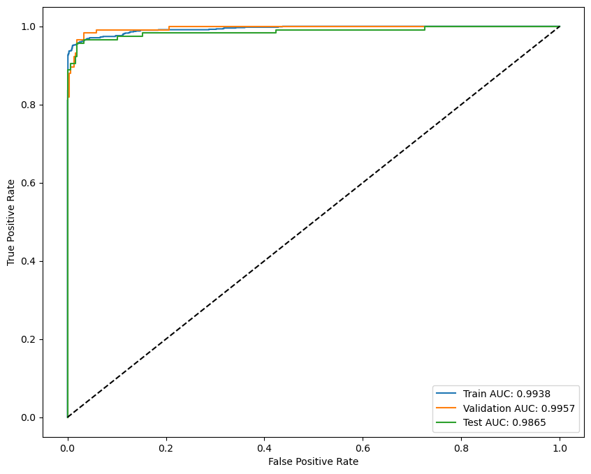
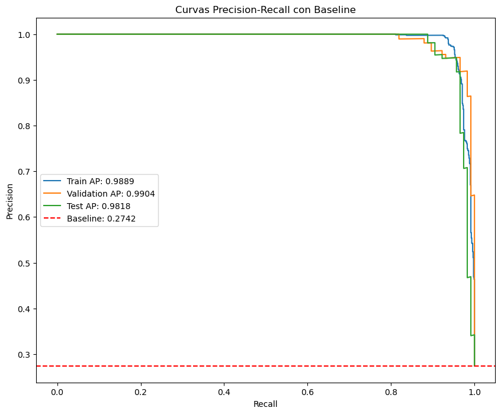
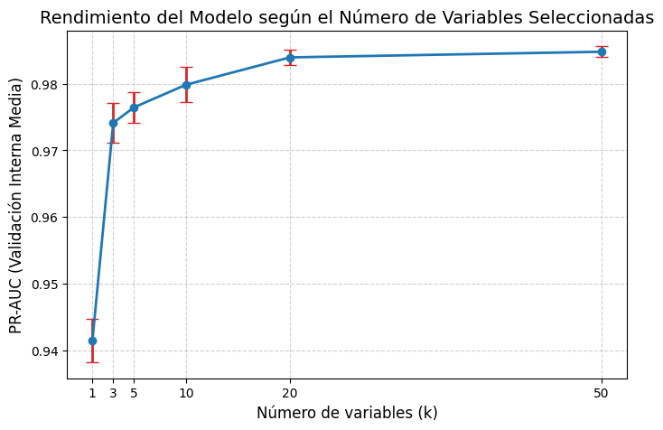
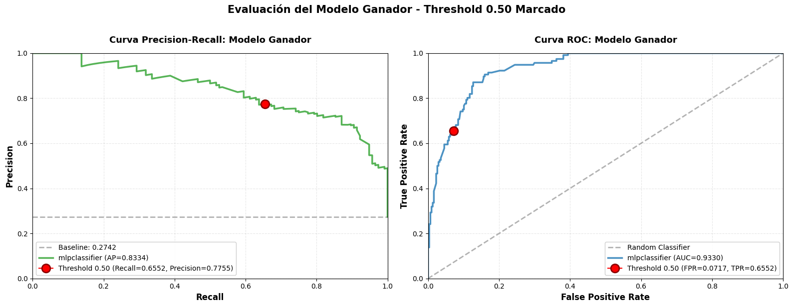
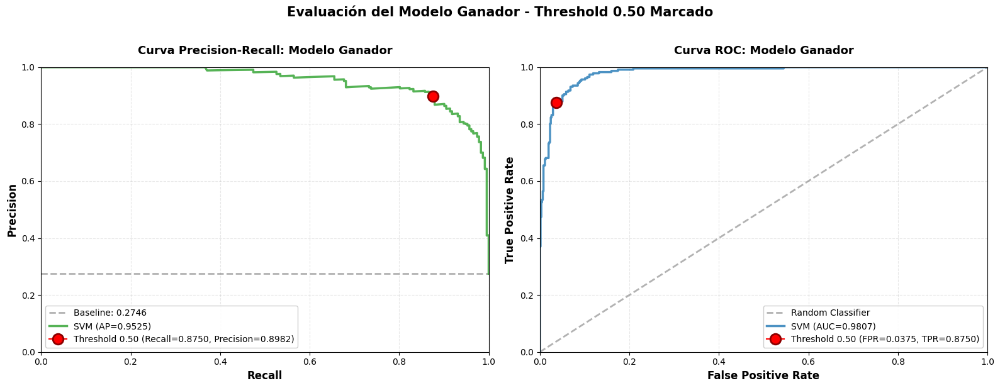
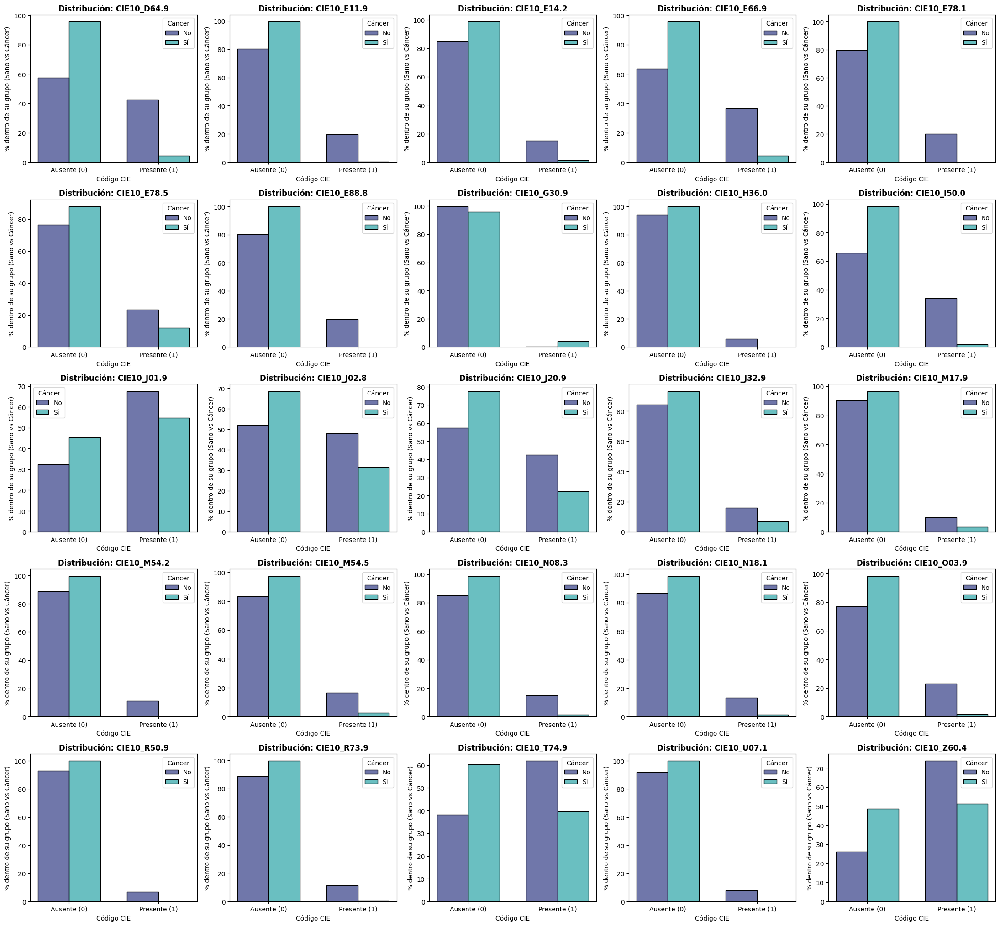
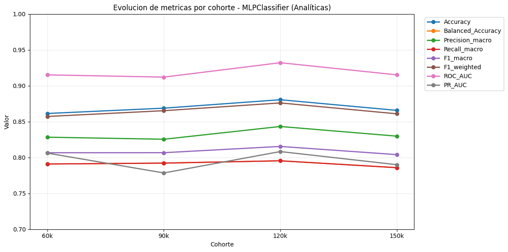

Este apéndice describe la fase inicial del proyecto, concebida como la reproducción y evaluación crítica del estudio de referencia de Chen y Chen [@chen2022simulation]. En dicho trabajo se aborda la predicción del cáncer de pulmón como un problema de clasificación estático y transversal sobre datos sintéticos generados con *Synthea*. Aunque la memoria principal ya expone en detalle la procedencia general de la cohorte y su estructura longitudinal, resulta imprescindible documentar este experimento previo: su análisis demostró que el planteamiento estático sobre estos datos constituía un experimento vacío o nulo (*null experiment*), pues los patrones aprendidos por los clasificadores respondían a una severa fuga de información (*data leakage*) y a la forma en que el generador sintetizó las muestras, motivando el cambio metodológico radical hacia el modelado temporal y de supervivencia que articula esta memoria.

## Planteamiento inicial y reproducción del modelo estático

En el enfoque propuesto por Chen y Chen, el historial clínico de cada paciente se reduce a una única fila en una tabla agregada con 765 variables que resumen diagnósticos, procedimientos, fármacos y analíticas observados hasta el momento del corte transversal. No existe, por tanto, una dimensión temporal dinámica ni una formulación de tiempo hasta el evento.

Para evaluar este enfoque, se construyó un pipeline de aprendizaje automático convencional en Python empleando *scikit-learn*:

```python
from sklearn.compose import make_column_selector, ColumnTransformer
from sklearn.pipeline import Pipeline
from sklearn.preprocessing import OrdinalEncoder, StandardScaler
from sklearn.feature_selection import SelectKBest
from sklearn.impute import SimpleImputer
from sklearn.linear_model import LogisticRegressionCV

cat_pipeline = Pipeline([
    ("codif", OrdinalEncoder(handle_unknown='use_encoded_value', unknown_value=-1)),
    ("imputer", SimpleImputer(strategy="constant", fill_value=0.0, keep_empty_features=True)),
])

num_pipeline = Pipeline([
    ("imputer", SimpleImputer(strategy="constant", fill_value=0.0, keep_empty_features=True)),
    ("scaler", StandardScaler())
])

preprocesamiento = ColumnTransformer([
    ("cat", cat_pipeline, make_column_selector(dtype_include="object")),
    ("num", num_pipeline, make_column_selector(dtype_exclude="object"))
], remainder=SimpleImputer(strategy="constant", fill_value=0.0), verbose_feature_names_out=False)

seleccion = Pipeline([
    ("preprocesamiento", preprocesamiento),
    ("50mejores", SelectKBest(k=50)),
])

regresor = Pipeline([
    ("seleccion", seleccion),
    ("logistic_regression", LogisticRegressionCV(max_iter=1000, n_jobs=-1, scoring="recall", cv=5, random_state=625)),
])
```

Al evaluar este modelo de regresión logística sobre el conjunto de prueba, se obtuvieron unas métricas de rendimiento excepcionalmente altas (@tbl-clasification-report), acompañadas de curvas ROC y de precisión-exhaustividad prácticamente perfectas (@fig-evaluacion).

::: {#tbl-clasification-report}
| Exactitud | Sensibilidad |   F1 |  AUC  |
|:---------:|:------------:|:----:|:-----:|
| 0,97      | 0,95         | 0,97 | 0,986 |

: "Informe de clasificación del modelo logístico en el pipeline estático inicial."
:::

::: {#fig-evaluacion layout-ncol="2"}
{#fig-roc}

{#fig-nueva-grafica}

Curvas de rendimiento diagnóstico del modelo de regresión logística sobre el corte estático.
:::

Para examinar la estabilidad de estos resultados y determinar cuántas variables eran realmente necesarias para sostener dicho rendimiento, se llevó a cabo un protocolo de validación cruzada anidada (*Nested Cross-Validation*). En el bucle externo (5 particiones estratificadas) se evaluó la generalización, mientras que en el interno (otras 5 particiones) se exploró el espacio de hiperparámetros mediante `GridSearchCV`, variando el número de características seleccionadas ($k \in \{1, 3, 5, 10, 20, 50\}$) y el parámetro de regularización $C$, con el área bajo la curva PR (PR-AUC) como función objetivo. Como ilustra la @fig-nested-cv, el modelo alcanzaba una saturación casi completa con apenas 5 o 10 variables predictoras.

{#fig-nested-cv width="60%"}

## Detección de fuga de información (*Data Leakage*)

Alcanzar un área bajo la curva ROC de 0,986 y un F1 de 0,97 en un problema de cribado general precoz de cáncer de pulmón resulta inverosímil desde el punto de vista clínico. Estos valores suscitaron la hipótesis inmediata de que el conjunto de datos contenía una grave fuga de información (*data leakage*): variables predictoras que no preceden a la enfermedad como factores de riesgo, sino que son consecuencia directa de que el paciente ya ha sido diagnosticado o se encuentra bajo tratamiento oncológico.

La inspección detallada de las 765 variables confirmó esta sospecha. Se identificaron múltiples columnas que delataban explícitamente el estado de cáncer avanzado (@tbl-reveladoras-cancer), tales como `C-88040-1` (*Response to cancer treatment*), `C-59557-9` (*Treatment status Cancer*), `C-21908-9` (*Stage group.clinical Cancer*), procedimientos de quimioterapia y radioterapia, citostáticos específicos (carboplatino, paclitaxel, docetaxel) o intervenciones quirúrgicas invasivas como trasplantes pulmonares. La inclusión de estas variables explicaba la aparente omnisciencia del modelo.

::: {#tbl-reveladoras-cancer}
| Código | Descripción clínica |
|:---|:---|
| C-33756-8 | Polyp size greatest dimension by CAP cancer protocols |
| C-88040-1 | Response to cancer treatment |
| C-59557-9 | Treatment status Cancer |
| C-21908-9 | Stage group.clinical Cancer |
| C-85318-4 | HER2 [Presence] in Breast cancer specimen by FISH |
| C-85319-2 | HER2 [Presence] in Breast cancer specimen by Immune stain |
| C-85337-4 | Estrogen receptor Ag [Presence] in Breast cancer specimen by Immune stain |
| C-85339-0 | Progesterone receptor Ag [Presence] in Breast cancer specimen by Immune stain |
| C-21924-6 | Tumor marker Cancer |
| C-367336001 | Chemotherapy (procedure) |
| C-703423002 | Combined chemotherapy and radiation therapy |
| C-108290001 | Radiation oncology AND/OR radiotherapy |
| C-385798007 | Radiation therapy care |
| C-597195 | Carboplatin 10 MG/ML Injectable Solution |
| C-583214 | Paclitaxel 100 MG Injection |
| C-1860480 | DOCEtaxel 20 MG/ML Injection |
| C-1734919 | Cyclophosphamide 1000 MG Injection |
| C-429609002 | Lung volume reduction surgery |
| C-88039007 | Transplant of lung |
| C-232657004 | Lung Transplant |
| scc | Squamous Cell Carcinoma Antigen |

: "Variables y marcadores clínicos reveladores de estado oncológico eliminados para corregir la fuga evidente de información."
:::

## Ingeniería de características médicas sobre ontologías clínicas

Con el propósito de subsanar esta deficiencia y evaluar si era factible construir un clasificador estático legítimo y reproducible, se eliminaron todas las variables reveladoras y se rediseñó el espacio de características apoyándose en las ontologías biomédicas estándar que codifican los datos:

1. **Diagnósticos y procedimientos (SNOMED-CT y CIE-10):** Codificados originalmente en SNOMED-CT [@snomed_es]. Para reducir la excesiva granularidad y mitigar la dispersión, se planificó agrupar conceptos por sus relaciones jerárquicas de ancestros. Debido a que las limitaciones de tasa de peticiones en la API pública de SNOMED International [@snomed_browser] impedían procesar las consultas ECL necesarias de forma masiva, se optó por desplegar localmente un servidor terminológico **Snowstorm** mediante contenedores Docker, importando e indexando íntegramente la *International Edition* con aproximadamente 526 000 conceptos activos. Mediante este servicio se extrajeron los ancestros ontológicos:
   - Los diagnósticos (*disorder* y *finding*) se redujeron de 178 variables a 90 categorías consolidadas tras eliminar atributos con más del 99 % de nulos.
   - Los procedimientos (*procedure* y *therapy*) pasaron de 186 a 123 variables.
   - Adicionalmente, se utilizó el mapeo oficial de SNOMED a la Clasificación Internacional de Enfermedades (CIE-10 [@cie10]), reduciendo el espacio de diagnósticos a unas 150 categorías con amplia interpretabilidad clínica.

2. **Medicamentos (RxNorm a ATC):** Originalmente en RxNorm [@rxnorm], cuya granularidad llega al nivel de presentación y principio activo individual (más de 200 variables). Se realizó una correspondencia cruzada hacia la clasificación Anatómica, Terapéutica y Química (ATC) de la OMS [@atc] en su nivel 2 (@tbl-mapeo-medicamentos). Esta agrupación redujo los fármacos a 43 variables que agrupan los principios activos por sistema orgánico y propiedad terapéutica (por ejemplo, antibacterianos sistémicos `J01`).

::: {#tbl-mapeo-medicamentos}
| RxNorm | Nombre RxNorm | ATC nivel 5 | ATC nivel 2 | Nombre ATC nivel 2 |
|:------:|:-------------|:-----------:|:-----------:|:-------------------|
| 562251 | Amoxicillin 250 MG / Clavulanate 125 MG Oral Tablet | J01CR02 | J01 | Antibacterianos para uso sistémico |

: "Ejemplo de mapeo jerárquico de principios activos de RxNorm a grupos terapéuticos ATC nivel 2."
:::

3. **Pruebas de laboratorio (LOINC):** Estandarizadas bajo la nomenclatura LOINC [@loinc], seleccionando las mediciones analíticas más frecuentes para su procesamiento numérico.

## Persistencia del sesgo: el experimento nulo

Tras aplicar esta rigurosa ingeniería ontológica y haber depurado las variables explícitamente reveladoras, se entrenó un modelo gradient boosting (*XGBoost*) para comprobar si el rendimiento se normalizaba en rangos clínicamente realistas.

El resultado, sin embargo, volvió a ser inverosímil: el modelo alcanzó nuevamente métricas casi perfectas con un F1 de 0,99 (@tbl-metricas_ing_medicaas-test). Al analizar la importancia de variables calculada por el modelo (@tbl-top5-variables-importantes), la variable más determinante resultó ser la preparación de frotis citopatológico, acompañada por la edad y marcadores como la hipertrigliceridemia o el sodio. La citopatología actuaba de nuevo como un indicador indirecto de sospecha tumoral avanzada.

::: {#tbl-metricas_ing_medicaas-test}
| Modelo | F1 | Precisión | Sensibilidad |
|:-------|:--:|:---------:|:------------:|
| **XGBoost** | 0,99 | 0,99 | 0,99 |

: "Métricas en el conjunto de test del modelo XGBoost tras la ingeniería ontológica completa."
:::

::: {#tbl-top5-variables-importantes}
| Posición | Variable | Descripción clínica |
|:--------:|:---------|:--------------------|
| 1 | Cytopathology procedure preparation of smear | Preparación de frotis para citopatología |
| 2 | `age` | Edad cronológica |
| 3 | Sodium | Concentración de sodio |
| 4 | Hypertriglyceridemia (disorder) | Hipertrigliceridemia diagnosticada |
| 5 | Urine screening for glucose | Cribado de glucosa en orina |

: "Cinco variables más influyentes en el modelo XGBoost tras la ingeniería ontológica."
:::

### Modelo exclusivo de variables de laboratorio

Ante la persistencia de sesgos en los códigos diagnósticos y procedimientos, se formuló una hipótesis adicional: evaluar si prescindiendo de toda codificación médica externa y utilizando **exclusivamente analíticas de laboratorio continuas (LOINC)** era posible capturar una señal biológica real sin contaminación diagnóstica.

Se preprocesaron las analíticas separando magnitudes continuas (imputadas a cero y estandarizadas) y categóricas. Se optimizaron cuatro familias algorítmicas mediante validación cruzada estratificada de 5 particiones con métrica `f1_weighted`: Random Forest (36 configuraciones), SVM (16 configuraciones), XGBoost y redes neuronales densas (*MLPClassifier*).

El mejor rendimiento en test lo obtuvo el perceptrón multicapa (*MLPClassifier*, @tbl-metricas-lab-test y @fig-pr-roc-lab), alcanzando un F1 de 0,71 y un ROC-AUC de 0,933. Si bien estas cifras resultaban superficialmente más "plausibles" que las de los modelos previos, seguían reflejando un poder discriminante extraordinario a partir de un conjunto muy básico de analíticas generales.

::: {#tbl-metricas-lab-test}
| Modelo | F1 | Precisión | Sensibilidad | ROC-AUC | PR-AUC |
|:-------|:--:|:---------:|:------------:|:-------:|:------:|
| **MLPClassifier** | 0,7100 | 0,7800 | 0,6600 | 0,9330 | 0,8334 |

: "Métricas en el conjunto de test del modelo basado exclusivamente en variables de laboratorio LOINC."
:::

{#fig-pr-roc-lab width="100%"}

### Modelo con diagnósticos CIE-10 y hallazgo del sesgo de síntesis

De forma complementaria, se evaluó un clasificador restringido únicamente a las ~150 variables de diagnóstico mapeadas a CIE-10 (reduciendo a las 25 características principales tras selección). La optimización arrojó un modelo SVM con métricas nuevamente exorbitantes (F1 de 0,88 y ROC-AUC de 0,981, @tbl-metricas-cie10-test y @fig-pr-roc-cie).

::: {#tbl-metricas-cie10-test}
| Modelo | F1 | Precisión | Sensibilidad | ROC-AUC | PR-AUC |
|:-------|:--:|:---------:|:------------:|:-------:|:------:|
| **SVM** | 0,8800 | 0,8900 | 0,8800 | 0,9807 | 0,9525 |

: "Métricas en el conjunto de test del modelo basado exclusivamente en diagnósticos CIE-10."
:::

{#fig-pr-roc-cie width="100%"}

La explicación definitiva de este fenómeno se descubrió al realizar un contraste de distribuciones entre pacientes sanos y pacientes con cáncer de pulmón (@fig-comparativa-distr-cie). Al modelar la prevalencia de cada diagnóstico como una variable de Bernoulli $X_i \sim \text{Be}(p_i)$, se constató que prácticamente **todas** las variables diagnósticas exhibían diferencias estadísticas acusadas y artificialmente consistentes entre ambos grupos. Asimismo, cuando el modelo de laboratorio se evaluó en cohortes sintéticas independientes sin reentrenar (@fig-evaluacion-nuevas-cohortes), su comportamiento mostró una gran disparidad.

::: {#fig-comparativa-distr-cie-box}
{#fig-comparativa-distr-cie width="100%"}
:::

::: {#fig-evaluacion-nuevas-cohortes-box}
{#fig-evaluacion-nuevas-cohortes width="100%"}
:::

La causa de este comportamiento no residía en un patrón fisiológico de predicción temprana, sino en el **método de síntesis de los datos**: al sintetizar el conjunto de datos de Chen y Chen a partir de Synthea, los registros de los pacientes con cáncer de pulmón se generaron a través de trayectorias sintéticas que presentaban frecuencias de utilización del sistema sanitario, prescripciones y analíticas radicalmente distintas a las de la población control. El clasificador no predecía el riesgo biológico a futuro, sino la firma estadística artificial producida por el propio generador sintético.

## Conclusión: Del experimento nulo a la formulación longitudinal

La reproducción experimental del estudio de referencia arrojó una conclusión rotunda: **se trataba de un experimento vacío**. Ningún refinamiento algorítmico, regularización matemática o selección de variables sobre ese corte transversal podía corregir el hecho de que el problema estaba mal formulado:
1. Había una fuga masiva de información derivada de diagnósticos y tratamientos tardíos.
2. La agregación estática colapsaba el tiempo clínico, mezclando eventos que ocurrieron años antes con pruebas realizadas días previos al diagnóstico.
3. El proceso de síntesis separaba artificialmente las cohortes de casos y controles en casi todos sus descriptores.

Este hallazgo justificó abandonar por completo la vía de la clasificación estática y replantear el Trabajo Fin de Máster desde sus bases metodológicas:
- Abandonar los cortes transversales agregados y trabajar directamente sobre **historias clínicas electrónicas sintéticas longitudinales** completas, preservando cada visita con su fecha exacta.
- Imponer un protocolo formal de **landmarking**, fijando instantes prospectivos de predicción basados en la edad (de 45 a 70 años) y evaluando únicamente la información acumulada *antes* de dicho hito.
- Tratar la censura y el tiempo hasta el evento mediante **análisis de supervivencia** formal y verosimilitud parcial de Cox con horizonte a 5 años, eliminando el sesgo de selección de casos y controles.
- Emplear arquitecturas diseñadas para **series temporales clínicas irregulares** (LSTM, GRU-D y transformers STraTS), cuya comparación rigurosa sobre este protocolo temporal limpio constituye el cuerpo central de la presente memoria.

