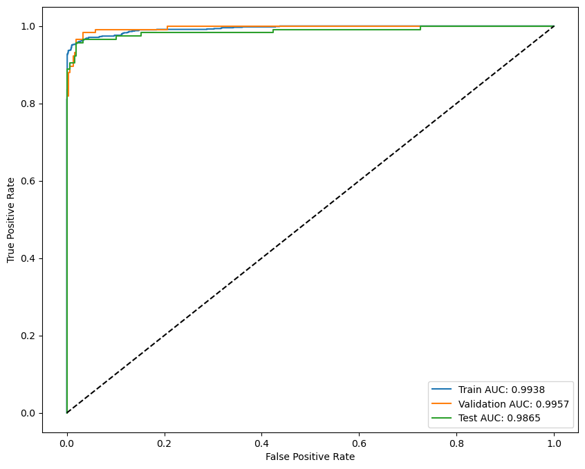
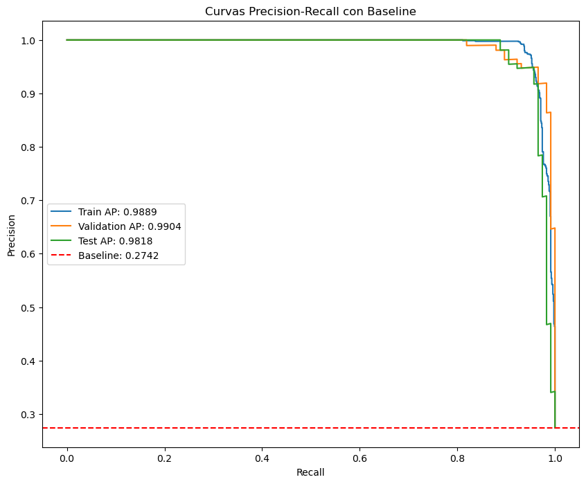

Este primer capítulo aborda un cribado general con el objetivo de predecir indicios de cáncer de pulmón. Se trata de un estudio estático, con una base de datos puntual, es decir, no se implementarán modelos longitudinales en el tiempo, sino un corte transversal en el historial médico de los pacientes en el preciso momento de la toma de datos.

## Presentación de los datos

Se introduce el conjunto de datos que se utilizará para este primer capítulo. Los datos provienen de la plataforma de datos sintéticos *Synthea*, y usaremos como referencia el estudio realizado en el artículo [@chen2022simulation].

Como un primer aproach, realizaremos un preprocesamiento básico de los datos, imputando NAs y estandarizando las variables numéricas para el correcto funcionamiento de los algoritmos de aprendizaje automático. Para ello, creamos el siguiente pipeline de preprocesamiento y planteamiento de un modelo de regresión logística:

```{python}
from sklearn.compose import make_column_selector, ColumnTransformer
from sklearn.pipeline import Pipeline
from sklearn.preprocessing import OrdinalEncoder, StandardScaler
from sklearn.feature_selection import SelectKBest
from sklearn.impute import SimpleImputer


cat_pipeline = Pipeline([
    ("codif", OrdinalEncoder(handle_unknown='use_encoded_value', unknown_value=-1)),
    ("imputer",SimpleImputer(strategy="constant", fill_value=0.0,keep_empty_features=True)),
])

num_pipeline = Pipeline([
    ("imputer",SimpleImputer(strategy="constant", fill_value=0.0,keep_empty_features=True)),
    ("scaler", StandardScaler())
])

preprocesamiento = ColumnTransformer([
    ("cat", cat_pipeline, make_column_selector(dtype_include="object")),
    ("num", num_pipeline,make_column_selector(dtype_exclude="object"))
], remainder=(SimpleImputer(strategy="constant", fill_value=0.0)), verbose_feature_names_out=False)

seleccion = Pipeline([
    ("preprocesamiento", preprocesamiento),
    ("50mejores", SelectKBest(k=50)),
])

regresor = Pipeline([
    ("seleccion", seleccion),
    ("logistic_regression", LogisticRegressionCV(max_iter=1000, n_jobs=-1,scoring="recall", cv=5,random_state=625)),
])

```

Este pipeline obtiene un rendimiento excelente en el conjunto de test:

::: {#tbl-clasification-report}
| Accuracy | Recall |   F1 |  AUC  |
|----------|:-------|-----:|:-----:|
| 0.97     | 0.95   | 0.97 | 0.986 |

: "Reporte de clasificación del modelo logístico con pipeline inicial."
:::

Y unas curvas ROC y PR:

::: {#fig-evaluacion layout-ncol="2"}
{#fig-roc}

{#fig-nueva-grafica}

Curvas de evaluación del modelo logístico.
:::



## Ingeniería de características médicas

En este apartado, vamos a adentrarnos en los sistemas de nomenclatura médicos estándar usados para la codificación de las variables del dataset. En primer lugar, se debe acceder al repositorio github del artículo y extraer la codificación de las variables. Se observan que todas las variables, excepto tres, empiezan con el prefijo "C-" y luego un número identificativo cuya nomenclatura dependerá del tipo de variable médico.

Principalmente, en el análisis de datos médicos solemos encontranos con cuatro tipos de variables:

-   **Diagnósticos:** Se refiere al registro médico de enfermedades, signos o síntomas padecidos por el paciente a lo largo de su historia clínica. En nuestros datos, estas dolencias suelen mapearse utilizando **SNOMED-CT**[@snomed_es].

-   **Procedimientos:** Pruebas analíticas, estudios por imagen o intervenciones quirúrgicas solicitadas por el equipo médico a un paciente para la prevención, detección o tratamiento de diagnósticos y riesgos subyacentes. También se usa para estos el sistema SNOMED-CT.

-   **Medicamentos:** Comprende el historial de fármacos y principios activos prescritos, dispensados o administrados al paciente con fines terapéuticos o paliativos. Se mapean mediante el vocabulario **RxNorm** [@rxnorm]

-   **Resultados de laboratorio:** Consiste en mediciones de laboratorio o evaluaciones fisiológicas (por ejemplo, analíticas de sangre o valores de presión). Estos resultados sirven como indicadores del estado biológico del modelo. En el dataset siguen la nomenclatura **LOINC** [@loinc].

A continuación, declararemos el plan de ejecución según el sistema de nomenclatura para realizar una extracción de características adecuado al objetivo de nuestro análisis.

### Atributos reveladores de cáncer de pulmón

El alto rendimiento del primer pipeline básico implementado anteriormente hace sospechar acerca de un problema de *data leakage* en el dataset inicial. Probablemente, entre las 765 variables predictoras de las que disponemos existan algunas de ellas que constituyan marcadores tumorales que pueden estar influyendo de manera crucial en el modelo pero que, sin embargo, no son marcadores habituales en la población general sino muestras de que un paciente ya está en altas sospechas o confirmación del tumor.

A simple vista, podemos detectar variables sospechosas como: `C-88040-1`: *Response to cancer treatment* o `C-59557-9`: *Treatment status Cancer*, que son marcadores tumorales del estado oncológico del paciente. Además, de estas variables evidentes, buscaremos en el análisis anterior las variables más extrañamente relevantes.

Los resultados de esta revisión se encuentran en el apendice

### Diagnósticos y procedimientos

Para la estandarización de este tipo de variables, se emplea SNOMED-CT (*Systematized Nomenclature of Medicine – Clinical Terms*). Tal y como indica el Ministerio de Sanidad español [@snomed_es], se trata de la terminología clínica de mayor amplitud y precisión a nivel global, cuyo propósito es permitir a los profesionales sanitarios codificar y comunicar información clínica de forma adecuada e inequívoca.

Las variables del dataset ya siguen esta nomenclatura, sin embargo, aprovecharemos la estructura jerárquica de SNOMED para elaborar agrupaciones ontológicas y conseguir de esta manera reducir la granularidad de la base de datos inicial.

#### Despliegue SNOMED Browser local

Inicialmente, se trató de interactuar con la API pública de SNOMED International [@snomed_browser] con consultas ECL con el objetivo de poder extraer la estructura de padres e hijos de un cierto diagnóstico. Por ejemplo, tener *anemia* (con código SNOMED 271737000), se situa en la estructura de SNOMED como descendiente de *trastorno de componente celular sanguíneo* (414022008), que a su vez es descendiente de *hallazgo relacionado con el sistema inmunitario, la sangre y los linfáticos* (299691001). Y todo esto es accesible mediante la consulta ECL: `>> 271737000 |anemia|`.

No obstante, durante este intento surgieron limitaciones debido al gran número de consultas que se debía realizar. Para superar estas limitaciones, se optó por desplegar una infraestructura propia de servidor terminológico. Se seleccionó **Snowstorm**, la implementación de referencia de código abierto mantenida por SNOMED International y se realizó mediante contenedorización con **Docker.**

La carga de la ontología médica se realizó mediante la importación de archivos *International Edition* de SNOMED CT, debido a que esta era la versión usada en nuestras variables iniciales. Se completó la indexación de conceptos con aproximadamente 526000 conceptos activos , relaciones y descripciones.

#### Extracción de ancestros

En este punto, se realiza el reconocimiento de los códigos SNOMED de las variables y las consultas de ancestros de estos códigos para su agrupación por ontología médica. La metodología seguida fue la siguiente:

-   Los diagnósticos, divididos en *disorder* y *finding* en la nomenclatura SNOMED se sometieron al proceso de análisis de ancestros con la heurística de agrupar unicamente las enfermedades poco frecuentes en nuestros datos. Además, se eliminaron las variables con más de un 99% de los registros nulos. El resultado obtenido fue: de las 178 variables iniciales de *disorder* y *finding* se redujo hasta unas 90 variables más generales.

-   Los procedimientos, comprendidos en SNOMED por las categorías *procedure* y también *therapy* fueron sometidos al mismo proceso, teniendo en este caso como resultado la reducción del número de variables de 186 a 123.

-   El resto es una mezcla de variables sociodemográficas, situaciones sociales o atributos relevantes no incluidos en los grupos anteriores. Este grupo aporta 14 variables.

### Medicamentos

Originalmente aparecen codificados en RxNorm. Desarrollado por la Biblioteca Nacional de Medicina de EE. UU. (NLM), esta es una nomenclatura terminológica que normaliza los nombres de los medicamentos clínicos y presentan una granularidad profunda (una variable por principio activo). [@rxnorm]

Nuestro objetivo fue reducir la granularidad y agrupar medicamentos por zona y efecto. Para ello, realizamos un mapeo de RxNorm a ATC. La nomenclatura RxNorm está pensada para logística y prescripción, por lo que su alta especifidad es innecesaria para un análisis estadístico y puede llegar a generar demasiado ruido. El sistema ATC (Anatomical Therapeutic Chemical) es mantenido por la Organización Mundial de la Salud (OMS) [@atc]. A diferencia de RxNorm, que se centra en el principio activo y la receta exacta, el ATC organiza los fármacos según dónde actuan y qué hacen. Además, la codificación ATC presenta niveles de especifidad del 1 al 5 siendo el nivel 5 el nivel más específico (principio activo) y el 1 la zona del cuerpo a la que afectan, por lo que nos permite escoger el nivel de granularidad que deseemos.

En este caso, se realizó el mapeo de los principios activos de RxNorm a ATC nivel 5 y después se generalizó, agrupando con códigos ATC nivel 2. A continuación se muestra el ejemplo:

::: {#tbl-mapeo-medicamentos}
| RxNorm | Nombre RxNorm | ATC nivel 5 | ATC nivel 2 | Nombre ATC nivel 2 |
|---------------|---------------|---------------|---------------|---------------|
| 562251 | Amoxicillin 250 MG / Clavulanate 125 MG Oral Tablet | J01CR02 | J01 | Antibacterianos para uso sistémico |

: "Ejemplo de mapeo de RxNorm a ATC nivel 2."
:::

Finalmente, se redujo en número de medicamentos de 200 principios activos iniciales a 43 variables interpretables y con sentido clínico para nuestro análisis.

## Resultados de laboratorio

Estas variables están codificadas según la nomenclatura LOINC, que es el estándar internacional para la identificación de mediciones de salud, observaciones clínicas y documentos [@loinc].

De todas las incluidas originalmente, haremos una selección de las más comunes