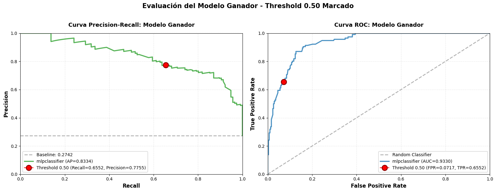
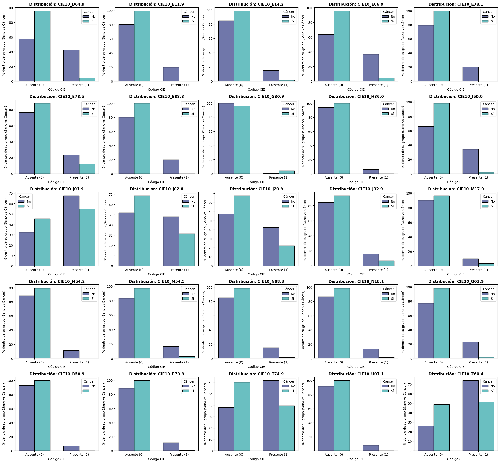
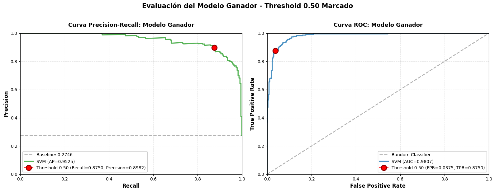

En este capítulo se detallan los resultados obtenidos en los distintos experimentos realizados a partir de diferentes procesamientos y configuraciones del dataset inicial. Destacamos tres modelos principales:

- Modelo con todas las variables tras ingeniería de características: Tras el preprocesamiento de los distintos conjuntos de datos (diagnósticos clínicos, procedimientos, histórico de medicamentos y pruebas de laboratorio) y el posterior entrenamiento y evaluación de diversos algoritmos de *Machine Learning*. 

- Modelo solo con variables de diagnósticos mapeadas a CIE-10: Tras realizar un mapeo de los diagnósticos clínicos a la nomenclatura CIE-10, se entrenaron y evaluaron los mismos algoritmos para comparar su rendimiento con el modelo anterior.

- Modelo solo con variables de analíticas de laboratorio: Se entrenaron y evaluaron los mismos algoritmos utilizando únicamente las variables relacionadas con las pruebas de laboratorio, para evaluar su capacidad predictiva en comparación con los modelos anteriores.

El objetivo principal de esta fase experimental ha sido encontrar el modelo más preciso y robusto, tratando de evitar los resultados inverosímiles que se obtuvieron en el modelo inicial.

## Modelo tras ingeniería de características.

Se realizó el preprocesamiento de variables médicas descritasen el primer capítulo. En primer lugar, se eliminaron variables reveladoras de cáncer de pulmón y no adecuadas para un cribado general. Posteriormente, se agruparon las variables de diagnóstico y procedimientos usando la extracción y agrupación por ancestros de SNOMED CT. En cuanto a los medicamentos, se realizó un mapeo a la nomenclatura ATC y se agruparon por nivel 2. Finalmente, se seleccionaron las variables de laboratorio más comunes.

Se entrenó un algoritmo *XGBoost* con hiperparámetros por defecto. El rendimiento de este nuevo modelo fue, de nuevo, totalmente ficticio, con métricas extremedamente altas (F1-Score > 0.99).

::: {#tbl-metricas_ing_medicaas-test}
| Modelo            | F1-Score | Precision | Recall |
|:------------------|:--------:|:---------:|:------:|
| **XGBoost**       |  0.99  |  0.99   | 0.99 |

: "Métricas de evaluación en modelo tras ingeniería de características completo en conjunto de test."
:::

Se analizaron las variables más importantes para el modelo, siendo la edad, género, algunas patologías como la anemia o procedimientos como la citopatología las más relevantes.

::: {#tbl-top5-variables-importantes}
| Rank | Variable |
|:----:|:---------|
| 1 | Cytopathology procedure preparation of smear |
| 2 | age |
| 3 | Sodium |
| 4 | Hypertriglyceridemia (disorder) |
| 5 | Urine screening for glucose |

: "Top 5 variables más importantes del modelo tras ingeniería de características."
:::

## Modelo solo con variables de laboratorio.

Se seleccionaros solo variables relacionadas con las pruebas de laboratorio comunes. La lista de variables está compuesta por características numéricas y categóricas, por lo que previamente al preprocesamiento se realizó una separación de estas variables. Las variables numéricas fueron imputadas con con valor constante cero. Posteriormente, se codificaron las variables categóricas y se escalaron las variables.

Por último, se realizó la busqueda de hiperparámetros para los algoritmos *Random Forest*, *SVM*, *XGBoost* y *MLPClassifier*.

### Metodología y Búsqueda de Hiperparámetros (Tuning)

Previo a la evaluación final, se ejecutó un proceso sistemático para optimizar los hiperparámetros de diferentes familias de algoritmos y determinar su configuración con mayor capacidad predictiva. Esta validación se realizó aplicando validación cruzada estratificada con 5 particiones (5-Fold Cross-Validation), empleando como métrica de optimización principal el `f1_weighted`. Elegir esta métrica asegura un buen balance penalizando correctamente predicciones desproporcionadas entre clases.

Se evaluaron e iteraron combinaciones para cuatro tipos de modelos:

-   **Random Forest**: Se evaluaron 36 combinaciones ajustando el número de árboles estimadores, la profundidad máxima, el mínimo de muestras para la partición y la selección de características.
-   **SVM (Máquinas de Vectores de Soporte)**: Se evaluaron 16 combinaciones explorando el parámetro de regularización matemática C, tipos de kernel y su grado.
-   **XGBoost (Extreme Gradient Boosting)**: Las pruebas abarcaron alteraciones sobre la ratio de aprendizaje (*learning rate*), reguladores de penalización L1 (`reg_alpha`) y L2 (`reg_lambda`), profundidad de los árboles y porcentajes de submuestreo.
-   **MLPClassifier (Red Neuronal Multicapa)**: Dos combinaciones con topología predefinida y variaciones en la tasa de aprendizaje adaptativa.

### Rendimiento en el Conjunto de Test

A las las métricas críticas evaluadas (F1-score, Precision y Recall) fueron añadidas nuevas métricas sobre las probabilidades del modelo, como el Área bajo la Curva Operativa del Receptor (ROC-AUC) y el Área Bajo la Curva de Precisión Exhaustiva (PR-AUC). El mejor modelo resultante de esta fase fue el **MLPClassifier**.

::: {#tbl-metricas-lab-test}
| Modelo            | F1-Score | Precision | Recall | ROC-AUC | PR-AUC |
|:------------------|:--------:|:---------:|:------:|:-------:|:------:|
| **MLPClassifier** |  0.7100  |  0.7800   | 0.6600 | 0.9330  | 0.8334 |

: "Métricas de evaluación en conjunto de test del modelo con variables de laboratorio."
:::

Los resultados confirmaron que el modelo basado únicamente en variables de laboratorio tiene un rendimiento significativamente inferior al modelo completo, aunque sigue mostrando una capacidad predictiva razonable teniendo en cuenta que estás tomando solo unas pocas variables muy generales. No obstante, estos resultados son mucho más realistas y plausibles que los obtenidos en el modelo completo.

{width="100%"}

## Modelo solo con variables de CIE-10 diagnósticos.

Se realizó un mapeo de los diagnósticos clínicos a la nomenclatura CIE-10, lo que permitió reducir el número de variables y se entrenó un modelo solo con estas variables. Se redujo  el número de variables de unas 450 de SNOMED CT a unas 150 de CIE-10.

El modelo está compuesto por un preprocesamiento de las variables de diagnóstico (imputación y codificación) seguido de una selección de características para la reducción a las 25 variables más importantes. Posteriormente, se realizó búsqueda de hiperparámetros para los algoritmos *Random Forest*, *SVM*, *XGBoost* y *MLPClassifier*.

### Análisis explaratorio de variables

Estadísticamente, estas variables (al ser binarias) siguen una distribución Bernoulli $X_i \sim Be(p_i)$. Es decir, los pacientes tienen la enfermedad $i$ con probabilidad $p_i$. Una pregunta lógica es preguntarse si esta probabilidad es diferente en la cohorte. 

En las siguientes gráficas se muestra la distribución de las variables de diagnóstico mapeadas a CIE-10 en la cohorte, comparando entre pacientes con cáncer de pulmón y sin cáncer de pulmón. Se observa que todas las variables muestran diferencias marcadas en su distribución, lo cual no suele ocurrir y que explica en parte el inversímil rendimiento de los modelos.

{width="100%"}

### Metodología y Búsqueda de Hiperparámetros (Tuning)

El proceso de optimización de hiperparámetros fue totalmente análogo al descrito en el modelo anterior, aplicando validación cruzada estratificada con 5 particiones y utilizando `f1_weighted` como métrica de optimización. Se evaluaron las mismas combinaciones para los cuatro tipos de modelos, ajustando los hiperparámetros específicos de cada algoritmo.

### Rendimiento en el Conjunto de Test

Con las configuraciones óptimas descubiertas, los modelos fueron entrenados de forma final y desplegados sobre un conjunto de test independiente, un entorno de simulación equivalente a operar con datos clínicos nunca antes vistos por el sistema.

A las las métricas críticas evaluadas (F1-score, Precision y Recall) fueron añadidas nuevas métricas sobre las probabilidades del modelo, como el Área bajo la Curva Operativa del Receptor (ROC-AUC) y el Área Bajo la Curva de Precisión Exhaustiva (PR-AUC).

::: {#tbl-metricas-cie10-test}
| Modelo                | F1-Score | Precision | Recall | ROC-AUC | PR-AUC |
|:----------------------|:--------:|:---------:|:------:|:-------:|:------:|
| **SVM**|  0.8800  |  0.8900   | 0.8800 |   0.9807   |   0.9525  |

: "Métricas de evaluación en conjunto de test del modelo con variables de CIE-10."
:::

{width="100%"}