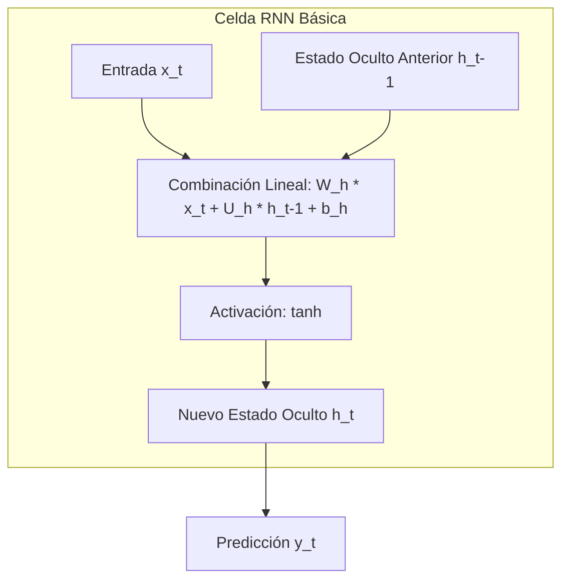
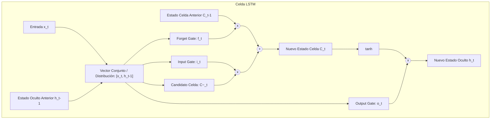
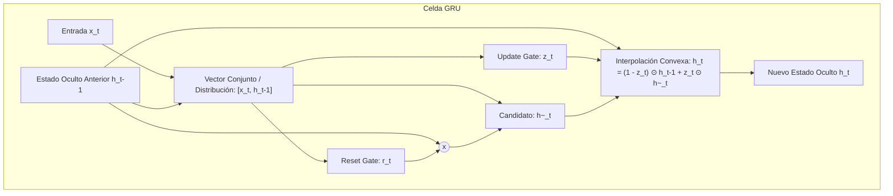
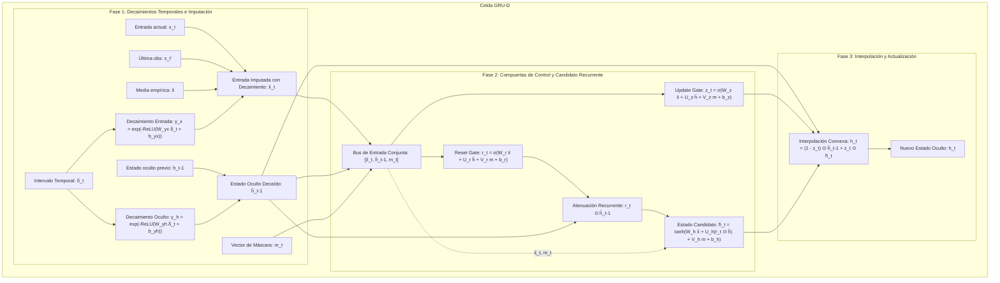

# Teoría de Redes Recurrentes: RNN, LSTM, GRU y GRU-D

Este documento compila la fundamentación teórica de las Redes Neuronales Recurrentes convencionales (RNN), las redes de memoria de largo y corto plazo (LSTM), las unidades recurrentes cerradas (GRU) y su adaptación para datos clínicos con valores ausentes e intervalos irregulares (GRU-D).

---

## 1. Redes Neuronales Recurrentes (RNN) Básicas

### Concepto General
Las Redes Neuronales Recurrentes (RNR o RNN) son una extensión de las redes neuronales artificiales convencionales (feedforward), diseñadas específicamente para procesar secuencias de datos de longitud variable $\mathbf{x} = (\mathbf{x}_1, \mathbf{x}_2, \dots, \mathbf{x}_T)$. 

A diferencia de las redes tradicionales, las RNN incorporan un **bucle de retroalimentación** que les permite mantener una memoria interna en forma de un **estado oculto** ($\mathbf{h}_t$). La activación del estado oculto en cada instante de tiempo $t$ depende tanto de la entrada actual $\mathbf{x}_t$ como del estado oculto del paso de tiempo anterior $\mathbf{h}_{t-1}$.

### Ecuaciones de la Celda RNN
Para cada paso de tiempo $t$:
$$\mathbf{h}_t = \tanh(\mathbf{W}_h \mathbf{x}_t + \mathbf{U}_h \mathbf{h}_{t-1} + \mathbf{b}_h)$$

Donde:
*   $\mathbf{x}_t \in \mathbb{R}^{d_x}$ es el vector de entrada en el instante $t$ ($d_x$ es la dimensión de la entrada).
*   $\mathbf{h}_t \in \mathbb{R}^{d_h}$ es el estado oculto en el instante $t$ ($d_h$ es la dimensión del estado oculto).
*   $\mathbf{W}_h \in \mathbb{R}^{d_h \times d_x}$ es la matriz de pesos para la transformación de la entrada.
*   $\mathbf{U}_h \in \mathbb{R}^{d_h \times d_h}$ es la matriz de pesos para la recurrencia del estado oculto anterior.
*   $\mathbf{b}_h \in \mathbb{R}^{d_h}$ es el vector de sesgo.
*   $\tanh$ es la función de activación tangente hiperbólica, que acota los valores del estado oculto en el rango $[-1, 1]$.

### Parámetros Entrenables
Los parámetros entrenables de la celda recurrente básica son las matrices de pesos y los vectores de sesgo asociados al cálculo de $\mathbf{h}_t$:
1.  $\mathbf{W}_h$: $d_h \times d_x$ parámetros.
2.  $\mathbf{U}_h$: $d_h \times d_h$ parámetros.
3.  $\mathbf{b}_h$: $d_h$ parámetros.

$$\text{Total de parámetros entrenables (RNN)} = d_h \times d_x + d_h \times d_h + d_h = d_h(d_x + d_h + 1)$$

### Limitaciones de la RNN Básica: Memoria a Corto Plazo
El mayor inconveniente de las RNN convencionales radica en su incapacidad para modelar dependencias a largo plazo debido a los problemas de **desvanecimiento del gradiente** (*vanishing gradient*) y **explosión del gradiente** (*exploding gradient*).

Para entender el desvanecimiento del gradiente, analicemos cómo influye el estado oculto inicial $\mathbf{h}_0$ en una predicción lejana $\mathbf{y}_T$. Si ignoramos temporalmente la entrada $\mathbf{x}_t$ y el sesgo $\mathbf{b}_h$ para simplificar el análisis, la relación anidada de los estados ocultos se calcula como:
$$\mathbf{h}_T = \tanh(\mathbf{U}_h \tanh(\mathbf{U}_h \dots \tanh(\mathbf{U}_h \mathbf{h}_0)))$$

Al derivar la pérdida final respecto a $\mathbf{h}_0$ mediante la regla de la cadena para el gradiente (durante el algoritmo de *Backpropagation Through Time* - BPTT), se multiplican repetidamente los pesos recurrentes $\mathbf{U}_h$ y las derivadas de la función $\tanh$. 
Puesto que la derivada de $\tanh(z)$ está acotada entre $0$ y $1$ (y es menor a $1$ en la mayoría de sus puntos), y si los autovalores de la matriz $\mathbf{U}_h$ son menores que 1, el gradiente disminuye de manera exponencial a medida que el número de pasos de tiempo $T$ aumenta.

Esto provoca que el efecto del estado inicial $\mathbf{h}_0$ se extinga al llegar a la predicción final. En la práctica, esto implica que las RNN básicas tienen una **memoria de muy corto plazo** y solo funcionan bien en secuencias cortas (por ejemplo, generación de palabras o nombres de pocos caracteres, donde el texto más allá de ciertos pasos tiende a volverse aleatorio).

---

## 2. Redes LSTM (Long Short-Term Memory)

### Concepto General
Las redes LSTM (propuestas por Hochreiter & Schmidhuber en 1997) resuelven las limitaciones de la RNN básica introduciendo una memoria tanto de largo como de corto plazo. 

Para lograr esto, la celda LSTM incorpora una variable interna llamada **estado de la celda** ($\mathbf{C}_t$), que actúa como una **banda transportadora**. La información puede viajar a lo largo de esta banda sufriendo solo pequeñas transformaciones lineales, lo que evita que los gradientes se desvanezcan al retropropagarse en el tiempo. La adición o eliminación de información en esta banda transportadora se regula mediante **compuertas** (*gates*), que actúan como válvulas controladas por funciones de activación sigmoidales.

### Funcionamiento de las Compuertas y Ecuaciones
Las compuertas están compuestas por una transformación lineal seguida de una activación sigmoide ($\sigma$), cuyos valores están en el rango $[0, 1]$ (donde $0$ bloquea el paso de información y $1$ la deja pasar por completo).

1.  **Forget Gate (Compuerta de Olvido, $\mathbf{f}_t$):** Decide qué información descartar del estado de la celda anterior $\mathbf{C}_{t-1}$.
    $$\mathbf{f}_t = \sigma(\mathbf{W}_f \mathbf{x}_t + \mathbf{U}_f \mathbf{h}_{t-1} + \mathbf{b}_f)$$

2.  **Input/Update Gate (Compuerta de Entrada, $\mathbf{i}_t$):** Decide qué parte de la nueva información entrante se guardará en el estado de la celda.
    $$\mathbf{i}_t = \sigma(\mathbf{W}_i \mathbf{x}_t + \mathbf{U}_i \mathbf{h}_{t-1} + \mathbf{b}_i)$$

3.  **Estado Candidato de Celda ($\mathbf{\tilde{C}}_t$):** Crea un vector de nuevos valores candidatos a ser añadidos a la celda de estado, empleando una activación $\tanh$.
    $$\mathbf{\tilde{C}}_t = \tanh(\mathbf{W}_c \mathbf{x}_t + \mathbf{U}_c \mathbf{h}_{t-1} + \mathbf{b}_c)$$

4.  **Actualización del Estado de Celda ($\mathbf{C}_t$):** Modifica la memoria de la red. Primero multiplica elemento a elemento (* Hadamard product*, $\odot$) el estado anterior $\mathbf{C}_{t-1}$ por la puerta de olvido $\mathbf{f}_t$ para borrar la información irrelevante, y luego le suma los nuevos candidatos filtrados por la compuerta de entrada $\mathbf{i}_t$.
    $$\mathbf{C}_t = \mathbf{f}_t \odot \mathbf{C}_{t-1} + \mathbf{i}_t \odot \mathbf{\tilde{C}}_t$$

5.  **Output Gate (Compuerta de Salida, $\mathbf{o}_t$):** Decide qué información del estado de la celda pasará al estado oculto de salida $\mathbf{h}_t$.
    $$\mathbf{o}_t = \sigma(\mathbf{W}_o \mathbf{x}_t + \mathbf{U}_o \mathbf{h}_{t-1} + \mathbf{b}_o)$$

6.  **Cálculo del Nuevo Estado Oculto ($\mathbf{h}_t$):** El estado de la celda se pasa a través de una función $\tanh$ para escalar los valores al rango $[-1, 1]$ y se multiplica por la compuerta de salida $\mathbf{o}_t$.
    $$\mathbf{h}_t = \mathbf{o}_t \odot \tanh(\mathbf{C}_t)$$

### Parámetros Entrenables
Una celda LSTM tiene cuatro componentes internos homólogos (tres compuertas y un generador de candidatos), cada uno provisto de sus propias matrices de pesos de entrada, recurrentes y sesgos:
*   Pesos de entrada: $\mathbf{W}_f, \mathbf{W}_i, \mathbf{W}_c, \mathbf{W}_o \in \mathbb{R}^{d_h \times d_x}$ ($4 \times d_h \times d_x$ parámetros).
*   Pesos recurrentes: $\mathbf{U}_f, \mathbf{U}_i, \mathbf{U}_c, \mathbf{U}_o \in \mathbb{R}^{d_h \times d_h}$ ($4 \times d_h \times d_h$ parámetros).
*   Vectores de sesgo: $\mathbf{b}_f, \mathbf{b}_i, \mathbf{b}_c, \mathbf{b}_o \in \mathbb{R}^{d_h}$ ($4 \times d_h$ parámetros).

$$\text{Total de parámetros entrenables (LSTM)} = 4 \times (d_h \times d_x + d_h \times d_h + d_h) = 4 d_h(d_x + d_h + 1)$$

---

## 3. Redes GRU (Gated Recurrent Unit)

### Concepto General
La arquitectura GRU (propuesta por Cho et al. en 2014) es una variante simplificada y altamente eficiente de la LSTM. La principal diferencia de diseño es que la GRU **no cuenta con una celda de memoria separada** (elimina el *cell state* $\mathbf{C}_t$). En su lugar, el estado oculto $\mathbf{h}_t$ actúa directamente como la memoria única de la red. 

Esto se logra fusionando la compuerta de olvido y la compuerta de entrada en una sola **compuerta de actualización** (*update gate*), y controlando la influencia del estado oculto anterior mediante una **compuerta de reinicio** (*reset gate*). Gracias a esto, la GRU presenta menos parámetros entrenables, lo que acelera el cálculo y reduce el riesgo de sobreajuste (*overfitting*), manteniendo una capacidad de memoria similar a la LSTM.

### Ecuaciones de la Celda GRU
Para cada paso de tiempo $t$:

1.  **Update Gate (Puerta de Actualización, $\mathbf{z}_t$):** Determina qué cantidad de la información del estado oculto pasado $\mathbf{h}_{t-1}$ debe transmitirse al futuro y cuánta información nueva debe incorporarse.
    $$\mathbf{z}_t = \sigma(\mathbf{W}_z \mathbf{x}_t + \mathbf{U}_z \mathbf{h}_{t-1} + \mathbf{b}_z)$$

2.  **Reset Gate (Puerta de Reinicio, $\mathbf{r}_t$):** Controla qué cantidad de la información del pasado se debe olvidar antes de generar la nueva propuesta de estado.
    $$\mathbf{r}_t = \sigma(\mathbf{W}_r \mathbf{x}_t + \mathbf{U}_r \mathbf{h}_{t-1} + \mathbf{b}_r)$$

3.  **Candidate Hidden State (Activación Oculta Candidata, $\mathbf{\tilde{h}}_t$):** Propone un nuevo estado oculto que combina la entrada actual $\mathbf{x}_t$ con el estado oculto anterior $\mathbf{h}_{t-1}$ atenuado (multiplicado componente a componente) por el resultado de la puerta de reinicio $\mathbf{r}_t$.
    $$\mathbf{\tilde{h}}_t = \tanh(\mathbf{W}_h \mathbf{x}_t + \mathbf{U}_h (\mathbf{r}_t \odot \mathbf{h}_{t-1}) + \mathbf{b}_h)$$

4.  **Update Hidden State (Actualización del Estado Oculto, $\mathbf{h}_t$):** Realiza una interpolación lineal directa entre el estado oculto previo $\mathbf{h}_{t-1}$ y el estado candidato $\mathbf{\tilde{h}}_t$, ponderada por el vector de actualización $\mathbf{z}_t$.
    $$\mathbf{h}_t = (1 - \mathbf{z}_t) \odot \mathbf{h}_{t-1} + \mathbf{z}_t \odot \mathbf{\tilde{h}}_t$$

### Parámetros Entrenables
Una celda GRU posee tres componentes (dos compuertas y el generador de estado candidato), reduciendo en un 25% el número de parámetros respecto a la LSTM:
*   Pesos de entrada: $\mathbf{W}_z, \mathbf{W}_r, \mathbf{W}_h \in \mathbb{R}^{d_h \times d_x}$ ($3 \times d_h \times d_x$ parámetros).
*   Pesos recurrentes: $\mathbf{U}_z, \mathbf{U}_r, \mathbf{U}_h \in \mathbb{R}^{d_h \times d_h}$ ($3 \times d_h \times d_h$ parámetros).
*   Sesgos: $\mathbf{b}_z, \mathbf{b}_r, \mathbf{b}_h \in \mathbb{R}^{d_h}$ ($3 \times d_h$ parámetros).

$$\text{Total de parámetros entrenables (GRU)} = 3 \times (d_h \times d_x + d_h \times d_h + d_h) = 3 d_h(d_x + d_h + 1)$$

---

## 4. Modelo GRU-D (GRU con Decaimiento Temporal)

El modelo **GRU-D** (propuesto por Zhengping Che et al. en 2018) es una arquitectura avanzada que extiende la celda GRU convencional para manejar de forma nativa **series temporales multivariadas con valores ausentes (missing values) e intervalos de tiempo irregulares**, una característica omnipresente en los registros médicos electrónicos (EHR).

### Motivación de GRU-D
En la práctica clínica, los datos no se recolectan a intervalos uniformes. Los pacientes son sometidos a exámenes en momentos impredecibles, lo que genera grandes matrices de datos con variables vacías. La motivación del modelo GRU-D parte de dos observaciones fundamentales sobre este tipo de datos:

1.  **Informative Missingness (Ausencia Informativa):** El hecho de que falte un dato no es aleatorio (MNAR, *Missing Not At Random*). La frecuencia y el patrón con el que se mide una variable clínica (o se omite) suelen estar altamente correlacionados con la etiqueta objetivo (ej. el estado del paciente o la mortalidad). Por ejemplo, si a un paciente en UCI se le mide el ritmo cardíaco de forma continua, pero el nivel de lactato en sangre solo de forma esporádica, esta diferencia en los patrones de medición refleja decisiones clínicas críticas.
2.  **Homeostasis y Pérdida de Influencia con el Tiempo:**
    *   **Propiedad 1:** El valor real de una variable ausente tiende a regresar progresivamente a un "valor por defecto" estable (como la media de la población) a medida que transcurre más tiempo desde su última medición (mecanismo homeostático fisiológico).
    *   **Propiedad 2:** La influencia de una variable observada en el pasado sobre las predicciones actuales disminuye gradualmente a medida que pasa el tiempo sin que se registre una nueva medición.

GRU-D incorpora un mecanismo de **decaimiento temporal entrenable** en la estructura de la red para modelar explícitamente estas dos propiedades.

### Notación y Representaciones del Patrón de Falta
Consideramos una serie temporal multivariada con $D$ variables de entrada registradas en timestamps $s_t$ ($t=1, \dots, T$). Se definen las siguientes variables auxiliares:

1.  **Masking Vector (Vector de Máscara, $\mathbf{m}_t \in \{0, 1\}^D$):** Indica si una variable específica fue observada en el paso $t$.
    $$m_t^d = \begin{cases} 1, & \text{si } x_t^d \text{ es observado} \\ 0, & \text{en caso contrario} \end{cases}$$

2.  **Time Interval (Intervalo de Tiempo, $\boldsymbol{\delta}_t \in \mathbb{R}^D$):** Mide el tiempo transcurrido desde la última observación válida para cada una de las variables $d$:
    $$\delta_t^d = \begin{cases} s_t - s_{t-1} + \delta_{t-1}^d, & \text{si } t > 1, m_{t-1}^d = 0 \\ s_t - s_{t-1}, & \text{si } t > 1, m_{t-1}^d = 1 \\ 0, & \text{si } t = 1 \end{cases}$$

### Fórmulas de Decaimiento Entrenable
Para regular cómo decaen las variables en el tiempo, se introduce un vector de tasas de decaimiento $\boldsymbol{\gamma}_t$ que se calcula a partir de los intervalos de tiempo $\boldsymbol{\delta}_t$:
$$\boldsymbol{\gamma}_t = \exp(-\max(0, \mathbf{W}_\gamma \boldsymbol{\delta}_t + \mathbf{b}_\gamma))$$

Donde $\mathbf{W}_\gamma$ y $\mathbf{b}_\gamma$ son parámetros que la red aprende durante el entrenamiento. Al usar la función exponencial con el negativo de un rectificador lineal (ReLU), se garantiza que $\gamma_t^d \in (0, 1]$ y que decaiga de forma monótona respecto al tiempo transcurrido.

El modelo implementa dos mecanismos de decaimiento independientes:

1.  **Decaimiento de la Entrada ($\boldsymbol{\gamma}_{x_t} \in \mathbb{R}^D$):** Se aplica a las variables de entrada ausentes para hacerlas decaer hacia la media empírica de la variable. 
    $$\boldsymbol{\gamma}_{x_t} = \exp(-\max(0, \mathbf{W}_{\gamma_x} \boldsymbol{\delta}_t + \mathbf{b}_{\gamma_x}))$$
    *Particularidad:* Se restringe la matriz de pesos $\mathbf{W}_{\gamma_x}$ para que sea **diagonal** ($\mathbf{W}_{\gamma_x} \in \mathbb{R}^{D \times D}$). Esto fuerza a que la tasa de decaimiento de cada variable de entrada dependa únicamente de sus propios intervalos temporales transcurridos, y no de las demás variables.

    La entrada decaída final $\mathbf{\hat{x}}_t$ se define para cada variable $d$ como:
    $$\hat{x}_t^d = m_t^d x_t^d + (1 - m_t^d) \left( \gamma_{x_t}^d x_{t'}^d + (1 - \gamma_{x_t}^d) \tilde{x}^d \right)$$
    Donde $x_{t'}^d$ es el valor medido en el último instante observado ($t' < t$) y $\tilde{x}^d$ es la media empírica de la variable $d$ en el conjunto de entrenamiento.

2.  **Decaimiento del Estado Oculto ($\boldsymbol{\gamma}_{h_t} \in \mathbb{R}^{d_h}$):** Decae el estado oculto anterior $\mathbf{h}_{t-1}$ antes de procesar el paso actual. Esto permite debilitar los rasgos extraídos en el pasado si ha pasado mucho tiempo sin observaciones.
    $$\boldsymbol{\gamma}_{h_t} = \exp(-\max(0, \mathbf{W}_{\gamma_h} \boldsymbol{\delta}_t + \mathbf{b}_{\gamma_h}))$$
    *Particularidad:* A diferencia de la entrada, la matriz $\mathbf{W}_{\gamma_h}$ **no se restringe a ser diagonal** ($\mathbf{W}_{\gamma_h} \in \mathbb{R}^{d_h \times D}$). Esto permite que los intervalos temporales de múltiples variables de entrada interactúen de manera compleja y regulen conjuntamente el decaimiento de las variables latentes ocultas.

    El estado oculto decaído anterior $\mathbf{\hat{h}}_{t-1}$ se define como:
    $$\mathbf{\hat{h}}_{t-1} = \boldsymbol{\gamma}_{h_t} \odot \mathbf{h}_{t-1}$$

### Fórmulas de Actualización de GRU-D
Las ecuaciones finales de GRU-D reemplazan la entrada estándar $\mathbf{x}_t$ por la entrada decaída $\mathbf{\hat{x}}_t$, el estado oculto anterior $\mathbf{h}_{t-1}$ por el estado decaído $\mathbf{\hat{h}}_{t-1}$, e incorporan directamente el vector de máscara $\mathbf{m}_t$ para proveer de forma explícita la información sobre qué datos están ausentes en cada paso:

*   **Puerta de Reinicio ($\mathbf{r}_t$):**
    $$\mathbf{r}_t = \sigma(\mathbf{W}_r \mathbf{\hat{x}}_t + \mathbf{U}_r \mathbf{\hat{h}}_{t-1} + \mathbf{V}_r \mathbf{m}_t + \mathbf{b}_r)$$
*   **Puerta de Actualización ($\mathbf{z}_t$):**
    $$\mathbf{z}_t = \sigma(\mathbf{W}_z \mathbf{\hat{x}}_t + \mathbf{U}_z \mathbf{\hat{h}}_{t-1} + \mathbf{V}_z \mathbf{m}_t + \mathbf{b}_z)$$
*   **Estado Candidato Oculto ($\mathbf{\tilde{h}}_t$):**
    $$\mathbf{\tilde{h}}_t = \tanh(\mathbf{W}_h \mathbf{\hat{x}}_t + \mathbf{U}_h (\mathbf{r}_t \odot \mathbf{\hat{h}}_{t-1}) + \mathbf{V}_h \mathbf{m}_t + \mathbf{b}_h)$$
*   **Actualización del Estado Oculto final ($\mathbf{h}_t$):**
    $$\mathbf{h}_t = (1 - \mathbf{z}_t) \odot \mathbf{\hat{h}}_{t-1} + \mathbf{z}_t \odot \mathbf{\tilde{h}}_t$$

Donde $\mathbf{V}_r, \mathbf{V}_z, \mathbf{V}_h \in \mathbb{R}^{d_h \times d_x}$ son las nuevas matrices de pesos para procesar el vector de máscara $\mathbf{m}_t$.

### Parámetros Entrenables en GRU-D
La celda GRU-D añade parámetros dedicados a los decaimientos temporales ($\boldsymbol{\gamma}_x, \boldsymbol{\gamma}_h$) y al procesamiento de la máscara ($\mathbf{m}_t$). Si denotamos $d_x = D$ como la dimensión de la entrada y $d_h$ como la dimensión del estado oculto:

1.  **Matrices de pesos de entrada ($\mathbf{W}_z, \mathbf{W}_r, \mathbf{W}_h$):** $3 \times (d_h \times d_x)$ parámetros.
2.  **Matrices de pesos recurrentes ($\mathbf{U}_z, \mathbf{U}_r, \mathbf{U}_h$):** $3 \times (d_h \times d_h)$ parámetros.
3.  **Matrices de pesos de máscara ($\mathbf{V}_z, \mathbf{V}_r, \mathbf{V}_h$):** $3 \times (d_h \times d_x)$ parámetros.
4.  **Vectores de sesgo de compuertas ($\mathbf{b}_z, \mathbf{b}_r, \mathbf{b}_h$):** $3 \times d_h$ parámetros.
5.  **Parámetros de decaimiento de entrada ($\boldsymbol{\gamma}_{x}$):**
    *   $\mathbf{W}_{\gamma_x}$ (restringida a diagonal): $d_x$ parámetros.
    *   $\mathbf{b}_{\gamma_x}$: $d_x$ parámetros.
6.  **Parámetros de decaimiento del estado oculto ($\boldsymbol{\gamma}_{h}$):**
    *   $\mathbf{W}_{\gamma_h}$ (llena, mapea de $\boldsymbol{\delta}_t \in \mathbb{R}^{d_x}$ a $\boldsymbol{\gamma}_{h} \in \mathbb{R}^{d_h}$): $d_h \times d_x$ parámetros.
    *   $\mathbf{b}_{\gamma_h}$: $d_h$ parámetros.

Sumando todos los componentes:
$$\text{Total de parámetros (GRU-D)} = 3 d_h d_x + 3 d_h^2 + 3 d_h d_x + 3 d_h + 2 d_x + d_h d_x + d_h$$
$$\text{Total de parámetros entrenables (GRU-D)} = 7 d_h d_x + 3 d_h^2 + 4 d_h + 2 d_x$$

### ¿Por qué GRU-D es excelente para lidiar con valores ausentes?
1.  **Unificación de Imputación y Predicción:** Tradicionalmente, lidiar con datos ausentes requiere un proceso de dos pasos: primero imputar los datos (usando técnicas estadísticas como MICE, interpolación spline o KNN) y luego alimentar el dataset completo al modelo predictivo. Esto es ineficiente y computacionalmente costoso. GRU-D integra la imputación (mediante el decaimiento hacia la media) directamente en la arquitectura del modelo de clasificación, optimizando todo el flujo en una única fase de entrenamiento guiada por el gradiente.
2.  **Explotación del Patrón de Medición (Masking):** Al alimentar $\mathbf{m}_t$ directamente a las compuertas, la red es informada de si el valor actual fue medido o imputado. Si un dato ausente es indicativo de un empeoramiento del paciente, las compuertas pueden abrirse o cerrarse selectivamente basándose en este patrón.
3.  **Sensibilidad al Retraso Temporal:** Con $\boldsymbol{\delta}_t$, el modelo distingue entre un valor imputado de hace 10 minutos (muy confiable) y uno de hace 10 horas (que debe decaer fuertemente hacia la media global debido a la homeostasis). Esto evita el efecto estático y artificial de las técnicas clásicas de relleno temporal como *forward-fill* o imputación por la media fija.
