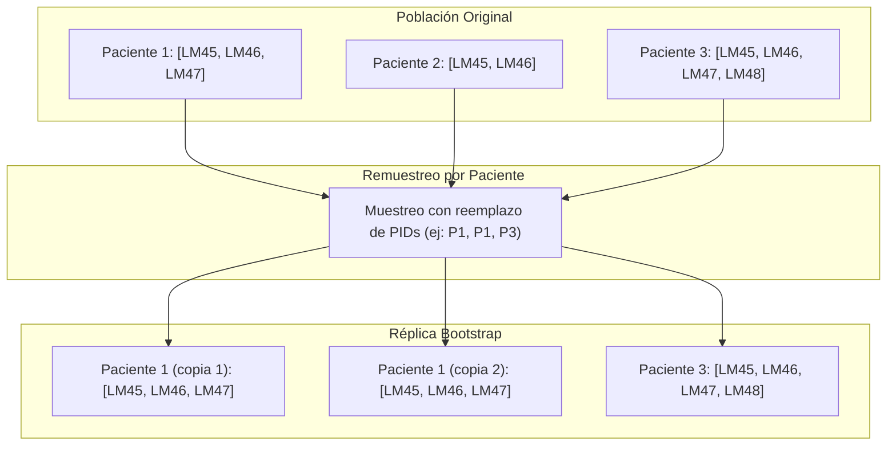
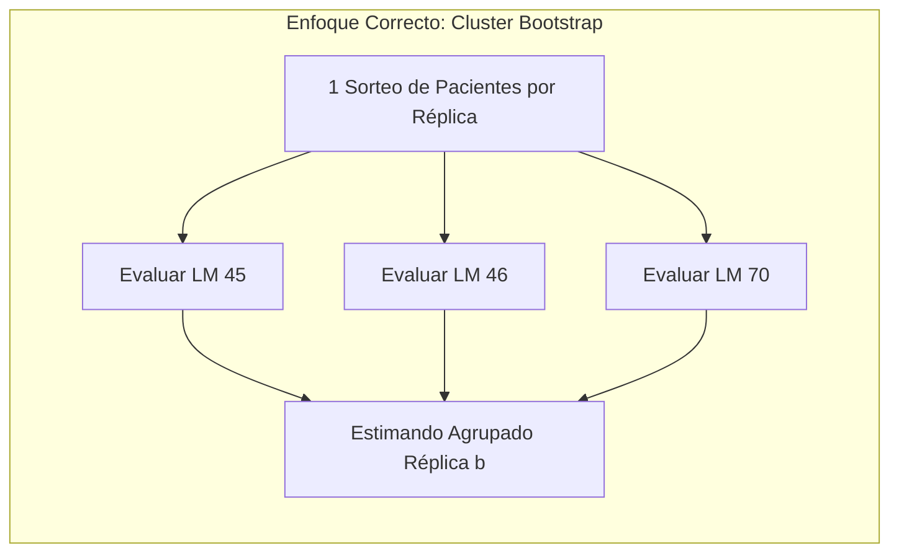

# Inferencia Estadística mediante Bootstrap en Modelos de Supervivencia con Landmarking

Este documento detalla los fundamentos teóricos, la justificación metodológica y la implementación técnica del remuestreo por **Bootstrap** para la estimación de intervalos de confianza (IC 95%) en el pipeline del TFM (implementado en [`workflow/scripts/eval.py`](file:///c:/Users/rtrin/OneDrive/Escritorio/FORMACION/MASTER/TFM/tfm-mulcia-2025/tfm-mulcia-2025-1/workflow/scripts/eval.py)).

---

## 1. Motivación y Desafío Metodológico

En el análisis de supervivencia dinámico mediante *landmarking*, evaluamos el rendimiento predictivo (discriminación y calibración) de los modelos a lo largo de múltiples edades de corte (por ejemplo, desde los 45 hasta los 70 años).

Para cuantificar la incertidumbre de las métricas obtenidas ($C\text{-index}$, $\text{AUROC}(t)$, $\text{Brier}(t)$, $\text{IPA}$), se requiere estimar intervalos de confianza empíricos. Sin embargo, surge un problema estadístico fundamental:

> [!WARNING]
> **Estructura Longitudinal y Dependencia Intra-Sujeto**:
> Los cortes de *landmark* están **anidados**: un paciente elegible en el landmark 60 ya era elegible y formó parte del landmark 45, 46, ..., 59 (siempre que permaneciera libre de evento y bajo seguimiento). Por tanto, la misma persona genera **múltiples filas** a lo largo de los diferentes cortes temporales.

Si se aplicara un **bootstrap ingenuo** seleccionando filas al azar de forma independiente:
1. Se violaría el supuesto de independencia idénticamente distribuida (i.i.d.).
2. Se rompería la trayectoria longitudinal del paciente (un individuo podría quedar incluido en el landmark 45 pero excluido en el 46).
3. Se tratarían las observaciones repetidas de un mismo sujeto como si fueran individuos distintos, sobreestimando la información efectiva y produciendo **intervalos de confianza artificialmente estrechos y optimistas**.

---

## 2. La Solución: Bootstrap por Conglomerados (*Cluster Bootstrap*)

Para respetar la estructura de dependencia intra-sujeto, la unidad primaria de remuestreo con reemplazo debe ser el **paciente completo** (`pid`), no la fila individual.

Cuando un paciente es sorteado en una réplica bootstrap:
- **Se arrastran todas sus filas** (de todos los landmarks en los que participe) en bloque.
- Si un paciente es seleccionado $k$ veces por el muestreo con reemplazo, todas sus filas se duplican $k$ veces.
- Si un paciente no es seleccionado, ninguna de sus observaciones participa en esa réplica.



---

## 3. Implementación en `eval.py`

### 3.1 Mapeo Vectorizado de Filas por Paciente: `_patient_positions`

Para realizar el remuestreo de miles de réplicas de forma computacionalmente eficiente sin bucles lentos de Pandas, [`workflow/scripts/eval.py:L171-L176`](file:///c:/Users/rtrin/OneDrive/Escritorio/FORMACION/MASTER/TFM/tfm-mulcia-2025/tfm-mulcia-2025-1/workflow/scripts/eval.py#L171-L176) indexa de antemano la posición de cada sujeto:

```python
def _patient_positions(ids):
    """Mapa pid -> posiciones de fila, para remuestrear pacientes y no filas."""
    ids_arr = np.asarray(ids, dtype=object)
    uniq, inv = np.unique(ids_arr, return_inverse=True)
    pos_by_id = [np.flatnonzero(inv == i) for i in range(len(uniq))]
    return pos_by_id
```

- **`uniq, inv = np.unique(..., return_inverse=True)`**: Extrae el listado de identificadores únicos y crea un vector de índices enteros (`0, 1, ..., n_pacientes - 1`) que clasifica a qué sujeto pertenece cada fila.
- **`np.flatnonzero(inv == i)`**: Obtiene los **índices numéricos de fila** exactos en los que aparece el paciente $i$ en el array original.
- **`pos_by_id`**: Es una lista de arrays NumPy donde `pos_by_id[i]` contiene los punteros a fila del paciente $i$. **No contiene IDs alfanuméricos ni datos del paciente, sino números de fila directos**.

#### Mecánica de Remuestreo y Pacientes OOB (*Out-Of-Bag*)
Durante cada réplica bootstrap se ejecuta:
```python
chosen = rng.integers(0, n_ids, size=n_ids)          # Pacientes, no filas (CON reemplazamiento)
pos = np.concatenate([pos_by_id[c] for c in chosen])  # Filas completas arrastradas en bloque
```
- **Muestreo CON reemplazamiento**: `rng.integers(0, n_ids, size=n_ids)` genera $N$ números aleatorios independientes entre $0$ y $n_{\text{ids}} - 1$.
- **Pacientes OOB**: Debido al reemplazamiento, por propiedades estadísticas clásicas del bootstrap, en cada réplica entra aproximadamente el $1 - 1/e \approx 63.2\%$ de los pacientes únicos, quedando aproximadamente el **$36.8\%$ fuera como muestra OOB (*Out-Of-Bag*)**, mientras que otros sujetos quedan repetidos 2 o más veces.

#### Correspondencia y Ordenación de Arrays Paralelos
No se requiere ordenar ni preprocesar `risks_sub` respecto a `pos_by_id`, ya que el pipeline garantiza que todos los vectores son **estrictamente paralelos**:
1. En la inferencia ([`eval.py:L391-L411`](file:///c:/Users/rtrin/OneDrive/Escritorio/FORMACION/MASTER/TFM/tfm-mulcia-2025/tfm-mulcia-2025-1/workflow/scripts/eval.py#L391-L411)), el `DataLoader` se ejecuta con `shuffle=False`, devolviendo `(risks, durs, evs, lms, ids)` con el mismo orden posicional 1 a 1.
2. Al filtrar un corte específico con `idx = (lms == lm)`, la máscara booleana se aplica uniformemente a todos los vectores.
3. El indexado avanzado de NumPy `risks_sub[pos]`, `durs_sub[pos]`, `evs_sub[pos]` extrae exactamente las filas coincidentes para cada paciente seleccionado.

---

### 3.2 Invarianza de las Referencias de Entrenamiento

> [!IMPORTANT]
> **Prevención de Fuga de Información y Sesgo en IPCW**:
> Las métricas basadas en IPCW ($C\text{-index}_{\text{IPCW}}$, $\text{AUROC}(t)$, $\text{Brier}(t)$, $\text{IPA}$) requieren estimar la distribución de censura $G(t) = P(C > t)$ y la función de riesgo base de Breslow ($H_0(t)$).
> 
> En [`eval.py`](file:///c:/Users/rtrin/OneDrive/Escritorio/FORMACION/MASTER/TFM/tfm-mulcia-2025/tfm-mulcia-2025-1/workflow/scripts/eval.py), **`y_train` y los valores de Breslow (`h0`, `maxr`, `h0_null`) se fijan estrictamente en el conjunto de entrenamiento (`train`) y NUNCA se remuestrean**:
> - La inferencia en `val` y `holdout` evalúa la variabilidad del rendimiento del modelo congelado ante variaciones de la muestra de prueba.
> - Remuestrear `train` dentro del bucle de `val`/`holdout` introduciría ruido no deseado y mezclaría la incertidumbre del ajuste con la del test.

---

### 3.3 Construcción de Intervalos por Percentiles: `_percentile_ci`

Los intervalos de confianza se calculan utilizando el método empírico de los percentiles al 95%:

```python
def _percentile_ci(values):
    """IC 95% por percentiles sobre las réplicas bootstrap (NaN -> excluidos)."""
    v = np.asarray([x for x in values if np.isfinite(x)], dtype=np.float64)
    if len(v) == 0:
        return [None, None]
    return [float(np.percentile(v, 2.5)), float(np.percentile(v, 97.5))]
```

- **Percentil 2.5**: Límite inferior del IC 95%.
- **Percentil 97.5**: Límite superior del IC 95%.
- **Filtrado de `NaN`**: Si en alguna réplica bootstrap degenerada no hay eventos en la ventana temporal, la métrica produce `NaN`, el cual se descarta para evitar corromper la distribución empírica.

---

## 4. Las Dos Modalidades de Inferencia en el Pipeline

[`eval.py`](file:///c:/Users/rtrin/OneDrive/Escritorio/FORMACION/MASTER/TFM/tfm-mulcia-2025/tfm-mulcia-2025-1/workflow/scripts/eval.py) ejecuta dos niveles de análisis bootstrap:

### 4.1 Modalidad A: Bootstrap por Landmark Individual (`_bootstrap_ci`)
- **Propósito**: Evalúa la incertidumbre de las métricas en una edad de corte específica (por ejemplo, en el landmark 55).
- **Mecánica**: Aunque dentro de un único landmark cada fila representa a un paciente distinto, la función agrupa igualmente mediante `_patient_positions` para garantizar consistencia y proteger el código ante posibles duplicidades.
- **Configuración**: Controlado por `BOOT_N` réplicas y una semilla determinista variable por landmark: `BOOT_SEED + int(lm)`.

### 4.2 Modalidad B: Cluster Bootstrap Agrupado (*Pooled*, `_cluster_bootstrap_pooled`)
- **Propósito**: Evalúa la incertidumbre del estimando global agrupado (*pooled*) a través de los 26 cortes de edad (de 45 a 70 años).
- **Mecánica del bucle por réplica**:
  1. En cada réplica $b$, se sortea la cohorte de pacientes **una sola vez** (`chosen = rng.integers(0, n_ids, size=n_ids)`).
  2. Con **esa misma pseudocohorte de pacientes**, se evalúan los 26 cortes de landmarking en paralelo.
  3. Para cada landmark $lm$, se extraen sus filas con `sel = pos[lm_masks[lm][pos]]` y se calculan sus métricas con `_compute_metrics`.
  4. Se combinan los 26 cortes con `_pool_landmark_metrics` (respetando los pares concordantes/discordantes estratificados y medias ponderadas exactas).
  5. Se almacena el valor agrupado de esa réplica $b$ y se pasa a la siguiente réplica $b + 1$.
- **Configuración**: Controlado por `BOOT_N_POOLED` réplicas y semilla fijada: `BOOT_SEED + 1000`.

---

## 5. Análisis Comparativo: Remuestreo Único vs Remuestreo por Landmark

Un aspecto metodológico clave es entender por qué en el bootstrap agrupado se sortea la cohorte **una sola vez por réplica** en lugar de remuestrear de forma independiente en cada landmark:



### ¿Tendría mayor coste computacional remuestrear por separado?
**No a nivel de cálculo de métricas.** En ambos enfoques se ejecutan exactamente las mismas operaciones:
$$\text{Evaluaciones de métricas} = B \times L = 200 \times 26 = 5.200$$
El sorteo aleatorio de enteros tarda microsegundos; el coste en tiempo de CPU lo acaparan las funciones de supervivencia (`concordance_index_ipcw`, `brier_score`, etc.), que se ejecutarían el mismo número de veces.

### La razón crítica: Validez Estadística
La diferencia crucial radica en la **preservación de la correlación intra-sujeto**:

- **Si se remuestreara cada landmark por separado**:
  - En la réplica 1, el landmark 45 tendría a los pacientes $\{P_1, P_5, P_9, \dots\}$.
  - En esa misma réplica 1, el landmark 46 tendría a los pacientes $\{P_2, P_4, P_8, \dots\}$.
  - **Consecuencia:** Se estaría tratando el problema como si los 26 cortes temporales fueran **26 estudios clínicos totalmente independientes sobre poblaciones distintas**. Al promediar métricas entre estudios independientes, la varianza del promedio se reduce artificialmente por un factor de $1/26$ (por la ley de los grandes números), produciendo **intervalos de confianza espuriamente estrechos y un falso exceso de precisión**.

- **Al remuestrear la cohorte una sola vez (*Cluster Bootstrap*)**:
  - Se sigue la evolución longitudinal completa de la **misma cohorte simulada** a través de todas sus edades de corte.
  - Se respeta la correlación temporal que un mismo individuo induce a lo largo de su seguimiento.

---

## 6. Tabla Resumen de Parámetros y Comportamiento

| Parámetro / Objeto | Definición | Valor habitual | Rol en el pipeline |
| :--- | :--- | :--- | :--- |
| **`ids` / `ids_sub`** | Vector de identificadores de paciente | `array` de strings | Base para definir los conglomerados (*clusters*). |
| **`pos_by_id`** | Mapeo paciente $\rightarrow$ índices de fila | Lista de `ndarray` | Punteros enteros a filas para acelerar la extracción en bloque. |
| **`chosen`** | Pacientes seleccionados por réplica | `ndarray` enteros | Sorteo uniforme **con reemplazamiento** (genera ~36.8% OOB). |
| **`BOOT_N`** | Réplicas por landmark individual | 200 - 1000 | Réplicas independientes por edad evaluada. |
| **`BOOT_N_POOLED`** | Réplicas para el estimando agrupado | 200 - 1000 | Réplicas multi-landmark arrastrando al sujeto completo. |
| **`BOOT_SEED`** | Semilla base del generador pseudoaleatorio | Configurable | Garantiza total reproducibilidad de los intervalos. |
| **`y_train_by_lm`** | Array estructurado de supervivencia en Train | `Surv.from_arrays` | Referencia de censura inmutable para estimar pesos IPCW. |
| **`splits` evaluados** | Subconjuntos sometidos a bootstrap | `val`, `holdout` | `train` no se remuestrea (el test coincidiría con el train). |
