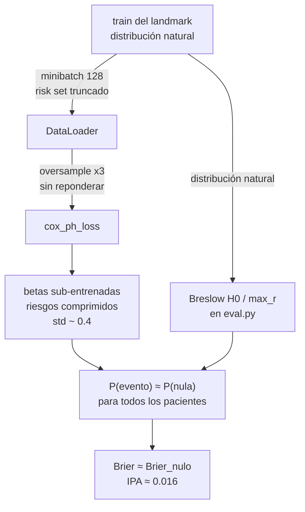

# Calibración del Modelo Cox: Diagnóstico y Corrección del Entrenamiento

Este documento describe el problema de calibración detectado en el modelo **Cox baseline** del pipeline (implementado en [`workflow/scripts/cox.py`](file:///c:/Users/rtrin/OneDrive/Escritorio/FORMACION/MASTER/TFM/tfm-mulcia-2025/tfm-mulcia-2025-1/workflow/scripts/cox.py)), el proceso de descarte seguido hasta localizar la causa raíz, la validación empírica de la solución mediante un script de diagnóstico *standalone*, y **los cambios exactos que deben aplicarse en `cox.py`** para corregirlo.

> [!IMPORTANT]
> **Estado actual**: problema diagnosticado y solución validada empíricamente. La corrección **aún no se ha aplicado** al pipeline (decisión de proyecto). Las secciones 6 y 7 indican qué cambiar y cómo re-entrenar cuando se decida aplicar.

---

## 1. Síntoma

Tras la reformulación de la evaluación (issue 2), las métricas agrupadas (*pooled*) en `holdout` para Cox mostraban:

| Métrica | Valor obtenido | Valor de referencia (spec) |
| :--- | :---: | :---: |
| Brier 5 años (pooled) | 0.008761 | ~0.0085 |
| **IPA 5 años (pooled)** | **0.0163** | **~0.047** |
| AUROC 5 años (pooled) | 0.7197 | ~0.747 |

El Brier absoluto "parecía bueno" (0.0088), pero el IPA revelaba que Cox **apenas mejoraba al modelo nulo** (sin covariables): con `Brier_null ≈ 0.008907`, la mejora absoluta era de solo `0.000146`. Los tres modelos secuenciales (LSTM, GRU-D, GRU-D labs) sí reproducían sus valores de referencia, por lo que el problema era específico de Cox.

---

## 2. Cadena de descartes

Antes de tocar el entrenamiento se verificaron y descartaron las siguientes hipótesis. Todas las comprobaciones se realizaron sobre los JSON ya generados (`results/metrics/*.json`) y se replicaron con el script de diagnóstico.

| # | Hipótesis | Verificación | Resultado |
| :--- | :--- | :--- | :--- |
| 1 | La fórmula del IPA individual está mal | Residuo entre `ipa` guardado y `1 - brier/brier_null` en los 26 landmarks | **Residuo máximo = 0.0** (fórmula exacta) |
| 2 | Cox usa un Brier nulo distinto | Reconstrucción de `brier_null = brier/(1-ipa)` por landmark para los 4 modelos | **Diferencia máxima entre modelos = 0.0** (idéntico bit a bit) |
| 3 | Cox devuelve probabilidades "muy bajas" | Cuantiles de la distribución de probabilidades predichas | **Falsa a medias**: las probabilidades no son bajas, están *comprimidas alrededor del nulo* (ver §4) |
| 4 | El agrupado del IPA está mal calculado | Comparación media ponderada vs ratio de Briers agrupados | **Cierto, pero es un problema general** (afecta a los 4 modelos; ver §10), no explica el gap adicional de Cox |

El Brier nulo (`h0_null` vía `compute_baseline_hazard` con riesgos fijados a cero) depende únicamente de duraciones y eventos de `train` por landmark, por lo que es estructuralmente idéntico para todos los modelos. El problema residía por tanto en las **probabilidades predichas por el propio Cox**.

---

## 3. Distribución de probabilidades del Cox original

La probabilidad de evento a 5 años se construye con el Breslow fijado en train:

$$\hat{P}(t \le 5 \mid x) = 1 - \exp\left(-H_0(5) \cdot \exp(\text{risk}(x) - \text{max\_risk})\right)$$

Para el artefacto original (`results/models/cox.pkl`), en `holdout`:

| Landmark | Tasa observada | Prob. nula | Media pred. | Desv. típica | p95 | Máx | % pacientes < nula/4 |
| :---: | :---: | :---: | :---: | :---: | :---: | :---: | :---: |
| 45 | 0.0044 | 0.0037 | 0.0038 | 0.0023 | 0.0072 | 0.083 | **0%** |
| 55 | 0.0060 | 0.0042 | 0.0043 | 0.0026 | 0.0086 | 0.060 | **0%** |
| 60 | 0.0096 | 0.0085 | 0.0086 | 0.0050 | 0.0176 | 0.168 | **0%** |
| 64 | 0.0167 | 0.0146 | 0.0152 | 0.0120 | 0.0335 | 0.197 | **1%** |
| 70 | 0.0154 | 0.0150 | 0.0154 | 0.0093 | 0.0326 | 0.130 | **0%** |

**Lectura**: la distribución está centrada en la probabilidad nula y prácticamente sin dispersión (desviación típica ~0.002–0.012). Ningún paciente recibe un riesgo cercano a cero. Un modelo así apenas puede superar al nulo en Brier, por construction: el IPA mide exactamente esa mejora relativa, y por eso colapsa a ~0.016.

Contraste con la calibración del landmark 55 (`mean_pred_prob` vs tasa observada):

| Modelo | Prob. media predicha | Tasa observada |
| :--- | :---: | :---: |
| lstm | 0.00521 | 0.00598 |
| grud | 0.00546 | 0.00598 |
| grud_labs | 0.00532 | 0.00598 |
| **cox (original)** | **0.00425** | 0.00598 |

Cox subestima la incidencia ~29% en ese landmark, síntoma de riesgos mal escalados.

---

## 4. Causa raíz: el entrenamiento de `train_cox`

El entrenamiento original de Cox (bloque de [`workflow/scripts/cox.py`](file:///c:/Users/rtrin/OneDrive/Escritorio/FORMACION/MASTER/TFM/tfm-mulcia-2025/tfm-mulcia-2025-1/workflow/scripts/cox.py) L248–L316) combina **tres defectos** que explican la compresión de riesgos:

1. **Verosimilitud parcial por minibatches de 128** (`run_cox_epoch` + `DataLoader(batch_size=128)`): en la partial likelihood de Cox, el denominador (risk set) de cada paciente debería incluir a **todos** los pacientes del landmark con duración ≥ la suya. Con minibatches, el risk set se limita a los ~128 pacientes del batch. Con una incidencia del ~0.5%, muchos batches contienen 0–2 eventos → gradientes ruidosos y betas sub-estimadas.

2. **Sobre-muestreo de eventos ×3** (`WeightedRandomSampler` con `event_oversample=3.0`): la verosimilitud aprende sobre una distribución con eventos triplicados, pero la pérdida (`cox_ph_loss`) **no repondera** para compensar (los pesos que recibe son los `weight` de edad del landmark, constantes por landmark y sin efecto). Resultado: betas infladas en dirección a los predictores de los eventos duplicados.

3. **Solo 5 épocas** (`max_epochs: 5` en `config/config.yaml`): con los dos defectos anteriores, 5 épocas de minibatch dejan el modelo claramente sub-entrenado. Síntoma evidente: el AUROC del original en el landmark 55 es **0.6102**, anormalmente bajo.

El desajuste final se produce en la evaluación: el Breslow `H0`/`max_r` se estima sobre la **distribución natural** de train (sin sobre-muestreo), mientras que las betas se aprendieron sobre la distribución **alterada** y con risk sets truncados.



---

## 5. Validación empírica: script de diagnóstico

Se construyó un script *standalone* (fuera del flujo Snakemake, sin escribir nada en disco):

```
workflow/scripts/cox_calibration_test.py
```

```powershell
pixi run python workflow/scripts/cox_calibration_test.py --quick   # solo landmarks 45,50,55,60,64,70
pixi run python workflow/scripts/cox_calibration_test.py           # los 26 landmarks (~60 s)
```

El script:
1. Reconstruye las mismas matrices LOCF por landmark que usa la evaluación (mismas medianas del artefacto, mismo `max_events=200`).
2. Diagnostica el artefacto **original** (distribución de probabilidades, Brier IPCW, IPA, C-index, AUROC por landmark).
3. Re-entrena una versión **corregida** por landmark: *full-batch* (risk set = landmark completo), **sin** sobre-muestreo, early stopping sobre la loss full-batch de `val`. Mismos datos, mismas medianas, mismo `CoxPHNet`: **solo cambia el procedimiento de entrenamiento**.
4. Compara ambos contra el modelo nulo y contra las cifras de referencia.

### Resultados (holdout, 26 landmarks)

| | Brier pooled | IPA pooled | Referencia spec |
| :--- | :---: | :---: | :---: |
| Original (minibatch + oversample) | 0.008761 | 0.0163 | — |
| **Corregido (full-batch, sin oversample)** | **0.008469** | **0.0492** | 0.0085 / ~0.047 |

Detalle por landmark (subconjunto de diagnóstico):

| Landmark | AUROC orig → corr | C-index orig → corr | IPA orig → corr |
| :---: | :---: | :---: | :---: |
| 45 | 0.7204 → 0.7293 | 0.6934 → 0.7101 | 0.0034 → 0.0149 |
| 50 | 0.7444 → 0.7448 | 0.7063 → 0.7277 | 0.0044 → 0.0077 |
| 55 | 0.6102 → 0.6752 | 0.6814 → 0.7455 | 0.0025 → -0.0041 |
| 60 | 0.7381 → 0.7636 | 0.7445 → 0.7847 | 0.0073 → 0.0139 |
| 64 | 0.8250 → 0.8776 | 0.8041 → 0.8475 | 0.0328 → 0.0867 |
| 70 | 0.8634 → 0.8875 | 0.8463 → 0.8731 | 0.0268 → 0.1126 |

**Conclusión empírica**: con los mismos datos y el mismo modelo, el entrenamiento corregido recupera el Brier (0.008469 ≈ 0.0085) y el IPA (0.0492 ≈ 0.047) de la ejecución de referencia. La causa raíz queda confirmada como el procedimiento de entrenamiento, no la evaluación.

---

## 6. Cambios a aplicar en `workflow/scripts/cox.py`

> [!WARNING]
> Corrección **pendiente de aplicar**. Los cambios siguientes son los validados en el §5 y han sido verificados sin tocar el resto del pipeline.

### 6.1 Añadir la función de entrenamiento full-batch

Añadir a `cox.py` (es la función validada en `cox_calibration_test.py`, con el estilo del módulo):

```python
def train_cox_lm_fullbatch(
    X_train: np.ndarray,
    dur_train: np.ndarray,
    ev_train: np.ndarray,
    X_val: np.ndarray,
    dur_val: np.ndarray,
    ev_val: np.ndarray,
    input_dim: int,
    device: torch.device = None,
    lr: float = 0.01,
    weight_decay: float = 0.01,
    max_epochs: int = 400,
    patience: int = 40,
):
    """
    Entrena el Cox de UN landmark a full-batch: la partial likelihood compara
    cada evento contra el risk set COMPLETO del landmark (no contra su batch).
    Sin sobre-muestreo: las betas se aprenden sobre la distribucion natural de
    train, la misma sobre la que se estima el Breslow en la evaluacion.
    Early stopping sobre la loss full-batch de val.

    Hiperparametros validados en docs/cox_calibration.md (seccion 5):
    lr=0.01, weight_decay=0.01, max_epochs=400, patience=40.
    """
    if device is None:
        device = torch.device("cuda" if torch.cuda.is_available() else "cpu")

    if ev_train.sum() == 0:
        m = CoxPHNet(input_dim=input_dim).to(device)
        nn.init.zeros_(m.linear.weight)
        if m.linear.bias is not None:
            nn.init.zeros_(m.linear.bias)
        return m

    model = CoxPHNet(input_dim=input_dim).to(device)
    opt = torch.optim.Adam(model.parameters(), lr=lr, weight_decay=weight_decay)

    xtr = torch.tensor(X_train, dtype=torch.float32)
    dtr = torch.tensor(dur_train, dtype=torch.float32)
    etr = torch.tensor(ev_train, dtype=torch.float32)
    has_val = len(X_val) > 0 and ev_val.sum() > 0
    if has_val:
        xva = torch.tensor(X_val, dtype=torch.float32)
        dva = torch.tensor(dur_val, dtype=torch.float32)
        eva = torch.tensor(ev_val, dtype=torch.float32)

    best_val, best_state, no_imp = float("inf"), None, 0
    for _ in range(1, max_epochs + 1):
        model.train()
        opt.zero_grad()
        loss = cox_ph_loss(model(xtr), dtr, etr, None)
        loss.backward()
        torch.nn.utils.clip_grad_norm_(model.parameters(), max_norm=1.0)
        opt.step()
        with torch.no_grad():
            model.eval()
            target = (
                cox_ph_loss(model(xva), dva, eva, None).item()
                if has_val
                else loss.item()
            )
        if target < best_val - 1e-5:
            best_val = target
            best_state = copy.deepcopy(model.state_dict())
            no_imp = 0
        else:
            no_imp += 1
            if no_imp >= patience:
                break
    if best_state is not None:
        model.load_state_dict(best_state)
    return model
```

### 6.2 Sustituir el bloque de entrenamiento dentro de `train_cox`

**Eliminar** el bloque actual (L248–L316 aproximadamente): la construcción de `TensorDataset`/`train_tensors`/`val_tensors`, la rama `WeightedRandomSampler` (`if event_oversample > 1.0: ...`), los `DataLoader` y el bucle `for epoch in range(1, max_epochs + 1): ...` con `run_cox_epoch`.

**Sustituirlo** por una única llamada:

```python
        model_lm = train_cox_lm_fullbatch(
            X_train_lm,
            dur_train_lm,
            ev_train_lm,
            X_val_lm,
            dur_val_lm,
            ev_val_lm,
            input_dim=input_dim,
            device=device,
        )
        state_dicts[str(lm)] = model_lm.state_dict()
```

Notas:
- `w_train_lm` / `w_val_lm` dejan de usarse (el peso de edad es constante dentro de cada landmark y no afecta a la verosimilitud); pueden eliminarse.
- El parámetro `event_oversample` de la config **pasa a no tener efecto para Cox** (no hay sampler). Dejarlo en la config no rompe nada, pero conviene fijar `event_oversample: 1.0` en el bloque `models: cox:` para evitar confusión.
- `run_cox_epoch` queda sin llamadas: puede eliminarse o conservarse (ruff no lo penaliza al ser función de módulo).
- Añadir `torch.manual_seed(0)` al inicio de `train_cox` para reproducibilidad del re-entrenamiento.

### 6.3 Hiperparámetros efectivos

| Parámetro | Valor validado | Origen |
| :--- | :---: | :--- |
| `lr` | **0.01** | función (la config tiene `0.001`, pensada para minibatch: a full-batch converge lento) |
| `weight_decay` | 0.01 | igual que config |
| `max_epochs` | 400 | función (early stopping real) |
| `patience` | 40 | función |
| `event_oversample` | **sin efecto** | — |

Si se quiere gobernar desde `config/config.yaml`, pasarlos como argumentos desde `train_cox` en lugar de usar los defaults de la función. El coste de re-entrenar los 26 landmarks es ~30 s en CPU (frente a ~7 s del original, que hacía 5 épocas de minibatch).

---

## 7. Re-entrenamiento y propagación por el pipeline

Cuando se aplique el cambio (editar `cox.py` marca como desactualizados los artefactos, porque `cox.py` es input común de `rule train` y `rule eval`):

```powershell
# 1) Re-entrenar SOLO Cox (target directo: el resto de modelos no se re-entrena)
pixi run snakemake -c1 results/models/cox.pkl

# 2) Re-evaluar Cox (métricas + bootstrap, JSON nuevo)
pixi run snakemake -c1 results/metrics/cox.json

# 3) Regenerar tablas y figuras
pixi run snakemake -c1 compare
```

> [!WARNING]
> **No lanzar `pixi run pipeline` a ciegas tras editar `cox.py`**: como `cox.py` figura como input de las reglas de los cuatro modelos, Snakemake intentaría re-entrenarlos todos. O bien se usan los targets sueltos de arriba, o bien se marcan los otros artefactos como actualizados con `pixi run snakemake --touch results/models/grud.pkl results/models/grud_labs.pkl results/models/lstm.pkl` antes de una ejecución completa.

---

## 8. Resultados esperados tras aplicar el fix

Con los datos actuales (pool `holdout`, 26 landmarks):

| Métrica pooled | Original | Corregido | Referencia |
| :--- | :---: | :---: | :---: |
| Brier 5 años | 0.008761 | **0.008469** | ~0.0085 |
| IPA 5 años | 0.0163 | **0.0492** | ~0.047 |
| AUROC por landmark | 0.61–0.86 | **0.68–0.89** | — |

Además, la distribución de probabilidades pasa a separar de verdad: ~28–50% de pacientes con probabilidad < nula/4 (riesgo casi nulo) y una cola alta bien ordenada (p95 hasta 0.077 en landmark 70), frente al 0% del original.

### Limitaciones conocidas del fix (a documentar en la memoria)

1. **Landmark 55**: el modelo corregido sigue subestimando ahí (prob. media 0.0047 vs observada 0.0060) y su IPA puntual es ligeramente negativo (-0.004). El agrupado lo compensa.
2. **Saturación de la cola**: en algunos landmarks la probabilidad máxima llega a ~1.0. Es el paciente con mayor riesgo recibiendo $1-\exp(-H_0)$ con un $H_0$ grande; no afecta al Brier agrupado (lo pagan 1–2 pacientes de ~10.000) pero conviene mencionarlo.

---

## 9. Script de diagnóstico (referencia)

`workflow/scripts/cox_calibration_test.py` queda disponible como prueba de regresión del problema. Ejecutarlo tras cualquier cambio en el entrenamiento de Cox y comprobar que el bloque "CORREGIDO" mantiene `ipa` agrupado ≈ 0.05 y `brier` ≈ 0.0085. No forma parte del DAG de Snakemake y no escribe nada en disco.

---

## 10. Nota relacionada: agrupación del IPA en `eval.py` (pendiente, separado)

Independiente del problema de Cox, el **IPA agrupado** de `eval.py` (`_pool_landmark_metrics`) se calcula hoy como media ponderada por `n` de los IPA por landmark, cuando el estimando correcto (y el que reproduce la tabla de referencia para los modelos secuenciales) es:

$$\text{IPA}_{\text{pooled}} = 1 - \frac{\sum_{\text{lm}} n_{\text{lm}} \cdot \text{Brier}_{\text{lm}}}{\sum_{\text{lm}} n_{\text{lm}} \cdot \text{Brier}^{\text{null}}_{\text{lm}}}$$

Es decir: primero agregar Brier y Brier nulo (medias ponderadas por `n`, ya exactas), y calcular el ratio una sola vez al final — conservando `brier_null` por landmark en la salida de `_compute_metrics` para poder agruparlo, e incluyendo el mismo cálculo en el bootstrap agrupado. Con la media ponderada actual, `lstm` da 0.0679 en vez de 0.0951 y `grud` 0.0547 en vez de 0.0713. Ambas correcciones (esta y la de Cox) son necesarias para que el panel C de `figure_main.png` reproduzca la referencia completa.

---

> [!TIP]
> Para el detalle de las métricas (Brier IPCW, IPA, convenios de `sksurv`) ver [`docs/survival_metrics.md`](file:///c:/Users/rtrin/OneDrive/Escritorio/FORMACION/MASTER/TFM/tfm-mulcia-2025/tfm-mulcia-2025-1/docs/survival_metrics.md); para los intervalos de confianza por bootstrap de paciente, ver [`docs/bootstrap.md`](file:///c:/Users/rtrin/OneDrive/Escritorio/FORMACION/MASTER/TFM/tfm-mulcia-2025/tfm-mulcia-2025-1/docs/bootstrap.md).
