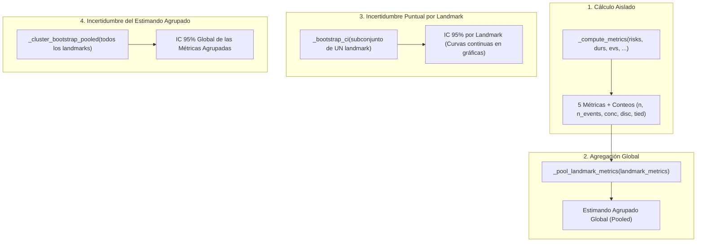

# Pipeline de Evaluación y Validación Estadística (`eval.py`)

Este documento describe la arquitectura, flujo de trabajo y funciones clave del script de evaluación [`workflow/scripts/eval.py`](file:///c:/Users/rtrin/OneDrive/Escritorio/FORMACION/MASTER/TFM/tfm-mulcia-2025/tfm-mulcia-2025-1/workflow/scripts/eval.py). Su propósito es evaluar el rendimiento predictivo de los modelos de supervivencia a lo largo de múltiples edades de corte (*landmarks*), calculando tanto estimaciones puntuales como intervalos de confianza empíricos (IC 95%) por remuestreo.

---

## 1. Visión General y Roadmap del Sistema

El script articula la evaluación en cuatro bloques funcionales modulares y complementarios:



---

## 2. Los 4 Pilares Funcionales

### Pilar 1: Cálculo Aislado por Landmark (`_compute_metrics`)
[`workflow/scripts/eval.py:L37-L127`](file:///c:/Users/rtrin/OneDrive/Escritorio/FORMACION/MASTER/TFM/tfm-mulcia-2025/tfm-mulcia-2025-1/workflow/scripts/eval.py#L37-L127)

Esta función es el motor elemental de cálculo:
- **Entrada:** Recibe los vectores de predicción de riesgo (`risks_sub`), tiempos de seguimiento (`durs_sub`) e indicador de evento (`evs_sub`) de un subconjunto homogéneo de pacientes (normalmente todos los pacientes pertenecientes a un landmark específico). También recibe las referencias inmutables de entrenamiento (`y_train`, `h0`, `maxr`, `h0_null`, `horizon`).
- **Salida:** Devuelve un diccionario exhaustivo con:
  - Las **5 métricas de supervivencia**:
    1. `c_index`: Índice de concordancia clásico de Harrell.
    2. `auroc`: AUROC dinámico acumulativo en el horizonte $t = \text{horizon}$ (Blanche / Hung & Chiang).
    3. `c_index_ipcw`: Índice de concordancia insesgado reponderado por censura (Uno et al.).
    4. `brier`: Error de predicción cuadrático (Brier score) con IPCW en el horizonte.
    5. `ipa`: *Index of Prediction Accuracy* (reducción porcentual del error frente al modelo nulo).
  - **Metadatos y conteos estructurales**:
    - `n`: Número de pacientes evaluados.
    - `n_events`: Número de eventos observados.
    - `n_comparable`: Número de pares evaluables.
    - `concordant`, `discordant`, `tied_risk`: Conteos de pares concordantes, discordantes y empatados.

> [!NOTE]
> Al exportar los conteos crudos de pares (`concordant`, `discordant`, `tied_risk`), esta función sienta las bases para realizar agrupaciones globales matemáticamente exactas sin reevaluar pacientes.

---

### Pilar 2: Agregación Global entre Landmarks (`_pool_landmark_metrics`)
[`workflow/scripts/eval.py:L131-L168`](file:///c:/Users/rtrin/OneDrive/Escritorio/FORMACION/MASTER/TFM/tfm-mulcia-2025/tfm-mulcia-2025-1/workflow/scripts/eval.py#L131-L168)

Recibe un diccionario que indexa las salidas de `_compute_metrics` para cada edad de landmark evaluada (por ejemplo, desde los 45 hasta los 70 años):
$$\text{landmark\_metrics} = \{45: \text{out}_{45},\, 46: \text{out}_{46},\, \dots,\, 70: \text{out}_{70}\}$$

A partir de esta estructura, computa el **estimando unificado estratificado (*pooled*)**:
- **Harrell's $C\text{-index}$ (Exacto Estratificado):**
  Suma los conteos de pares de todos los landmarks y divide al final:
  $$C\text{-index}_{\text{pooled}} = \frac{\sum \text{concordant} + 0.5 \sum \text{tied}}{\sum \text{concordant} + \sum \text{discordant} + \sum \text{tied}}$$
  *(Evita comparar pacientes entre landmarks distintos, preservando la validez del análisis dinámico)*.
- **`brier` e `ipa` (Media Ponderada Exacta):**
  Pondera el valor de cada landmark por su número de pacientes $n_{\text{lm}}$.
- **`auroc` y `c_index_ipcw` (Media Ponderada por Muestra/Pares):**
  Pondera por el tamaño muestral y los pares comparables de cada corte respectivamente.

---

### Pilar 3: Incertidumbre Puntual por Landmark (`_bootstrap_ci`)
[`workflow/scripts/eval.py:L187-L227`](file:///c:/Users/rtrin/OneDrive/Escritorio/FORMACION/MASTER/TFM/tfm-mulcia-2025/tfm-mulcia-2025-1/workflow/scripts/eval.py#L187-L227)

Se encarga de evaluar la variabilidad de las métricas en un corte temporal específico:
- **Mecánica:** Recibe los datos de un único landmark y realiza un remuestreo con reemplazo de pacientes mediante `_patient_positions` tantas veces como indique `n_boot` (por defecto, 200 réplicas).
- **Evaluación iterativa:** En cada réplica bootstrap se llama a `_compute_metrics` sobre la muestra sorteada, acumulando $N_{\text{boot}}$ valores para cada una de las 5 métricas.
- **Percentiles empíricos:** Mediante `_percentile_ci`, extrae los percentiles 2.5% y 97.5% de cada métrica.
- **Aplicación clínica:** Se aplica de forma iterativa sobre cada corte temporal (`boot_landmark_times`), permitiendo representar las **bandas de incertidumbre continuas (IC 95%)** a lo largo de la edad en las gráficas de evolución temporal.

---

### Pilar 4: Incertidumbre del Estimando Agrupado (`_cluster_bootstrap_pooled`)
[`workflow/scripts/eval.py:L230-L285`](file:///c:/Users/rtrin/OneDrive/Escritorio/FORMACION/MASTER/TFM/tfm-mulcia-2025/tfm-mulcia-2025-1/workflow/scripts/eval.py#L230-L285)

Calcula el intervalo de confianza al 95% del estimando global agrupado (*pooled*):
- **El desafío:** Los landmarks comparten pacientes (están anidados). Si se remuestrearan los landmarks por separado, se asumiría falsamente que son estudios independientes en personas distintas, destruyendo la correlación intra-sujeto y produciendo un intervalo de confianza artificialmente estrecho.
- **Solución (Cluster Bootstrap por Paciente):**
  1. En cada réplica bootstrap $b$, se sortea la cohorte de pacientes **una sola vez**.
  2. Todos los pacientes seleccionados aportan **todas sus filas de todos sus landmarks activos en bloque**.
  3. Sobre esa misma pseudopoblación, se computan las métricas de cada landmark con `_compute_metrics`.
  4. Se combinan los 26 cortes con `_pool_landmark_metrics`, obteniendo un único valor agrupado para esa réplica.
- **Resultado:** Tras completar las `n_boot` réplicas, se calculan los percentiles 2.5% y 97.5% sobre la distribución de estimandos agrupados, obteniendo el **IC 95% representativo de la métrica global**.

---

## 3. Flujo de Ejecución del Script (`eval.py`)

Al ejecutarse dentro del flujo de trabajo de Snakemake, `eval.py` sigue un pipeline secuencial estricto:

```
┌────────────────────────────────────────────────────────────────────────┐
│ 1. Predicciones Crudas (DataLoader shuffle=False)                     │
│    Obtiene (risks, durs, evs, lms, ids) para train, val y holdout      │
└───────────────────────────────────┬────────────────────────────────────┘
                                    │
                                    ▼
┌────────────────────────────────────────────────────────────────────────┐
│ 2. Fijación de Referencias en TRAIN                                   │
│    Estima y_train (Kaplan-Meier de censura IPCW) y Breslow (h0, null) │
│    NUNCA se recalculan sobre val ni holdout (previene data leakage)    │
└───────────────────────────────────┬────────────────────────────────────┘
                                    │
                                    ▼
┌────────────────────────────────────────────────────────────────────────┐
│ 3. Estimaciones Puntuales                                              │
│    - Ejecuta _compute_metrics para cada split y cada landmark          │
│    - Agrega mediante _pool_landmark_metrics (estimandos agrupados)     │
└───────────────────────────────────┬────────────────────────────────────┘
                                    │
                                    ▼
┌────────────────────────────────────────────────────────────────────────┐
│ 4. Intervalos de Confianza (IC 95%) en VAL y HOLDOUT                   │
│    - _bootstrap_ci por landmark (curvas continuas de IC)               │
│    - _cluster_bootstrap_pooled (IC 95% del estimando global)          │
└───────────────────────────────────┬────────────────────────────────────┘
                                    │
                                    ▼
┌────────────────────────────────────────────────────────────────────────┐
│ 5. Calibración en Landmark 55 y Exportación a JSON                     │
│    Genera results/{pool}/eval_{model}.json con métricas, IC y conteos  │
└────────────────────────────────────────────────────────────────────────┘
```

---

## 4. Documentación Complementaria

Para profundizar en los aspectos matemáticos y metodológicos específicos:
- **Métricas de evaluación detalladas:** Consulta [`docs/survival_metrics.md`](file:///c:/Users/rtrin/OneDrive/Escritorio/FORMACION/MASTER/TFM/tfm-mulcia-2025/tfm-mulcia-2025-1/docs/survival_metrics.md).
- **Fundamentos del Cluster Bootstrap y pacientes OOB:** Consulta [`docs/bootstrap.md`](file:///c:/Users/rtrin/OneDrive/Escritorio/FORMACION/MASTER/TFM/tfm-mulcia-2025/tfm-mulcia-2025-1/docs/bootstrap.md).
