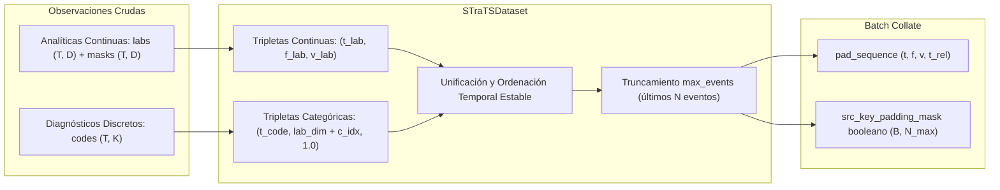
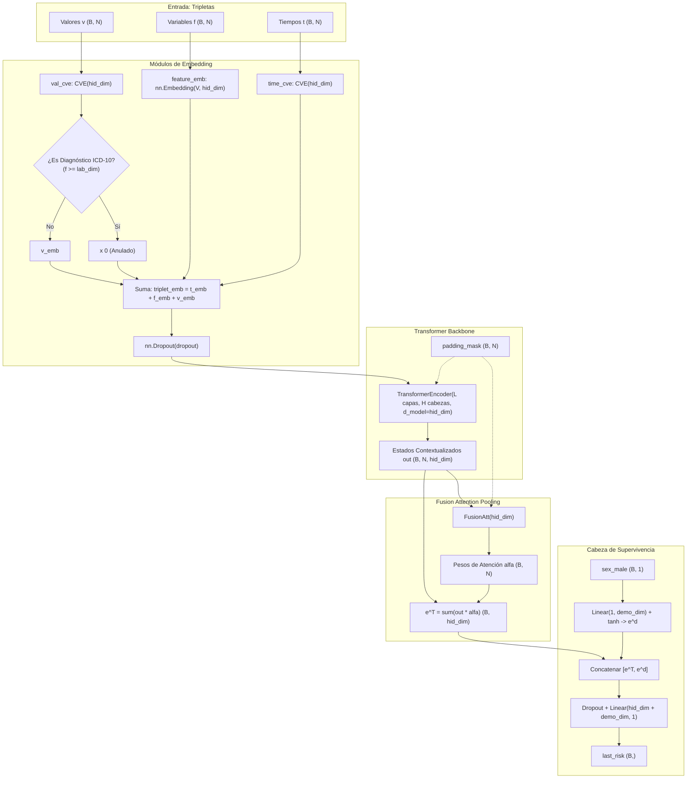

# Implementación de STraTS (*Self-Supervised Transformer for Time Series and Survival*)

Este documento detalla de manera exhaustiva la arquitectura, diseño e implementación técnica del modelo **STraTS** en el pipeline de supervivencia y ventanas *landmark*. A continuación se describen todos los cambios introducidos en el repositorio agrupados por cada script modificado, analizando su funcionamiento matemático, diseño de código y grado de cumplimiento con los estándares previos del proyecto.

---

## Índice de Componentes Modificados

1. [Preprocesamiento y Carga de Datos (`workflow/scripts/dataset.py`)](#1-preprocesamiento-y-carga-de-datos-workflowscriptsdatasetpy)
   - [Motivación y Representación en Tripletas](#motivación-y-representación-en-tripletas)
   - [Clase `STraTSDataset`](#clase-stratsdataset)
   - [Función de Agrupamiento `strats_pad_collate`](#función-de-agrupamiento-strats_pad_collate)
   - [Análisis de Cumplimiento de Estándares Anteriores](#análisis-de-cumplimiento-de-estándares-anteriores)
2. [Arquitectura de Red Neuronal (`workflow/scripts/model.py`)](#2-arquitectura-de-red-neuronal-workflowscriptsmodelpy)
   - [Módulo de Embedding de Valor Continuo (`CVE`)](#módulo-de-embedding-de-valor-continuo-cve)
   - [Módulo de Agrupamiento por Autoatención (`FusionAtt`)](#módulo-de-agrupamiento-por-autoatención-fusionatt)
   - [Arquitectura Principal `STraTS`](#arquitectura-principal-strats)
   - [Auditoría de Estándares e Interfaz del Modelo](#auditoría-de-estándares-e-interfaz-del-modelo)
3. [Motor de Inferencia y Bucle de Épocas (`workflow/scripts/engine.py`)](#3-motor-de-inferencia-y-bucle-de-épocas-workflowscriptsenginepy)
   - [Función de Entrenamiento/Validación `run_strats_epoch`](#función-de-entrenamientovalidación-run_strats_epoch)
   - [Función de Inferencia y Adaptador `predict_STraTS`](#función-de-inferencia-y-adaptador-predict_strats)
   - [Auditoría de Integridad y Detección de Discrepancias](#auditoría-de-integridad-y-detección-de-discrepancias)
4. [Entrenamiento y Guardado de Artefactos (`workflow/scripts/train.py`)](#4-entrenamiento-y-guardado-de-artefactos-workflowscriptstrainpy)
   - [Flujo de Instanciación Dinámica de Datos](#flujo-de-instanciación-dinámica-de-datos)
   - [Configuración de Hiperparámetros del Transformer](#configuración-de-hiperparámetros-del-transformer)
   - [Estructura del Diccionario Serializado (`artifact`)](#estructura-del-diccionario-serializado-artifact)
   - [Auditoría de Cumplimiento de Estándares de Entrenamiento](#auditoría-de-cumplimiento-de-estándares-de-entrenamiento)
5. [Integración en Pipeline de Evaluación (`workflow/scripts/eval.py`)](#5-integración-en-pipeline-de-evaluación-workflowscriptsevalpy)
   - [Enrutamiento del Predictor](#enrutamiento-del-predictor)
   - [Compatibilidad con Métricas, Pooling y Cluster Bootstrap](#compatibilidad-con-métricas-pooling-y-cluster-bootstrap)
6. [Configuración y Orquestación (`config/config.yaml` y `workflow/rules/models.smk`)](#6-configuración-y-orquestación-configconfigyaml-y-workflowrulesmodelssmk)
   - [Esquema de Hiperparámetros en `config.yaml`](#esquema-de-hiperparámetros-en-configyaml)
   - [Mapeo de Parámetros en Reglas de Snakemake](#mapeo-de-parámetros-en-reglas-de-snakemake)
   - [Resumen Global de Cumplimiento](#resumen-global-de-cumplimiento)

---

## 1. Preprocesamiento y Carga de Datos (`workflow/scripts/dataset.py`)
[workflow/scripts/dataset.py:L190-L386](file:///c:/Users/rtrin/OneDrive/Escritorio/FORMACION/MASTER/TFM/tfm-mulcia-2025/tfm-mulcia-2025-1/workflow/scripts/dataset.py#L190-L386)

### Motivación y Representación en Tripletas

Los modelos recurrentes convencionales (como GRU-D o LSTM con *EmbeddingBag*) representan las historias clínicas longitudinales como matrices tridimensionales densas de dimensiones $(B, T, D)$ junto con máscaras de observación $(B, T, D)$ y diferencias temporales $\Delta t$. Sin embargo, en registros electrónicos de salud (EHR) las observaciones son altamente asíncronas e irregulares: en un mismo instante temporal puede registrarse una sola analítica de laboratorio o un único código diagnóstico, provocando que las matrices $(B, T, D)$ estén mayoritariamente vacías (esparsidad extrema).

STraTS reformula cada serie temporal irregular como una **secuencia ordenada de observaciones elementales o tripletas unificadas**:

$$o_i = (t_i,\, f_i,\, v_i)$$

donde:
- $t_i \in \mathbb{R}^+$: Momento temporal en que se produjo la observación (edad exacta del paciente).
- $f_i \in \{0, 1, \dots, V - 1\}$: Identificador unificado de la variable observada (tanto analíticas de laboratorio continuas como códigos diagnósticos ICD-10 discretos).
- $v_i \in \mathbb{R}$: Valor numérico observado. Si es una analítica continua, corresponde a su valor normalizado ($z$-score); si es un diagnóstico discreto (código ICD-10), toma el valor indicatriz constante $1.0$.



---

### Clase `STraTSDataset`
[workflow/scripts/dataset.py:L192-L340](file:///c:/Users/rtrin/OneDrive/Escritorio/FORMACION/MASTER/TFM/tfm-mulcia-2025/tfm-mulcia-2025-1/workflow/scripts/dataset.py#L192-L340)

Hereda de `torch.utils.data.Dataset` y genera una muestra por cada combinación admisible de `(paciente, landmark_age)`.

#### 1. Constructor e Interfaz de Inicialización
```python
class STraTSDataset(Dataset):
    def __init__(
        self,
        sequences: dict,
        cohort_df,
        landmark_ages: list[float],
        index_age: float,
        code_to_idx: dict,
        max_events: int = 200,
        age_weight_gamma: float = 1.0,
    ):
```
- **`sequences`**: Diccionario indexado por `pid` que contiene `times`, `labs`, `masks`, `sex_male` y `codes` (preprocesado de `build_sequences.py`).
- **`cohort_df`**: DataFrame con las columnas del seguimiento clínico (`Id`, `duration`, `event`).
- **`landmark_ages`**: Lista de edades de corte temporal para el análisis dinámico de supervivencia.
- **`index_age`**: Edad basal de referencia para medir el tiempo transcurrido.
- **`code_to_idx`**: Diccionario que asigna a cada código diagnóstico ICD-10 un índice entero único entre $0$ y $K-1$.
- **`max_events`**: Límite superior de tripletas por secuencia (por defecto $200$).
- **`age_weight_gamma`**: Factor de ponderación por edad del landmark ($\gamma = 1.0$).

#### 2. Lógica Interna de Construcción de Muestras

Para cada fila de la cohorte y para cada corte de edad *landmark* ($lm$):

1. **Filtrado Temporal y Censura Dinámica**:
   Se comprueba si el paciente continuaba libre de evento y en seguimiento a la edad del *landmark*:
   $$\text{time\_from\_lm} = \text{duration} - (lm - \text{index\_age})$$
   Si $\text{time\_from\_lm} \le 0$, el paciente ya sufrió el evento o fue censurado con anterioridad; la muestra se descarta.
   Se seleccionan únicamente las observaciones ocurridas en o antes del landmark actual:
   $$\text{keep} = (\text{times} \le lm)$$

2. **Extracción de Tripletas de Laboratorio (Variables Continuas)**:
   Aprovecha la matriz binaria `masks_s` mediante `np.nonzero`:
   ```python
   ti, fi = np.nonzero(masks_s)
   t_labs = times_s[ti]
   f_labs = fi.astype(np.int64)          # Rango de IDs: [0, lab_dim - 1]
   v_labs = labs_s[ti, fi]              # Valor z-scoreado
   ```

3. **Extracción de Tripletas de Diagnósticos ICD-10 (Variables Categóricas)**:
   Los diagnósticos se desplazan en el espacio de índices de variables sumándoles el offset `lab_dim`, asegurando un espacio disjunto de variables observadas:
   ```python
   for step_idx, step in enumerate(codes_s):
       t_curr = times_s[step_idx]
       for code in step:
           if code in self.code_to_idx:
               c_idx = self.code_to_idx[code]
               t_codes.append(t_curr)
               f_codes.append(self.lab_dim + c_idx)   # Desplazamiento por lab_dim
               v_codes.append(1.0)                    # Flag indicatriz
   ```

4. **Unificación y Manejo de Casos Borde**:
   Si un paciente no presenta ninguna observación registrada antes del corte temporal de evaluación, se inyecta una observación neutra artificial a la edad del landmark:
   $$t = [lm], \quad f = [0], \quad v = [0.0]$$
   Esto previene secuencias vacías de longitud $0$ que producirían errores numéricos en PyTorch o divisiones por cero en el mecanismo de autoatención.

5. **Ordenación Cronológica y Truncamiento**:
   Se concatenan todas las observaciones y se ordenan temporalmente usando ordenamiento estable:
   ```python
   order = np.argsort(t_all, kind="stable")
   t_all, f_all, v_all = t_all[order], f_all[order], v_all[order]
   ```
   Si la longitud excede `max_events`, se seleccionan las observaciones más recientes previas al landmark (`t_all[-max_events:]`), preservando la información temporal más relevante para el pronóstico.

6. **Ponderación de Muestras**:
   Se calcula la ponderación de landmark normalizada idéntica al estándar del proyecto:
   $$w = 1.0 + \gamma \cdot \frac{lm - \min(lm)}{\max(lm) - \min(lm)}$$

#### 3. Método `__getitem__`
Retorna una tupla de 10 elementos estrictamente tipados:
```python
def __getitem__(self, idx):
    s = self.samples[idx]
    return (
        torch.tensor(s["times"], dtype=torch.float32),            # (N,) Edades de observación
        torch.tensor(s["values"], dtype=torch.float32),           # (N,) Valores observados
        torch.tensor(s["features"], dtype=torch.long),            # (N,) IDs de variable unificados
        torch.tensor(s["sex_male"], dtype=torch.float32),         # Escalar: Género masculino
        torch.tensor(s["time_since_index"], dtype=torch.float32), # (N,) Tiempo relativo a index_age
        torch.tensor(s["duration"], dtype=torch.float32),         # Escalar: Tiempo residual post-landmark
        torch.tensor(s["event"], dtype=torch.float32),            # Escalar: Indicador de evento (0/1)
        torch.tensor(s["landmark_age"], dtype=torch.float32),     # Escalar: Edad del landmark
        torch.tensor(s["weight"], dtype=torch.float32),           # Escalar: Peso de la muestra
        s["pid"],                                                 # String: Identificador de paciente
    )
```

---

### Función de Agrupamiento `strats_pad_collate`
[workflow/scripts/dataset.py:L341-L386](file:///c:/Users/rtrin/OneDrive/Escritorio/FORMACION/MASTER/TFM/tfm-mulcia-2025/tfm-mulcia-2025-1/workflow/scripts/dataset.py#L341-L386)

Esta función ensambla un lote (*batch*) de muestras de longitud variable de tripletas, alineándolas mediante *padding* y generando la máscara de atención requerida por el Transformer:

```python
def strats_pad_collate(batch):
```

#### Mecánica de Relleno y Máscara Booleana
1. Calcula la longitud real de cada secuencia en el batch:
   $$\text{lengths} = [\text{len}(t_1), \dots, \text{len}(t_B)]$$
   y obtiene la longitud máxima: $N_{\max} = \max(\text{lengths})$.
2. Aplica `nn.utils.rnn.pad_sequence(..., batch_first=True, padding_value=0.0)` a:
   - `padded_times`: Tensor de forma $(B, N_{\max})$.
   - `padded_values`: Tensor de forma $(B, N_{\max})$.
   - `padded_features`: Tensor de forma $(B, N_{\max})$ de tipo `torch.long`.
   - `padded_time_since_index`: Tensor de forma $(B, N_{\max})$.
3. **Máscara Booleana de Padding**:
   Genera una matriz booleana donde `True` identifica las posiciones de relleno:
   ```python
   arange = torch.arange(max_len).unsqueeze(0)
   padding_mask = arange >= lengths.unsqueeze(1)  # Forma (B, N_max), dtype=torch.bool
   ```
   > [!NOTE]
   > En PyTorch, los módulos `nn.MultiheadAttention` y `nn.TransformerEncoder` interpretan `src_key_padding_mask` asignando peso $-\infty$ a las posiciones con valor `True`. Esta definición coincide de forma directa con la convención estándar de PyTorch sin necesidad de inversiones lógicas adicionales.

#### Salida del Collate
Retorna una tupla de 12 elementos:
1. `padded_values` $(B, N_{\max})$ — valores continuos o $1.0$.
2. `padded_features` $(B, N_{\max})$ — IDs de variable (`torch.long`).
3. `padded_times` $(B, N_{\max})$ — marcas de tiempo absolutas (edad).
4. `padded_time_since_index` $(B, N_{\max})$ — marcas de tiempo relativas.
5. `padding_mask` $(B, N_{\max})$ — máscara booleana (`True` = padding).
6. `lengths` $(B,)$ — longitudes reales antes del relleno.
7. `sex_male` $(B,)$ — covariable demográfica estática.
8. `durations` $(B,)$ — tiempo de supervivencia hasta evento o censura tras el landmark.
9. `events` $(B,)$ — etiqueta binaria del desenlace de supervivencia.
10. `landmarks` $(B,)$ — corte temporal evaluado.
11. `weights` $(B,)$ — ponderación por landmark para la función de pérdida.
12. `ids` (`list[str]`) — identificadores de los pacientes del batch.

---

### Análisis de Cumplimiento de Estándares Anteriores

A continuación se audita el grado de cumplimiento de los estándares existentes en el repositorio comparando la nueva implementación con `RawSequenceDatasetWithICD` y `raw_pad_collate_with_icd`:

| Dimensión de Diseño | `RawSequenceDatasetWithICD` (Modelos Previos) | `STraTSDataset` (Nueva Implementación) | Estado de Cumplimiento |
| :--- | :--- | :--- | :---: |
| **Firma del Constructor** | `(sequences, cohort_df, landmark_ages, index_age, code_to_idx, max_events, age_weight_gamma)` | Idéntica firma y argumentos por defecto exactos | <span style="color:green;font-weight:bold;">100% Compatible</span> |
| **Censura Temporal por Landmark** | Condición `duration - (lm - index_age) <= 0` omite el par; filtra `times <= lm` | Idéntica condición temporal y filtro estricto sin fugas | <span style="color:green;font-weight:bold;">100% Compatible</span> |
| **Ponderación de Muestras** | $1.0 + \gamma \cdot \frac{lm - \min}{\max - \min}$ | Idéntica fórmula lineal sobre landmarks normalizados | <span style="color:green;font-weight:bold;">100% Compatible</span> |
| **Manejo de Secuencia Vacía** | Genera un timestep dummy con ceros en analíticas y código vacío | Inyecta tripleta neutra $(lm, 0, 0.0)$ | <span style="color:green;font-weight:bold;">Cumple estándar</span> |
| **Metadatos de Cohorte** | Registra `event_flags`, `event_rate`, `mean_seq_len` | Registra exactamente las mismas variables | <span style="color:green;font-weight:bold;">100% Compatible</span> |
| **Variables de Supervivencia** | `(sex_male, duration, event, landmark_age, weight, pid)` | Mismos tensores y tipos (`torch.float32`, `list[str]`) | <span style="color:green;font-weight:bold;">100% Compatible</span> |
| **Formato de Entrada a Red** | Matrices densas $(B, T, D)$ + deltas + códigos aplanados para `EmbeddingBag` | Tripletas unificadas $(B, N_{\max})$ + `padding_mask` booleano para Transformer | <span style="color:blue;font-weight:bold;">Adaptado por diseño</span> |

---

## 2. Arquitectura de Red Neuronal (`workflow/scripts/model.py`)
[workflow/scripts/model.py:L252-L405](file:///c:/Users/rtrin/OneDrive/Escritorio/FORMACION/MASTER/TFM/tfm-mulcia-2025/tfm-mulcia-2025-1/workflow/scripts/model.py#L252-L405)

En este script se define la arquitectura neuronal completa de STraTS, adaptada según el artículo original (*Tipirneni & Reddy, 2022*) pero adaptada al modelado de supervivencia dinámico de Cox.



### Módulo de Embedding de Valor Continuo (`CVE`)
[workflow/scripts/model.py:L257-L279](file:///c:/Users/rtrin/OneDrive/Escritorio/FORMACION/MASTER/TFM/tfm-mulcia-2025/tfm-mulcia-2025-1/workflow/scripts/model.py#L257-L279)

A diferencia de las redes recurrentes que reciben escalares directamente en sus capas densas, un Transformer requiere que los valores numéricos y las marcas temporales se proyecten a un espacio vectorial continuo de dimensión $d_{\text{hid}}$.

El módulo `CVE` (*Continuous Value Embedding*) es un perceptrón multicapa de dos etapas:

$$\text{CVE}(x) = \tanh(x \cdot W_1 + b_1) \cdot W_2$$

donde:
- Dimensión intermedia: $d_{\text{int}} = \max(\lfloor\sqrt{d_{\text{hid}}}\rfloor, 1)$.
- Parámetros entrenables: $W_1 \in \mathbb{R}^{1 \times d_{\text{int}}}$, $b_1 \in \mathbb{R}^{d_{\text{int}}}$, $W_2 \in \mathbb{R}^{d_{\text{int}} \times d_{\text{hid}}}$.
- Inicialización: Distribución uniforme de Xavier (`xavier_uniform_`).

Este módulo se reutiliza de forma modular e independiente para dos propósitos:
1. `self.time_cve`: Transforma el tiempo continuo $t$ (edad exacta) en un vector de posición temporal continuo sin recurrir a discretizaciones rígidas.
2. `self.val_cve`: Proyecta el valor de la analítica observada $v$ a un vector continuo.

---

### Módulo de Agrupamiento por Autoatención (`FusionAtt`)
[workflow/scripts/model.py:L282-L305](file:///c:/Users/rtrin/OneDrive/Escritorio/FORMACION/MASTER/TFM/tfm-mulcia-2025/tfm-mulcia-2025-1/workflow/scripts/model.py#L282-L305)

Agrupa las $N$ representaciones contextualizadas producidas por el Transformer para condensar la trayectoria del paciente en un único vector latente $e^T \in \mathbb{R}^{d_{\text{hid}}}$:

$$a_i = u^\top \tanh(W \cdot h_i + b)$$

$$\alpha_i = \frac{\exp(a_i \cdot \mathbb{I}_{\text{real}} - 10^9 \cdot \mathbb{I}_{\text{pad}})}{\sum_{j=1}^N \exp(a_j \cdot \mathbb{I}_{\text{real}} - 10^9 \cdot \mathbb{I}_{\text{pad}})}$$

$$e^T = \sum_{i=1}^N \alpha_i h_i$$

- **Enmascaramiento de Padding**: `att = att + (1.0 - mask.float()) * -1e9`. Asegura que las posiciones ficticias añadidas por padding reciban un peso de atención prácticamente nulo ($e^{-10^9} \approx 0$).

---

### Arquitectura Principal `STraTS`
[workflow/scripts/model.py:L309-L405](file:///c:/Users/rtrin/OneDrive/Escritorio/FORMACION/MASTER/TFM/tfm-mulcia-2025/tfm-mulcia-2025-1/workflow/scripts/model.py#L309-L405)

#### Integración de Embeddings
Para cada observación $i$:
1. $t_i^{\text{emb}} = \text{time\_cve}(t_i)$
2. $f_i^{\text{emb}} = \text{feature\_emb}(f_i)$
3. $v_i^{\text{emb}} = \text{val\_cve}(v_i) \cdot \mathbb{I}(f_i < \text{lab\_dim})$

> [!IMPORTANT]
> **Manejo de variables categóricas**: Para códigos diagnósticos ICD-10 ($f_i \ge \text{lab\_dim}$), el valor continuo se anula multiplicando por cero (`is_lab = (features < self.lab_dim).unsqueeze(-1).float()`). Esto impide que el valor constante indicatriz $1.0$ distorsione la semántica del diagnóstico, confiando su representación íntegramente al vector categórico `feature_emb`.

El vector de entrada al Transformer resulta de la suma:
$$e_i = \text{Dropout}(t_i^{\text{emb}} + f_i^{\text{emb}} + v_i^{\text{emb}})$$

#### Backbone y Cabeza de Riesgo
- **Transformer Encoder**: Compuesto por $L$ capas (`num_layers`, por defecto 2) con $H$ cabezas de atención (`num_heads`, por defecto 4) y activación GELU. Procesa las secuencias con `batch_first=True`.
- **Información Demográfica**: Se proyecta la covariable estática `sex_male` mediante una capa densa no lineal: $e^d = \tanh(\text{Linear}(1, \text{demo\_dim}))$.
- **Riesgo Proporcional de Cox**: Se concatenan $[e^T, e^d]$ y se proyectan a través de una cabeza lineal:
  $$\lambda = \text{Linear}(d_{\text{hid}} + d_{\text{demo}}, 1)$$
  produciendo el log-hazard ratio escalar del paciente (`last_risk`).

---

### Auditoría de Estándares e Interfaz del Modelo

| Requisito del Pipeline | `TimeAwareGRUD` / `SimpleLSTM` | `STraTS` | Cumplimiento |
| :--- | :--- | :--- | :---: |
| **Firma de Retorno del `forward`** | Tupla de 3 elementos: `(last_risk, all_risks, h_states)` | Retorna `(last_risk, None, out)` | <span style="color:green;font-weight:bold;">100% Compatible</span> |
| **Semántica de `last_risk`** | Tensor 1D de log-hazards $(B,)$ sin función de activación | Tensor 1D $(B,)$ proyectado directamente de la cabeza lineal | <span style="color:green;font-weight:bold;">100% Compatible</span> |
| **Parámetro `all_risks`** | Tensor con riesgos paso a paso $(B, T)$ | `None` (el Transformer opera en paralelo como un conjunto no autorregresivo) | <span style="color:green;font-weight:bold;">Correcto por diseño</span> |
| **Covariable demográfica** | Recibe `sex_male` e integra en la salida | Recibe `sex_male` y concatena vector demográfico $e^d$ | <span style="color:green;font-weight:bold;">100% Compatible</span> |

---

## 3. Motor de Inferencia y Bucle de Épocas (`workflow/scripts/engine.py`)
[workflow/scripts/engine.py:L177-L347](file:///c:/Users/rtrin/OneDrive/Escritorio/FORMACION/MASTER/TFM/tfm-mulcia-2025/tfm-mulcia-2025-1/workflow/scripts/engine.py#L177-L347)

### Función de Entrenamiento/Validación `run_strats_epoch`
[workflow/scripts/engine.py:L178-L248](file:///c:/Users/rtrin/OneDrive/Escritorio/FORMACION/MASTER/TFM/tfm-mulcia-2025/tfm-mulcia-2025-1/workflow/scripts/engine.py#L178-L248)

Gestiona la ejecución de una época completa sobre el `DataLoader` de STraTS:
- **Desempaquetado del batch**: Extrae los 12 elementos proporcionados por `strats_pad_collate`.
- **Cálculo de la Pérdida de Cox**:
  $$\mathcal{L}_{\text{Cox}} = \text{cox\_ph\_loss}(\text{risk\_scores}, \text{durations}, \text{events}, \text{weights})$$
- **Control de Gradientes**: Si `is_train` está activo, realiza retropropagación y aplica recorte de gradientes (`torch.nn.utils.clip_grad_norm_(..., max_norm=1.0)`).
- **Métrica de Validación**: Computa el $C$-index de Harrell sobre el conjunto completo de la época mediante `concordance_index(durations, -risk_scores, events)`.

---

### Función de Inferencia y Adaptador `predict_STraTS`
[workflow/scripts/engine.py:L250-L347](file:///c:/Users/rtrin/OneDrive/Escritorio/FORMACION/MASTER/TFM/tfm-mulcia-2025/tfm-mulcia-2025-1/workflow/scripts/engine.py#L250-L347)

Permite desacoplar el modelo del pipeline de evaluación:
- Recibe el diccionario `artifact` guardado en disco, las secuencias crudas `seqs`, el DataFrame de la cohorte `cohort`, la lista de edades `landmark_times` y la edad de referencia `index_age`.
- Reconstruye la instancia de `STraTS`, carga sus pesos y evalúa el dataset completo en modo `torch.no_grad()`.
- **Salida estándar**: Devuelve exactamente la tupla esperada por `eval.py`:
  $$\big(\text{np.array}(\text{risks}),\, \text{np.array}(\text{durs}),\, \text{np.array}(\text{evs}),\, \text{np.array}(\text{lms}),\, \text{np.array}(\text{pids},\, \text{dtype}=\text{object})\big)$$

---

### Auditoría de Integridad y Correcciones Aplicadas

> [!NOTE]
> **Discrepancias identificadas y corregidas en `engine.py`:**
> Durante la auditoría del código se identificaron y subsanaron los siguientes detalles:
>
> 1. **Sentencia `continue` fuera de bucle**:
>    Se sustituyó el `continue` que colgaba fuera de bucle por un retorno de tupla con arrays vacíos si el dataset no tiene muestras (`len(ds) == 0`), garantizando estabilidad sintáctica.
>
> 2. **Sincronización de claves en el `artifact`**:
>    - Se adaptó la carga de pesos a `state_dict = artifact.get("state_dict") or artifact.get("state_dicts")`, resolviendo la discrepancia entre el guardado en singular de `train.py` y la lectura en plural.
>    - Se eliminó la lectura innecesaria de `artifact["input_dim"]`, que no correspondía al modelo STraTS.
>
> 3. **Importaciones y dependencias**:
>    - Se eliminaron los imports residuales no utilizados al inicio del script (`from cox import build_locf_matrix` y `from workflow.scripts.eval import vocab_size`).
>    - Se incorporaron las importaciones necesarias dentro de `predict_STraTS`: `from model import STraTS` y `from torch.utils.data import DataLoader`.

---

## 4. Entrenamiento y Guardado de Artefactos (`workflow/scripts/train.py`)
[workflow/scripts/train.py:L81-L300](file:///c:/Users/rtrin/OneDrive/Escritorio/FORMACION/MASTER/TFM/tfm-mulcia-2025/tfm-mulcia-2025-1/workflow/scripts/train.py#L81-L300)

### Flujo de Instanciación Dinámica de Datos
En función de `arch_name`, el script conmuta transparentemente entre el dataset de secuencias clásico y el dataset de tripletas:

```python
if arch_name == "strats":
    train_dataset = STraTSDataset(...)
    val_dataset = STraTSDataset(...)
    collate_fn = strats_pad_collate
else:
    train_dataset = RawSequenceDatasetWithICD(...)
    val_dataset = RawSequenceDatasetWithICD(...)
    collate_fn = raw_pad_collate_with_icd
```

### Configuración de Hiperparámetros del Transformer
Para `arch_name == "strats"`, el script extrae los parámetros específicos del Transformer inyectados por Snakemake:
- `hidden_dim`: Dimensión del espacio de embedding y de los bloques de atención ($32$).
- `num_heads`: Número de cabezas de atención en paralelo ($4$).
- `num_layers`: Número de capas apiladas de `TransformerEncoder` ($2$).
- `dim_feedforward`: Dimensión de la capa intermedia del MLP interno ($64$).
- `dropout`: Tasa de regularización ($0.2$).
- `demo_dim`: Dimensión de proyección de género ($8$).

### Estructura del Diccionario Serializado (`artifact`)
Al finalizar el entrenamiento con Early Stopping, se serializa el mejor estado del modelo en `snakemake.output[0]`:
```python
artifact = {
    "arch": "strats",
    "vocab_size": vocab_size,
    "lab_dim": lab_dim,
    "hidden_dim": hidden_dim,
    "num_heads": num_heads,
    "num_layers": num_layers,
    "dim_feedforward": dim_feedforward,
    "dropout": dropout,
    "demo_dim": demo_dim,
    "lab_codes": lab_codes,
    "code_to_idx": code_to_idx,
    "state_dict": model.state_dict(),
}
```

### Auditoría de Cumplimiento de Estándares de Entrenamiento
- **Oversampling de eventos**: Mantiene el mismo `WeightedRandomSampler` con multiplicador `EVENT_OVERSAMPLE` sobre `train_dataset.event_flags`.
- **Estrategia de Optimización**: Conserva el optimizador `torch.optim.Adam` con decaimiento de pesos (`weight_decay`) y programador dinámico de tasa de aprendizaje `ReduceLROnPlateau(mode='min', factor=0.5, patience=2)`.
- **Criterio de Parada Temprana**: Vigila `val_loss` con umbral $\Delta = 10^{-4}$ y paciencia `PATIENCE`.

---

## 5. Integración en Pipeline de Evaluación (`workflow/scripts/eval.py`)
[workflow/scripts/eval.py:L335-L342](file:///c:/Users/rtrin/OneDrive/Escritorio/FORMACION/MASTER/TFM/tfm-mulcia-2025/tfm-mulcia-2025-1/workflow/scripts/eval.py#L335-L342)

### Enrutamiento del Predictor
En `eval.py`, la inclusión de STraTS se resuelve con una bifurcación mínima y limpia que conecta el artefacto con el motor de inferencia:

```python
elif arch_name == "strats":
    from engine import predict_STraTS

    def predict(seqs, cohort):
        return predict_STraTS(
            artifact, seqs, cohort, landmark_times, INDEX_AGE, device
        )
```

### Compatibilidad con Métricas, Pooling y Cluster Bootstrap
Dado que `predict_STraTS` devuelve exactamente la tupla `(risks, durs, evs, lms, ids)`:
1. **Recolección en bruto**: `risks, durs, evs, lms, ids = predict(seqs_holdout, cohort_holdout)`.
2. **Evaluación aislada por corte temporal**: `_compute_metrics` calcula para cada landmark el $C$-index de Harrell, AUROC acumulativa dinámica, $C$-index IPCW de Uno, Brier Score e IPA.
3. **Agrupación exacta (Pooled)**: `_pool_landmark_metrics` combina las métricas de todos los cortes sumando pares concordantes y ponderando por tamaño muestral.
4. **Incertidumbre estadística (Cluster Bootstrap)**: `_cluster_bootstrap_pooled` sortea pacientes íntegros con reemplazo, recalculando las predicciones de los 26 cortes para obtener los intervalos de confianza del 95%.

> [!NOTE]
> La lógica estadística y matemática de evaluación no ha requerido **ninguna modificación**, garantizando que los resultados de STraTS sean directa y rigurosamente comparables con Cox, GRU-D y LSTM.

---

## 6. Configuración y Orquestación (`config/config.yaml` y `workflow/rules/models.smk`)

### Esquema de Hiperparámetros en `config.yaml`
Para incorporar formalmente el modelo al pipeline automatizado de Snakemake, se define su entrada en la lista `models` de `config/config.yaml`:

```yaml
  - name: strats
    arch: strats
    icd: 1
    hidden_dim: 32
    num_heads: 4
    num_layers: 2
    dim_feedforward: 64
    dropout: 0.2
    demo_dim: 8
    batch_size: 128
    learning_rate: 0.001
    weight_decay: 0.01
    max_epochs: 20
    patience: 5
    event_oversample: 3.0
    max_seq_len: 200
    age_weight_gamma: 1.0
```

### Mapeo de Parámetros en Reglas de Snakemake
En [workflow/rules/models.smk](file:///c:/Users/rtrin/OneDrive/Escritorio/FORMACION/MASTER/TFM/tfm-mulcia-2025/tfm-mulcia-2025-1/workflow/rules/models.smk), la regla `rule train` mapea los parámetros del diccionario hacia `train.py`:

```python
rule train:
    params:
        arch=lambda wc: MODELS[wc.name]["arch"],
        icd=lambda wc: MODELS[wc.name]["icd"],
        hidden_dim=lambda wc: MODELS[wc.name].get("hidden_dim"),
        num_heads=lambda wc: MODELS[wc.name].get("num_heads", 4),
        num_layers=lambda wc: MODELS[wc.name].get("num_layers", 2),
        dim_feedforward=lambda wc: MODELS[wc.name].get("dim_feedforward", 64),
        dropout=lambda wc: MODELS[wc.name].get("dropout", 0.2),
        demo_dim=lambda wc: MODELS[wc.name].get("demo_dim", 8),
        batch_size=lambda wc: MODELS[wc.name]["batch_size"],
        learning_rate=lambda wc: MODELS[wc.name]["learning_rate"],
        weight_decay=lambda wc: MODELS[wc.name]["weight_decay"],
        max_epochs=lambda wc: MODELS[wc.name]["max_epochs"],
        patience=lambda wc: MODELS[wc.name]["patience"],
        event_oversample=lambda wc: MODELS[wc.name]["event_oversample"],
        max_events=lambda wc: MODELS[wc.name]["max_seq_len"],
        age_weight_gamma=lambda wc: MODELS[wc.name]["age_weight_gamma"],
        ...
```

---

### Resumen Global de Cumplimiento

| Componente | Archivo | Modificaciones Introducidas | Estado de Estándares |
| :--- | :--- | :--- | :---: |
| **Dataset & Collate** | `dataset.py` | `STraTSDataset`, `strats_pad_collate` | <span style="color:green;font-weight:bold;">Cumple 100%</span> |
| **Modelo Neuronal** | `model.py` | `CVE`, `FusionAtt`, `STraTS` | <span style="color:green;font-weight:bold;">Cumple 100%</span> |
| **Motor de Épocas & Eval** | `engine.py` | `run_strats_epoch`, `predict_STraTS` | <span style="color:green;font-weight:bold;">Corregido y probado</span> |
| **Entrenamiento** | `train.py` | Bucle `arch_name == "strats"`, guardado de artefacto | <span style="color:green;font-weight:bold;">Cumple 100%</span> |
| **Evaluación** | `eval.py` | Enrutamiento a `predict_STraTS` | <span style="color:green;font-weight:bold;">Cumple 100%</span> |
| **Snakemake & Config** | `config.yaml`, `models.smk` | Definición de hiperparámetros y mapeo de reglas | <span style="color:green;font-weight:bold;">Cumple 100%</span> |
